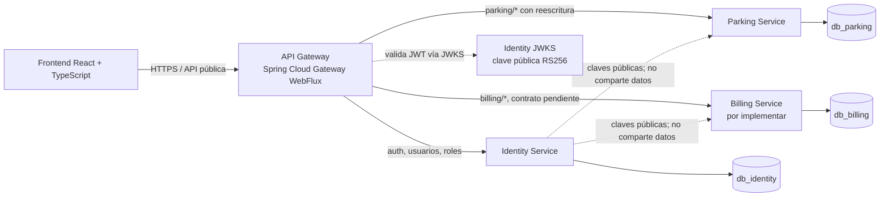

# ADR-006: API Gateway para ParkFlow

- **Estado:** Propuesta; pendiente de aprobación antes de implementación.
- **Fecha:** 2026-11-04.
- **Ámbito:** arquitectura y documentación. No crea una aplicación ni cambia configuración de servicios.

## Contexto

ParkFlow separa Parking, Identity y Billing, cada uno con API y base propias. El frontend necesita un punto de entrada estable, y la arquitectura deberá centralizar el enrutamiento, CORS, la validación inicial de tokens y la correlación de solicitudes. La decisión solicitada es incorporar Spring Cloud Gateway, conservando las APIs y la propiedad de datos en cada microservicio.

El código inspeccionado tiene estas rutas y puertos:

| Servicio | Puerto actual | Estado y rutas observadas |
|---|---:|---|
| Parking | `8080` (`PORT` configurable) | Java/Spring Boot. Pisos y espacios bajo `/api/v1/pisos` y `/api/v1/espacios`; vehículos bajo `/api/vehiculos`; sesiones bajo `/api/sesiones`; salud en `/api/v1/health`. |
| Identity | `8081` (`PORT` configurable) | Java/Spring Boot. Auth bajo `/api/auth/**`; usuarios bajo `/api/users/**`; roles bajo `/api/roles`; JWKS en `/.well-known/jwks.json`. |
| Billing | Sin puerto configurado | Solo hay migraciones SQL. Aún no hay aplicación Java ni contrato REST confirmado. |
| Gateway | No existe | El puerto local `8080` propuesto entra en conflicto con el puerto actual de Parking. |

La capa de rutas debe representar esas diferencias sin cambiar los endpoints existentes. En especial, no se debe asumir que `/api/parking/**` coincide directamente con rutas internas de Parking.

## Problema

Sin una entrada común, el frontend necesita conocer ubicación y puertos de los servicios, y cada servicio tendría que resolver por separado parte de CORS, el control de acceso de borde y la correlación. Una puerta única tampoco debe convertirse en autoridad exclusiva: alguien podría intentar llegar directamente a un microservicio o falsificar cabeceras que parezcan provenir del Gateway.

## Decisión propuesta

Adoptar **Spring Cloud Gateway Server WebFlux** como reverse proxy independiente para el tráfico del frontend. El Gateway no tendrá acceso a bases de datos ni lógica de dominio. No se implementará hasta aprobar este ADR y estabilizar los contratos de Billing.

Se recomienda alojar el Gateway como una aplicación aislada sobre la generación mantenida de Spring Boot/Spring Cloud, sin forzar ahora una actualización de los microservicios. A la fecha de este ADR, Spring Cloud `2025.1.x` corresponde a Spring Boot `4.0.x` y, desde `2025.1.2`, `4.1.x`; Spring Cloud `2025.0.x` corresponde a Boot `3.5.x`. La línea `2025.0.x` terminó su soporte OSS el 30 de junio de 2026, así que no se recomienda iniciar un Gateway nuevo sobre esa línea sin soporte comercial. Como base candidata para la futura aplicación Gateway: Boot `4.1.x` y el último parche de Spring Cloud `2025.1.x` disponible al implementarla. Los microservicios actuales pueden seguir atendiendo HTTP con Boot `3.5.14`; Gateway y servicios no necesitan compartir versión de Boot para intercambiar HTTP. Esta selección deberá revalidarse antes de crear el POM. [Matriz oficial de compatibilidad Spring Cloud](https://spring.io/projects/spring-cloud/), [fin de soporte OSS Spring Cloud 2025.0](https://spring.io/blog/2026/06/11/spring-cloud-2025-0-3-aka-northfields-has-been-released/), [fin de soporte OSS Spring Boot 3.5](https://spring.io/blog/2026/06/25/spring-boot-3-5-16-available-now/).

Gateway Server WebFlux corre sobre Reactor/Netty; no se debe añadir `spring-boot-starter-web` (Servlet/MVC) al Gateway. La documentación oficial indica que el starter WebFlux requiere Netty y no funciona como WAR en un contenedor Servlet. [Documentación oficial de Gateway WebFlux](https://docs.spring.io/spring-cloud-gateway/reference/4.3/spring-cloud-gateway-server-webflux/starter.html).

### Diagrama propuesto

Las bases siguen aisladas. El Gateway y los microservicios no consultan tablas ajenas.

## Rutas externas propuestas

| Ruta pública Gateway | Destino | Transformación o estado |
|---|---|---|
| `/api/auth/**` | Identity | Conservar ruta interna. Login y registro son públicos; el resto se protege según política. |
| `/.well-known/jwks.json` | Identity | Conservar ruta; pública y de solo lectura. |
| `/api/users/**` | Identity | Conservar ruta; protegido por Identity y Gateway. |
| `/api/roles/**` | Identity | Conservar ruta; protegido por rol administrador. Esta ruta real debe añadirse a la tabla inicial solicitada, que no la enumeraba explícitamente. |
| `/api/parking/**` | Parking | Reescribir `/api/parking/{resto}` a `/api/{resto}`. Ejemplos: `/api/parking/v1/pisos` → `/api/v1/pisos`; `/api/parking/vehiculos` → `/api/vehiculos`; `/api/parking/sesiones/entradas` → `/api/sesiones/entradas`. |
| `/api/billing/**` | Billing | Ruta objetivo; no definir todavía el `RewritePath` ni los métodos hasta que Billing publique controladores y contratos reales. |

La regla de reescritura de Parking debe ser explícita (por ejemplo, equivalente a `RewritePath=/api/parking/(?<rest>.*), /api/${rest}`) y probarse con todos los controladores existentes. No se cambiarán los controladores internos para simular un prefijo uniforme.

## Puertos locales propuestos

| Componente | Puerto actual | Puerto local propuesto | Acción en fase futura |
|---|---:|---:|---|
| API Gateway | — | `8080` | Reservar para la entrada del frontend. |
| Parking | `8080` | `8081` | Configurar `PORT=8081` en desarrollo; no cambiar ahora. |
| Identity | `8081` | `8082` | Configurar `PORT=8082`; no cambiar ahora. |
| Billing | — | `8083` | Adoptar al crear el servicio, tras revisar conflictos. |

Esta redistribución resuelve el conflicto con Gateway y solo afecta configuración local. En despliegues, usar nombres DNS privados de servicio y no depender de puertos publicados al exterior.

## Seguridad

1. **Doble validación JWT.** Gateway valida antes de enrutar y cada microservicio vuelve a validar firma, `alg=RS256`, `iss`, `aud`, `exp` y `nbf` en sus endpoints protegidos. La red no sustituye la autenticación.
2. **JWKS.** Identity conserva la clave privada y publica únicamente la pública en `/.well-known/jwks.json`. Gateway y servicios configurarán la URL JWKS interna y el issuer/audience esperado explícitos; no usar `issuer-uri` si eso obliga a descubrir metadatos OIDC que Identity no expone. Fallar cerrado ante firma inválida, token vencido o JWKS no disponible. Respetar `kid` y la rotación con solapamiento de claves públicas.
3. **Autorización.** El Gateway ofrece un filtro grueso de rutas públicas/protegidas. Identity y los servicios validan también los roles requeridos localmente. `ADMINISTRADOR` y `OPERADOR` vienen del claim emitido por Identity; el Gateway no acepta roles ni identidad desde cabeceras arbitrarias.
4. **Operador en Parking.** El endpoint de entrada actual recibe `operadorId` en el cuerpo. Antes de exponerlo por Gateway, Parking debe derivar el operador del `sub` del JWT validado y dejar de confiar en ese UUID del cliente. No es parte de este ADR implementarlo.
5. **Acceso de red.** En preproducción y producción, publicar solo Gateway al frontend. Mantener servicios en una red privada con reglas de entrada explícitas. Cuando un servicio llame a otro, definir identidad servicio-a-servicio (credencial de cliente, scopes/audience o mTLS) separada del token del usuario.
6. **CORS.** Centralizar orígenes permitidos en Gateway por ambiente; no usar `*` con credenciales. Revisar si se requiere CORS adicional en servicios por pruebas locales o acceso interno. No permitir cabeceras `X-User`, `X-Roles` o similares como sustituto del JWT.
7. **Errores y cabeceras.** Normalizar `401`/`403` sin revelar detalles internos. Generar o validar un `X-Correlation-ID` con formato y longitud limitados, propagarlo y registrarlo; no tratarlo como identidad ni autorización. Confiar en cabeceras `Forwarded`/`X-Forwarded-*` solo desde el proxy conocido.
8. **Rate limiting.** Reservar el punto de extensión en el Gateway, pero dejarlo apagado hasta fijar límites y almacenamiento compartido. No añadir Redis ni otra infraestructura de estado en esta fase.

## Alternativas consideradas

| Alternativa | Ventajas | Desventajas / motivo para no elegirla ahora |
|---|---|---|
| El frontend llama directo a cada servicio | Menos componentes al principio. | Expone direcciones internas, multiplica CORS y acopla cliente a la topología. No cumple el punto de entrada único. |
| Reverse proxy de plataforma (Nginx, Azure API Management u otro) | Puede cubrir TLS, routing y reglas de borde; menos código Java. | Agrega una tecnología/configuración externa al flujo local y de desarrollo; se puede reevaluar si el despliegue lo favorece. |
| Spring Cloud Gateway MVC | Modelo Servlet familiar para los microservicios. | Gateway MVC es otra variante; la variante WebFlux es la recomendada para el servidor gateway de alto uso. No se mezclará MVC con el starter WebFlux. |
| Spring Cloud Gateway WebFlux | Mantiene enrutamiento, filtros y seguridad en el stack Spring elegido; independiente del dominio y las bases. | Nuevo servicio que operar y monitorizar; requiere conocer WebFlux/Reactor y elegir una línea Spring con soporte vigente. |

## Comunicación interna

Las rutas se resolverán mediante configuración por ambiente y destinos conocidos. No se agrega service discovery, Kubernetes, Kafka, Redis ni broker. Localmente se podrán usar `localhost` y los puertos propuestos; en contenedores o nube, usar DNS privado. El Gateway no debe exponer directamente un endpoint de administración interno ni reenviar credenciales de base.

## Impacto esperado por componente

- **Frontend:** apuntar a una sola URL base y adoptar los prefijos públicos; manejar respuestas `401`/`403` y `X-Correlation-ID`.
- **Identity:** mantener sus rutas; entregar JWKS y documentar issuer, audience, `kid` y roles. Su doble validación se mantiene en recursos protegidos.
- **Parking:** mantener rutas existentes detrás de la reescritura; habilitar Spring Security y validación JWT local; derivar `operadorId` del token y restringir acceso de red.
- **Billing:** definir APIs de tarifas, liquidación, resolución de pagos y comprobantes antes de configurar ruta y autorización. Implementar validación JWT local y llamadas internas con timeout/identidad técnica.
- **Gateway:** servicio independiente sin JPA ni conexión a PostgreSQL; configurar rutas, JWT/JWKS, CORS, correlation id, errores y health/observabilidad.
- **Bases SQL:** sin cambios.

## Estrategia de implementación futura

1. Aprobar este ADR y cerrar contratos REST de Billing y sus roles.
2. Fijar las versiones Gateway/Boot vigentes y validar dependencias con un build mínimo; conservar el Gateway como aplicación independiente.
3. Reservar los puertos locales y definir URLs DNS privadas por ambiente.
4. Añadir rutas Identity y Parking, probar la reescritura contra todos los controladores, y mantener rutas de Billing apagadas hasta existir su contrato.
5. Configurar validación RS256/JWKS en Gateway y en cada servicio; añadir autorización, CORS, errores y correlation id.
6. Añadir pruebas de rutas, seguridad (token inválido, expirado, issuer/audience/rol incorrectos), CORS y correlation id sin DB; después ejecutar pruebas entre servicios y despliegue de prueba.
7. Restringir conectividad directa desde el frontend y verificar que un acceso directo a un servicio también requiere token válido.

## Ventajas

- Una URL estable para el frontend aunque cambien hosts/puertos internos.
- Política de CORS y control de borde centralizables.
- Los nombres de ruta del frontend pueden mantenerse uniformes sin romper rutas internas heredadas.
- Correlation ID y errores de acceso pueden uniformarse.
- El Gateway no mezcla ownership ni lógica de negocio.

## Desventajas

- El Gateway es un salto extra y un punto de capacidad/disponibilidad que habrá que escalar y monitorizar.
- Una mala reescritura puede romper endpoints; requiere pruebas de contrato.
- La doble validación añade configuración de JWKS a todos los servicios.
- Gateway puede crear una falsa sensación de seguridad si se permite acceso directo a servicios o si estos confían en cabeceras reenviadas.
- La línea compatible con el Boot actual 3.5 ya no recibe soporte comunitario; una solución mantenida requiere Gateway aislado con Boot 4 / Spring Cloud 2025.1, o soporte comercial si se mantiene Boot 3.5.

## Riesgos y mitigaciones

| Riesgo | Mitigación |
|---|---|
| Gateway 8080 colisiona con Parking 8080 | Mover Parking/Identity a los puertos locales propuestos y mantenerlos privados al implementar. |
| Prefijos y versiones de rutas inconsistentes | Conservar APIs internas y probar `RewritePath` contra cada controller; normalizar nuevas rutas públicas. |
| Billing todavía no tiene contrato | No habilitar ruta funcional hasta aprobar endpoints y autorizaciones. |
| Gateway se convierte en único control de acceso | JWT y roles se verifican en cada servicio; red privada; no confiar en cabeceras del gateway. |
| JWKS no disponible/rotación incorrecta | Cache controlada, fallo cerrado, `kid` y ventana de solapamiento documentada. |
| Dependencias Spring Cloud sin soporte | Revalidar versiones antes de implementación; preferir Boot 4.1.x/Cloud 2025.1.x vigentes. |
| Baja de usuario después de emitir JWT | Tokens breves y futura decisión explícita de revocación/introspección si 15 minutos no son aceptables. |

## Referencias oficiales

- [Spring Cloud: compatibilidad entre release train y Spring Boot](https://spring.io/projects/spring-cloud/)
- [Spring Cloud 2025.0.3: último release OSS y fin de soporte](https://spring.io/blog/2026/06/11/spring-cloud-2025-0-3-aka-northfields-has-been-released/)
- [Spring Boot 3.5.16: último release OSS de Boot 3.5](https://spring.io/blog/2026/06/25/spring-boot-3-5-16-available-now/)
- [Spring Cloud Gateway Server WebFlux: dependencia y runtime](https://docs.spring.io/spring-cloud-gateway/reference/4.3/spring-cloud-gateway-server-webflux/starter.html)
