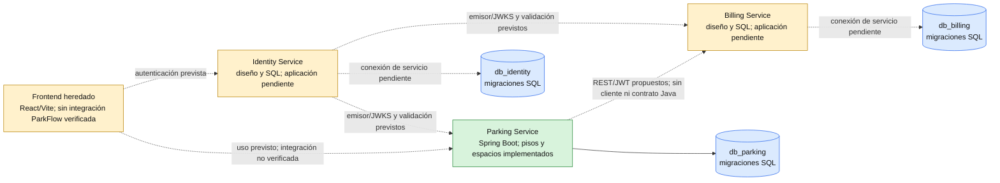

# ParkFlow — arquitectura y modelo de datos

**Estado del documento:** auditoría estática del monorepositorio. La fuente de verdad del esquema es Flyway; una migración presente define el esquema, pero no demuestra que se haya aplicado a una base activa.

## 1. Objetivo y alcance

ParkFlow es un sistema de gestión de parqueaderos cuya arquitectura objetivo separa la operación del parqueadero, la identidad y la facturación en tres servicios con bases PostgreSQL propias. El backend se desarrolla progresivamente: hoy hay una aplicación Spring Boot ejecutable para Parking con administración inicial de pisos y espacios; Billing e Identity existen como modelos SQL, no como aplicaciones Java.

El objetivo funcional completo contempla administrar recursos, registrar entradas y salidas, liquidar el tiempo de permanencia y autenticar operadores. La primera entrega de backend visible cubre salud y CRUD de pisos/espacios. Vehículos, sesiones, asignación, tickets, pagos, comprobantes, login y JWT siguen pendientes en Java. No se verificó una conexión a PostgreSQL durante esta auditoría.

## 2. Arquitectura y estado



El POM, configuración y código ejecutable corresponden a `services/parking-service`. No se encontraron módulos Java ejecutables de Billing o Identity. Las tres carpetas de migraciones describen propiedad de datos separada; no hay claves foráneas entre bases. La integración HTTP, tokens JWT, JWKS y despliegue Azure son objetivos documentales, no componentes verificados en ejecución.

| Servicio | Propiedad prevista | Implementado en Java | Estado de datos |
|---|---|---|---|
| Parking | Pisos, espacios, vehículos y sesiones | Salud; pisos y espacios | Migraciones V1/V2 presentes |
| Identity | Usuarios, roles y autenticación | Nada localizado | Migraciones V1/V2 y semillas de desarrollo |
| Billing | Tarifas, pagos y comprobantes | Nada localizado | Migraciones V1/V2 y semillas de desarrollo |

### 2.1 Parking Service

La aplicación usa Java 21, Spring Boot 3.5.14, Spring Web, Spring Data JPA, validación, PostgreSQL y Flyway. Tiene entidades/repositorios/controladores de `Piso` y `Espacio`, respuestas DTO y manejo de errores. La disponibilidad de espacios se consulta desde las sesiones activas mediante una consulta nativa; no hay entidad Java de sesión.

Rutas implementadas:

| Método | Ruta | Operación |
|---|---|---|
| GET | `/api/v1/health` | Salud del proceso; no prueba PostgreSQL |
| POST, GET | `/api/v1/pisos` | Crear/listar pisos |
| GET, PUT | `/api/v1/pisos/{id}` | Consultar/actualizar piso |
| PATCH | `/api/v1/pisos/{id}/habilitado` | Cambiar habilitación |
| POST, GET | `/api/v1/espacios` | Crear/listar espacios; GET acepta filtro `pisoId` |
| GET, PUT | `/api/v1/espacios/{id}` | Consultar/actualizar espacio |
| PATCH | `/api/v1/espacios/{id}/habilitado` | Cambiar habilitación |

Vehículos, ingreso/salida, sesión, ticket, cobro, seguridad y llamadas a otros servicios no tienen endpoints Java localizados. `seq_ticket` está definida en SQL, pero su reserva/formato aún no tiene implementación Java localizada.

### 2.2 Identity Service

El dominio previsto administra usuarios, roles y asignaciones. `db_identity` contiene estas tablas y V1 inserta roles de referencia `ADMINISTRADOR` y `OPERADOR`. No se encontraron aplicación Spring, API de registro/login, hash adaptativo, emisión JWT, publicación JWKS ni autorización Java. El SQL no especifica algoritmo para `password_hash`.

### 2.3 Billing Service

El dominio previsto administra tarifas, instantáneas de liquidación, intentos de pago y comprobantes. SQL define idempotencia, transiciones de pago y restricciones de comprobante. No se encontraron aplicación Java, API, llamada desde Parking ni integración con adquirente de tarjetas. `TARJETA` es solo un valor permitido por la columna `metodo`.

## 3. Comunicación, seguridad y consistencia

No hay contratos HTTP entre microservicios implementados. UUID como `sesion_id`, `pago_id` y operadores son referencias externas almacenadas por valor; no son FKs cross-database. El flujo síncrono Parking→Billing, la identidad de servicio, validación de JWT y la recuperación ante resultado indeterminado son decisiones de diseño que requieren contratos antes de habilitar pagos.

El siguiente diagrama expresa el flujo propuesto, no una API existente. No se asignan rutas inventadas:

```mermaid
sequenceDiagram
    autonumber
    actor Operador
    participant P as Parking (diseño de salida)
    participant DBP as db_parking
    participant B as Billing (diseño)
    participant DBB as db_billing
    Operador->>P: Solicitar salida por sesión/ticket
    P->>DBP: Leer y bloquear sesión activa (diseñado)
    P->>P: Capturar corte y formar solicitud idempotente
    P->>B: Solicitud de liquidación (contrato pendiente)
    B->>DBB: Guardar pago/snapshot (lógica Java pendiente)
    DBB-->>B: Resultado sujeto a restricciones SQL
    B-->>P: Resultado; transporte aún no implementado
    alt Pago aprobado
        P->>DBP: Cerrar sesión en transacción local (pendiente)
        alt Cierre confirmado
            DBP-->>P: Cierre persistido
        else Fallo después de aprobar pago
            DBP-->>P: Resultado incierto; reconciliación pendiente
            Note over P,B: Consultar o repetir por clave idempotente antes de otro cobro
        end
    else Pago rechazado o indeterminado
        P-->>Operador: No confirmar cierre; resolución según contrato pendiente
    end
```

No se encontró Spring Security en dependencias ni configuración de JWT, issuer, audience, `exp`, `nbf`, subject, JWKS o credenciales servicio-a-servicio. Firma asimétrica, roles mínimos, expiración y secretos separados son recomendaciones por decidir. La configuración usa variables de entorno para conexión; los valores de desarrollo no son credenciales de despliegue. No se incluyen secretos en esta documentación.

## 4. Modelo de datos y ownership

Hay diez tablas distribuidas en tres bases. Detalle de columnas, restricciones, índices, triggers, funciones y secuencias en [`DATABASE_SCHEMA.md`](DATABASE_SCHEMA.md). Los diagramas ER son separados por base. La regla de ownership es que cada servicio futuro opere únicamente su base.

| Base | Tablas | Referencias externas (sin FK) |
|---|---|---|
| `db_parking` | `pisos`, `espacios`, `vehiculos`, `sesiones_parqueo` | `sesiones_parqueo.pago_id` a Billing; operadores a Identity |
| `db_identity` | `usuarios`, `roles`, `usuario_roles` | Ninguna |
| `db_billing` | `tarifas`, `pagos`, `comprobantes` | `pagos.sesion_id` a Parking; operadores a Identity |

### 4.1 Integridad, concurrencia y secuencias

- Parking impone una sesión activa por vehículo y espacio mediante índices únicos parciales; `uq_sesion_pago` evita reutilizar un pago no nulo. Triggers validan compatibilidad/habilitación al insertar sesión, hacen inmutables las sesiones terminales y rechazan deshabilitar pisos/espacios ocupados.
- `fn_sesion_validar_insert()` bloquea espacio y piso con `FOR SHARE`. Esto protege la creación frente a deshabilitación concurrente. El repositorio Java actual administra pisos/espacios y usa bloqueos de fila para operaciones de actualización; el flujo Java de asignación de sesiones y `FOR UPDATE SKIP LOCKED` aún no está implementado.
- SQL calcula disponibilidad desde sesiones activas; no hay tabla materializada de ocupación. La consulta Java de espacios existente usa ese principio.
- Billing tiene clave de idempotencia única, hash de solicitud, y un índice parcial que limita a un pago pendiente/aprobado por sesión. La restricción de unicidad no implementa por sí sola la política Java para reusar una clave con payload distinto.
- Los pagos solo transitan desde pendiente a aprobado/rechazado; el comprobante solo corresponde a pago aprobado. Un trigger de restricción diferido exige comprobante para cada pago aprobado al confirmar la transacción.
- `seq_ticket` y `seq_comprobante` reservan números; no se localizó función/trigger generador. La aplicación futura debe definir formato y política de reintento.

### 4.2 Liquidación definida en SQL

Billing almacena un snapshot de tarifa y sesión. SQL valida:

`minutos_permanencia = floor(epoch(fecha_corte - fecha_entrada) / 60)`

`unidades_cobradas = ceil(max(0, minutos_permanencia - minutos_gracia) / unidad_minutos)`

`valor_total = unidades_cobradas * valor_unidad`

Los valores de unidad y gracia son datos de la tarifa, no constantes globales impuestas por SQL. Los métodos permitidos son `EFECTIVO`, `TARJETA`, `SIN_COSTO`; la tarifa vigente es única por tipo de vehículo. Una tarifa activa se desactiva, pero no puede reactivarse según su trigger. La integración con procesador externo no está definida.

## 5. Migraciones, configuración y ejecución local

Las migraciones Flyway están bajo `parkflow-db/{parking-service,billing-service,identity-service}/src/main/resources/db/migration/`, con V1 de esquema y V2 de grants. Los datos V900 están en `src/main/resources/db/dev/` de cada servicio. Los archivos raíz `01_db_parking.sql`, `02_db_billing.sql` y `03_db_identity.sql` son scripts de conveniencia, no sustituyen a Flyway como fuente versionada.

Parking empaqueta sus migraciones en el artefacto. Flyway está desactivado por defecto en configuración base; el perfil `migrate` lo activa con credenciales de migración separadas, validación, `clean` deshabilitado y baseline configurado. No se verificó la ejecución de Flyway contra base alguna. V2 concede permisos solo si el rol de aplicación existe previamente; el aprovisionamiento y privilegios del migrador son externos a esas migraciones.

`parkflow-db/run_local.sh` elimina/recrea las bases locales y `run_tests.sh` invoca ese flujo: ambos son destructivos y no se ejecutaron para esta documentación. El informe de resultados SQL afirma pruebas con PostgreSQL 16; no se repitieron aquí. No se confirmó disponibilidad de una instancia DB.

## 6. Despliegue previsto

Azure Container Apps, Azure Database for PostgreSQL Flexible Server, Key Vault, red privada, TLS y despliegues separados aparecen como propuestas futuras. No se encontraron recursos Azure desplegados ni evidencia de imágenes construidas en esta auditoría. El Dockerfile de Parking configura una compilación, pero la existencia del archivo no demuestra que la imagen se haya compilado o desplegado.

## 7. Estado, discrepancias y trabajo pendiente

| Elemento | Estado verificable | Evidencia principal |
|---|---|---|
| Parking | Aplicación Java con salud, pisos y espacios | `services/parking-service/src/main/java` |
| Identity / Billing | SQL presente; aplicación Java pendiente | ausencia de servicios Java; migraciones por dominio |
| Tres modelos de BD | Definidos en migraciones | V1 de los tres servicios |
| Flyway | Dependencia y recursos configurados; aplicación real no verificada | POM, propiedades y V1/V2 |
| JWT / comunicación HTTP | Pendiente | no localizados en código/dependencias |
| Frontend | Proyecto heredado, integración ParkFlow no verificada | fuera del alcance backend |
| Azure | Futuro | sin evidencia de despliegue |

Discrepancias y riesgos concretos:

1. La documentación previa dibujaba `SESIONES_PARKING`; el nombre real es `sesiones_parqueo`.
2. La cardinalidad anterior de pagos/comprobantes era obligatoria uno a uno. SQL permite inicialmente cero o un comprobante por pago; un pago aprobado debe tener uno al commit.
3. Referencias UUID entre bases no prueban existencia del objeto remoto. Se requieren contratos y recuperación distribuida.
4. La generación de folios, operaciones de sesión, cobro, identidad y seguridad no están implementadas en Java.
5. Pruebas SQL reportadas no equivalen a pruebas de integración Java/Flyway; no fueron revalidadas en esta auditoría.
6. `updated_at` tiene defaults, pero no trigger general de actualización; debe mantenerse desde aplicación cuando corresponda.

El inventario de fuentes, límites de verificación y trazabilidad está en [`ARCHITECTURE_DOCUMENTATION_AUDIT.md`](ARCHITECTURE_DOCUMENTATION_AUDIT.md).
