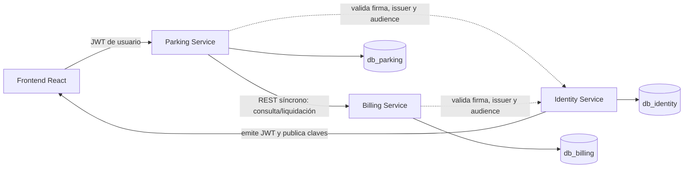

# ParkFlow — Revisión arquitectónica

**Alcance:** auditoría estática de los archivos del backend y de las migraciones SQL de ParkFlow. No se modificaron código, SQL ni configuraciones durante esta revisión. Las decisiones propuestas son recomendaciones, no funcionalidades implementadas.

> **Nota de vigencia:** este documento registra la auditoría anterior a la reorganización de Parking. El código Java, el POM y el Dockerfile se trasladaron a `services/parking-service/`; las observaciones sobre Docker y estructura describen el estado previo y no el actual.

## 1. Resumen ejecutivo

ParkFlow cuenta con una separación de datos bien definida en SQL: hay tres bases de datos y diez tablas distribuidas por dominio. Las restricciones, índices únicos parciales y triggers de PostgreSQL cubren varias invariantes importantes, incluidas sesiones activas exclusivas, idempotencia de pagos, integridad de comprobantes y operaciones concurrentes.

Sin embargo, **todavía no hay tres microservicios ejecutables**. En Java existe una única aplicación Spring Boot, enfocada en Parking, con un endpoint de salud y sin entidades, repositorios, lógica de negocio, clientes REST ni seguridad. Billing e Identity existen como esquemas, migraciones y datos/pruebas SQL; no como aplicaciones Java.

La recomendación es conservar un monorepositorio al inicio, pero construir cada microservicio como una aplicación Spring Boot ejecutable y desplegable de forma independiente, con configuración, acceso a datos, seguridad y pruebas propias. Para la primera versión, las llamadas síncronas REST son suficientes si se implementan idempotencia, límites de tiempo y recuperación ante fallos parciales. No se recomienda una transacción distribuida.

**Riesgos principales encontrados:**

1. El `Dockerfile` no está alineado con el artefacto Maven actual y no copia el directorio desde donde Maven empaqueta las migraciones de Parking.
2. No hay un contrato de salida/pago entre Parking y Billing ni una estrategia de recuperación implementada.
3. Las migraciones de Parking se empaquetan en la aplicación, pero Flyway está apagado por defecto y no se ha verificado conexión ni adopción de una base existente.
4. El endpoint de salud responde al estado del proceso, no a la disponibilidad de PostgreSQL.
5. `DATABASE_SCHEMA.md` tiene dos relaciones Mermaid que no representan exactamente el esquema real.

## 2. Alcance, fuentes y criterio

Se revisaron:

- [POM de Parking](./services/parking-service/pom.xml), configuración `application*.properties`, [Dockerfile de Parking](./services/parking-service/Dockerfile) y [README.md](./README.md).
- Código y pruebas Java bajo `services/parking-service/src/`.
- Migraciones `V1__create_initial_schema.sql` y `V2__grants.sql` de los tres servicios en [parkflow-db](./parkflow-db/).
- Scripts y pruebas SQL de [parkflow-db/tests](./parkflow-db/tests/), así como la documentación de resultados [AJUSTES_V3_1_Y_RESULTADOS.md](./parkflow-db/AJUSTES_V3_1_Y_RESULTADOS.md).
- [DATABASE_SCHEMA.md](./DATABASE_SCHEMA.md).

Las pruebas SQL no se ejecutaron durante esta auditoría: [run_local.sh](./parkflow-db/run_local.sh) elimina y recrea las bases y [run_tests.sh](./parkflow-db/run_tests.sh) invoca ese script. La documentación de resultados afirma que las pruebas fueron ejecutadas en PostgreSQL 16, pero eso no se volvió a verificar en esta revisión. No se estableció una conexión con una base PostgreSQL durante la auditoría.

Las etiquetas distinguen **hechos observados** de **diseño recomendado**:

- **CORRECTO:** respaldado por archivos presentes.
- **MEJORABLE:** base útil con aspectos que conviene resolver.
- **FALTANTE:** todavía no existe en el código.
- **RIESGO:** puede producir errores operativos o de consistencia si no se aborda.

## 3. Arquitectura actual y objetivo

### Hechos observados

- El POM define una sola aplicación Maven/Spring Boot, Java 21 y Spring Boot 3.5.14.
- El punto de entrada es `com.parkflow.ParkflowApplication`.
- La única ruta Java es `GET /api/v1/health`.
- El código no contiene entidades JPA, repositorios, servicios de negocio, clientes HTTP ni configuración de seguridad.
- Las migraciones de tres dominios están bajo `parkflow-db/`, pero el POM empaqueta solo las migraciones de Parking en `classpath:db/migration`.
- La aplicación se conecta a una base configurada mediante variables `PARKING_DB_*`; el valor predeterminado del nombre de base es `db_parking`.
- No se ha implementado el proceso Java de Billing ni el de Identity.

Por tanto, el estado real es **una aplicación inicial de Parking y tres diseños SQL**, no tres microservicios desplegables. La separación de bases es necesaria para microservicios, pero por sí sola no los constituye.

### Arquitectura objetivo recomendada



Las flechas punteadas representan validación de tokens usando claves públicas/JWKS o una distribución segura de claves; los servicios no deben consultar directamente las tablas de Identity. No debe haber claves foráneas entre bases.

### Organización de repositorio

| Alternativa | Ventajas | Costos y riesgos | Evaluación |
|---|---|---|---|
| Un repositorio por microservicio | Aislamiento de permisos y ciclos de release; apropiado para equipos autónomos | Más coordinación de contratos, versiones, configuración y cambios transversales | Puede ser conveniente si los equipos y ciclos de despliegue ya son independientes |
| Monorepositorio con tres aplicaciones Spring Boot independientes | Cambios y contratos visibles en un lugar; desarrollo local sencillo; permite despliegues separados | Requiere mantener límites explícitos; el monorepo puede inducir dependencias cruzadas | **Recomendado para la etapa inicial**, con límites de compilación y dependencias por servicio |
| Una aplicación Spring Boot con tres bases y tres paquetes | Menos despliegue inicial | Acopla despliegues, seguridad, configuración y fallos; no representa tres microservicios independientes | No recomendada como arquitectura final |

Las aplicaciones pueden residir en el mismo repositorio y aun así tener artefactos, configuraciones, pipelines y despliegues separados. No crear un Gateway hasta que exista una necesidad concreta.

## 4. Responsabilidades por servicio

| Servicio | Responsabilidad propuesta | Propiedad de datos comprobada |
|---|---|---|
| Parking | Pisos, espacios, vehículos, entrada, asignación, sesión, ticket, ocupación y cierre | `pisos`, `espacios`, `vehiculos`, `sesiones_parqueo` |
| Billing | Tarifas, liquidación, intentos/pagos, aprobación/rechazo e inmutabilidad de comprobantes | `tarifas`, `pagos`, `comprobantes` |
| Identity | Usuarios, roles, asignación de roles, autenticación, emisión de tokens y política de autorización | `usuarios`, `roles`, `usuario_roles` |

`numero_ticket` se almacena en `sesiones_parqueo`; no existe una tabla `tickets`. Parking es propietario del ciclo de vida de la sesión. Billing almacena el `sesion_id`, el ticket y un snapshot de los datos tarifarios/de vehículo para conservar el contexto de la liquidación sin leer la base de Parking.

El esquema de Billing registra métodos `EFECTIVO`, `TARJETA` y `SIN_COSTO`, pero no define una integración con un procesador/adquirente externo ni un identificador de transacción de ese proveedor. El alcance real de “pago” y la responsabilidad de una futura integración externa deben aclararse antes de implementar ese camino.

## 5. Persistencia y hallazgos del esquema

### Inventario real

- **`db_parking` (4 tablas):** `pisos`, `espacios`, `vehiculos`, `sesiones_parqueo`.
- **`db_billing` (3 tablas):** `tarifas`, `pagos`, `comprobantes`.
- **`db_identity` (3 tablas):** `usuarios`, `roles`, `usuario_roles`.

Las claves foráneas observadas son locales a cada base: `espacios.piso_id`; `sesiones_parqueo.vehiculo_id` y `espacio_id`; `pagos.tarifa_id`; `comprobantes.pago_id`; y las dos relaciones de `usuario_roles`. Los campos `sesiones_parqueo.pago_id`, `operador_entrada_id`, `operador_cierre_id`, `pagos.sesion_id`, `operador_id` y `operador_resolucion_id` no tienen FK cross-database.

### Protecciones SQL útiles

- Parking: UUID, unicidad de placa/código/ticket, validaciones de formatos y estados, coherencia entre el estado de sesión y sus fechas/pago/operador, e índices únicos parciales que impiden más de una sesión activa por vehículo o espacio. `uq_sesion_pago` impide reutilizar un pago en varias sesiones.
- `fn_sesion_validar_insert()` comprueba compatibilidad vehículo/espacio y habilitación. Bloquea el espacio y el piso con `FOR SHARE`; los triggers de deshabilitación verifican que no haya sesiones activas.
- `fn_sesion_inmutable()` hace definitivo el registro cerrado/anulado y protege la identidad de una sesión activa.
- Billing: una tarifa activa por tipo de vehículo; unicidad de la clave de idempotencia; como máximo un pago pendiente o aprobado por sesión; snapshots, cálculo y coherencia de estado validados por restricciones.
- `fn_tarifa_inmutable()` y `fn_pago_inmutable()` protegen el historial. El comprobante solo se inserta para pagos aprobados y el constraint trigger diferido `ctrg_pago_aprobado_con_comprobante` exige que el pago aprobado tenga comprobante al confirmar la transacción.
- Identity: correo único sin distinguir mayúsculas, unicidad de rol y clave primaria compuesta para asignaciones de rol.
- Las migraciones `V2` otorgan permisos a roles de aplicación solo si estos ya existen. Parking y Billing no conceden `DELETE`; Identity permite quitar filas de `usuario_roles`.

### Límites e invariantes que debe implementar Java

- La secuencia `seq_ticket` existe, pero no se encontró una función o trigger que genere el ticket; la aplicación debe reservar el número y construir un `PF-####-######` válido, manejando colisiones/reintentos.
- La disponibilidad se calcula desde sesiones activas; no hay una tabla de ocupación materializada.
- `updated_at` tiene columna en varias tablas, pero no trigger de actualización. La documentación de ajustes indica que se actualizará desde Java.
- La fórmula de tarifa se calcula en Java y SQL verifica minutos, unidades e importe persistidos.
- La comparación de `fecha_salida` de Parking con el `fecha_corte` de Billing no puede imponerse con una FK/check local y corresponde a un contrato entre servicios.
- La base no verifica por sí sola que referencias externas (usuario, sesión o pago) existan en otra base. Deben comprobarse mediante los contratos de servicio y la recuperación distribuida.

### Discrepancias de documentación

En [DATABASE_SCHEMA.md](./DATABASE_SCHEMA.md):

1. El Mermaid de Parking llama `SESIONES_PARKING` a la entidad; el nombre real es `sesiones_parqueo`.
2. El diagrama de Billing dibuja una relación obligatoria uno a uno entre `PAGOS` y `COMPROBANTES`. SQL permite cero o un comprobante por pago; un pago aprobado debe tener uno al confirmar, y los comprobantes solo se admiten para pagos aprobados.
3. Algunos fragmentos de SQL de Billing omiten restricciones presentes en V1 (por ejemplo, restricciones CHECK y fórmulas de `pagos`). El documento sirve como resumen, pero la migración debe seguir siendo la autoridad.

Los scripts SQL de conveniencia en la raíz de `parkflow-db/` y los V1 de Flyway difieren en los bloques de permisos: las migraciones separan esos grants en V2. La estructura de tablas de V1 es coherente con los scripts de conveniencia inspeccionados; conviene conservar explícito qué ruta se usa para la instalación y evitar mantener definiciones de esquema divergentes a futuro.

## 6. Comunicación entre servicios

### Propuesta REST inicial

1. El frontend presenta al operador un token de usuario firmado por Identity y llama a Parking.
2. Parking es el coordinador del flujo de entrada/salida y consulta a Billing solo para operaciones de cobro.
3. Billing no consulta directamente la base de Parking: recibe los datos necesarios para crear un snapshot de liquidación.
4. Parking y Billing validan el JWT de usuario. Para llamadas internas, usar además una identidad de servicio (por ejemplo, credenciales de cliente o mTLS); no confiar solo en que la petición procede de una red “interna”.
5. No introducir colas/broker en v1. Evitar llamadas circulares: Billing no debe llamar a Parking para completar una transacción de pago.

Contratos HTTP candidatos — **no existen todavía y requieren diseño**:

- `POST /api/v1/parking-sessions` para registrar una entrada.
- `GET /api/v1/parking-sessions/{id}` o consulta por ticket para recuperar contexto.
- `POST /internal/v1/settlements` en Billing para cotizar/crear liquidación con clave de idempotencia y snapshot de sesión.
- `GET /internal/v1/payments/by-idempotency-key/{key}` o repetición idempotente para resolver una respuesta perdida.
- Operación de aprobación/rechazo en Billing con actor, método y resultado.
- Operación de cierre en Parking con el pago aprobado y el operador de salida.

Los nombres son ilustrativos, no contratos aprobados. Definir DTOs, estados HTTP, errores estables y autenticación antes de que ambos servicios se implementen.

Para todas las llamadas salientes: configurar timeout de conexión y respuesta. Reintentar solo fallos transitorios y operaciones idempotentes, con límite, backoff y jitter; no repetir una escritura ciega tras timeout. Evitar guardar una transacción/lock de PostgreSQL abierto durante una llamada HTTP.

## 7. Flujos de negocio y consistencia

### Entrada propuesta

1. Parking valida campos y existencia local del vehículo; si es una operación que registra el vehículo, lo persiste en `db_parking`.
2. En una transacción local, obtiene un espacio habilitado del tipo compatible, bloqueándolo con `FOR UPDATE SKIP LOCKED`, crea la sesión y genera el ticket.
3. Mantiene el bloqueo hasta que la inserción de sesión confirme; los índices únicos parciales y trigger actúan como última defensa.
4. Devuelve ticket, sesión, espacio y hora de entrada.

El SQL de concurrencia contiene un ejemplo de selección con `FOR UPDATE SKIP LOCKED`; el código Java aún no lo implementa. La transacción local debe abarcar selección e inserción. Si se obtiene una colisión por índice único, comenzar una transacción nueva antes de reintentar; si no hay fila porque todas están bloqueadas, distinguir contención transitoria de parqueadero realmente lleno.

### Permanencia

La sesión activa es la fuente de ocupación. Los conteos de disponibilidad se calculan con sesiones activas y el estado habilitado del piso/espacio. `parkflow-db/queries/disponibilidad_por_piso.sql` demuestra una consulta agregada; no existe aún repositorio/endpoint Java para exponerla.

### Salida y pago propuestos

1. Parking carga y bloquea la sesión activa localmente para evitar cierres concurrentes; captura el instante de corte para la cotización.
2. Parking llama a Billing con contexto suficiente (`sesion_id`, ticket, vehículo, entrada, corte, operador) y una clave de idempotencia estable para esa operación.
3. Billing calcula la tarifa, guarda el snapshot y el pago pendiente en su transacción local. La base limita los intentos pendientes/aprobados por sesión.
4. El operador confirma el resultado del pago. Billing realiza en su transacción local la transición del pago y, si se aprueba, crea el comprobante en la misma transacción; el constraint trigger difiere la validación hasta commit.
5. Tras aprobación confirmada, Parking cierra la sesión en una transacción local, registrando `pago_id`, fecha de salida y operador de cierre. La liberación del espacio se deriva del estado; no se borra el historial.
6. La respuesta final a la UI solo debe indicar cierre completado después de que Parking confirme su commit.

### Fallos parciales y mitigación v1

| Fallo | Mitigación propuesta |
|---|---|
| Billing aprobó, pero Parking no cerró | No emitir un segundo cobro. Mantener la sesión activa hasta cerrar; repetir el cierre idempotente o consultar el estado de la sesión y del pago para reconciliar. Una sesión ya cerrada con el mismo `pago_id` debe responder como resultado ya completado sin volver a mutarla: el trigger de Parking prohíbe actualizar una sesión terminal. |
| Se perdió la respuesta de Billing | Reintentar con la misma clave y payload; Billing devuelve el pago original o permitir una consulta por clave. Comparar `request_hash`; misma clave con otro payload debe ser conflicto. El UNIQUE SQL no implementa por sí solo esta política de comparación. |
| Dos operadores cobran la misma sesión | Bloqueo/validación local en Parking, más índice parcial de Billing que permite un solo pago PENDIENTE/APROBADO. Al recibir violación UNIQUE, la transacción perdedora debe revertirse y, en una nueva transacción, leer y devolver el pago existente. |
| Billing rechaza el pago | No cerrar sesión; mantener el intento rechazado como historial y emitir clave nueva para un intento nuevo. |
| Proceso se interrumpe tras pago aprobado | Recuperación explícita: al reintentar, consultar por sesión/clave en Billing y completar el cierre; revisar sesiones activas con pagos aprobados. El esquema actual no tiene un estado “cierre pendiente” en Parking ni un proceso reconciliador. |
| Tiempo de espera con resultado desconocido | Tratar como resultado indeterminado, no como rechazo. Consultar/repetir idempotentemente antes de habilitar un nuevo intento de cobro. |

No usar 2PC ni transacción distribuida. Cada servicio confirma su propia base; el flujo entre ambos es una saga orquestada de forma síncrona por Parking, con recuperación/reconciliación operacional. Definir cómo se bloquea el egreso físico mientras el pago está aprobado pero Parking aún no cerró es una decisión operativa pendiente.

## 8. Seguridad

### Estado observado

- No hay dependencia `spring-boot-starter-security`, filtro, configuración de roles ni endpoint de login en el código actual.
- Identity contiene `password_hash`, usuarios y roles `ADMINISTRADOR` y `OPERADOR` como filas de referencia.
- Los datos `V900` de Identity son semilla local; no son autenticación Java implementada.
- No se encontraron claims JWT, issuer, audience, JWKS ni credenciales de servicio configuradas.

### Recomendación

- Identity emite JWT tras autenticar; guardar contraseñas usando un hash adaptativo como BCrypt o Argon2id y comparar con una librería estándar.
- Preferir firma asimétrica (RS256/ES256): Identity protege la clave privada y publica claves públicas rotables mediante JWKS. Parking y Billing configuran validadores Spring Security que verifican firma, `iss`, `aud`, `exp` y, cuando aplique, `nbf`; rechazar tokens para otra audiencia.
- Incluir subject UUID y roles/autoridades mínimas; autorización explícita por endpoint. La baja de usuario no invalida automáticamente un JWT ya emitido, por lo que fijar expiración breve y una política de revocación/rotación.
- Separar autenticación de operador (JWT de usuario) de autenticación servicio-a-servicio. Emplear identidad de servicio con scopes/audience o mTLS, secretos gestionados y rotación. No compartir credenciales de base entre servicios.
- Los valores por defecto de BD en `application.properties` son convenientes para desarrollo; no son credenciales aceptables para despliegue.

## 9. Arquitectura interna

El código actual aún no prueba una arquitectura por capas: solo hay paquete `controller` para la ruta de salud. Para cada aplicación, crecer por dominio/feature y mantener dependencias claras:

```text
com.parkflow.parking
  health/
    api/
  floors/
    api/             # controllers, request/response DTOs
    application/     # casos de uso y límites transaccionales
    domain/          # reglas/invariantes sin dependencia de web
    infrastructure/  # entidades JPA, repositorios y adaptadores
  spaces/
  vehicles/
  sessions/
  shared/
    config/
    error/
    security/
```

Para el inicio pequeño se pueden combinar `api`/DTO o `application` con service donde sea práctico; evitar una interfaz/clase por cada método CRUD sin una necesidad. Las entidades representan el esquema de **su propia base** y no deben importarse entre servicios. Los controladores traducen HTTP, DTOs y errores; no contienen reglas de negocio ni acceden a repositorios directamente. La transacción pertenece al caso de uso de aplicación, no debe abarcar llamadas de red.

## 10. Concurrencia y transacciones

### Confirmado en el SQL

- Asignación demostrada por la prueba `concurrencia.sh`: `FOR UPDATE SKIP LOCKED` permite que operadores simultáneos elijan filas distintas.
- Los índices únicos parciales son garantía final incluso si dos operaciones compiten por un mismo vehículo/espacio.
- El trigger de entrada bloquea espacio/piso con `FOR SHARE`; evita una carrera entre alta de sesión y deshabilitación.
- La prueba de cierre usa `SELECT ... FOR UPDATE` y comprueba que la segunda operación ve la sesión ya cerrada.
- Billing limita pagos activos por sesión e idempotency key con índices únicos.
- El constraint trigger de comprobante diferido permite aprobar + emitir comprobante en una sola transacción Billing.

### Recomendación Java

- Resolver asignación en una transacción Parking corta que incluya `SELECT ... FOR UPDATE SKIP LOCKED` e inserción de sesión.
- Cerrar mediante `SELECT ... FOR UPDATE`, verificar `ACTIVA` y actualizar a `CERRADA` una sola vez. Ante repetición, consultar si ya está cerrada con el mismo pago antes de mutar; no hacer UPDATE sobre estado terminal.
- Mantener cualquier llamada a Billing fuera de una transacción con locks de Parking. Revalidar/bloquear al volver para cerrar.
- Mapear los errores de integridad SQL (por nombre de constraint/SQLSTATE) a conflictos de dominio; retry solo en una transacción nueva y solo para causas clasificadas como transitorias/idempotentes.
- Billing ejecuta aprobación y comprobante en una sola transacción local por el constraint diferido.

## 11. Pruebas

### Estado comprobable

- Java tiene tres pruebas ligeras: endpoint de salud con `@WebMvcTest`, carga de clase y presencia de migraciones empaquetadas/exclusión de datos `dev`.
- El POM incluye Testcontainers PostgreSQL, JUnit y Spring Boot Test, pero no se encontró una prueba de integración DB en Java.
- Existen pruebas SQL de Parking, Billing e Identity y una prueba de concurrencia con dos sesiones PostgreSQL. El informe de resultados declara PostgreSQL 16 y pruebas exitosas; no se ejecutaron aquí porque los scripts locales eliminan/recrean bases.
- No existen pruebas Java de repositorios, seguridad, comunicación HTTP, flujo de salida o recuperación tras fallo.

### Estrategia futura

1. Unitarias de reglas deterministas (cálculo de importe en Billing, validación de transiciones).
2. Integración por servicio con PostgreSQL 16/Testcontainers aplicando las migraciones del servicio en una base desechable.
3. Pruebas de repositorio y constraints reales, incluidos bloqueos, índices parciales y triggers.
4. Pruebas MVC de contratos, validación, autorización y formato uniforme de errores.
5. Pruebas de integración HTTP con dependencias simuladas o servicios de prueba; timeout, error y respuesta perdida.
6. Pruebas concurrentes reales para doble entrada, doble pago, cierre duplicado y deshabilitación contra asignación.
7. Prueba de recuperación de pago aprobado y cierre pendiente.

Mantener los scripts destructivos claramente etiquetados como locales; no usarlos contra bases compartidas ni de producción.

## 12. Despliegue e infraestructura futura

### Estado y riesgo observado

El Dockerfile original de la auditoría (hoy trasladado a [services/parking-service/Dockerfile](./services/parking-service/Dockerfile)) requería atención antes de usarlo:

- El POM actual produce `parkflow-backend-0.0.1-SNAPSHOT.jar`, mientras el Dockerfile copia `target/app-0.0.1-SNAPSHOT.jar`.
- Maven incluye las migraciones desde `parkflow-db/parking-service/...`, pero el Dockerfile copia `src` y no copia `parkflow-db/` antes de `mvn clean package`. Por tanto, en la imagen las migraciones no estarán en el contexto de compilación y el paso que copia el JAR también apunta a un nombre desactualizado.
- No se ejecutó el build de Docker; este diagnóstico estático debe confirmarse al preparar el despliegue.

### Evolución recomendada

- **Local:** PostgreSQL 16 aislado; cada servicio configurado para su base/usuario. Mantener `run_local.sh` y `run_tests.sh` solo como scripts de desarrollo porque reconstruyen bases.
- **Contenedores:** una imagen y proceso por servicio, artefactos/versiones separados, health/readiness probes y configuración externa. Corregir el contexto Docker y probar cada imagen antes de desplegar.
- **Azure:** valorar Azure Container Apps para servicios HTTP de escala moderada y Azure Database for PostgreSQL Flexible Server como base administrada; elegir topología, red privada y alta disponibilidad según costo y requisitos operativos reales.
- Usar Key Vault/identidades administradas para secretos, TLS, usuarios de BD separados por servicio y privilegio mínimo.
- No desplegar tres servicios ni introducir gateway/broker hasta que los límites, contratos y necesidades de operación estén definidos.

## 13. Observabilidad y salud

Actualmente, `/api/v1/health` devuelve `UP` y `parking-service` desde el controlador. No prueba base de datos; no se encontró Actuator, métricas, trazas, logging estructurado ni correlación distribuida.

Para v1:

- Separar liveness (proceso responde) de readiness (servicio puede atender; incluir DB solo si es requisito del endpoint de readiness).
- Añadir request/correlation ID y propagarlo en cabecera entre Parking y Billing.
- Registrar eventos con campos estructurados: servicio, request ID, sesión/pago, actor y resultado; no registrar contraseñas, tokens ni datos sensibles.
- Estandarizar errores HTTP y logs de fallos de integración, con timeout y resultado indeterminado identificables.
- Añadir métricas de disponibilidad, conexiones DB, sesiones activas, errores y latencia de llamadas remotas; tracing distribuido puede esperar a tener más de un servicio en ejecución.

## 14. Hallazgos clasificados

| Clasificación | Hallazgo | Evidencia / interpretación |
|---|---|---|
| **CORRECTO** | Propiedad de datos separada en SQL por dominio | Tres carpetas de migración, diez tablas y sin FK entre bases |
| **CORRECTO** | Integridad local fuerte para sesiones y pagos | CHECKs, FKs locales, índices parciales y triggers en V1 |
| **CORRECTO** | Protección declarativa contra carreras importantes | Pruebas y restricciones de asignación, cierre y pagos |
| **MEJORABLE** | Monorepo como lugar de desarrollo | Adecuado ahora, siempre que se convierta en tres aplicaciones y artefactos independientes |
| **MEJORABLE** | Documentación del esquema | Los diagramas Mermaid de Parking/Billing tienen cardinalidad/nombre incorrectos; algunos fragmentos omiten restricciones |
| **FALTANTE** | Billing e Identity como servicios Java | No hay aplicaciones Java para esos dominios |
| **FALTANTE** | Endpoints y contratos REST entre servicios | No hay cliente REST ni contrato de cobro/salida en código |
| **FALTANTE** | Entidades, repositorios y lógica de Parking | No existían en `src/main/java` durante la auditoría |
| **FALTANTE** | JWT y autorización | Sin Spring Security ni emisor/validador en el proyecto actual |
| **FALTANTE** | Pruebas Java con PostgreSQL y resiliencia distribuida | Solo pruebas MVC/recursos; no se prueba DB o servicios remotos |
| **FALTANTE** | Readiness, métricas, trazas y correlación | Health route no verifica dependencias ni observabilidad |
| **RIESGO** | Imagen Docker no compila/empaca según configuración actual | Nombre de JAR anterior y carpeta de migraciones ausente del build context |
| **RIESGO** | Flyway/adopción de base existente sin verificar | Flyway está deshabilitado por defecto; no hay verificación DB ni estrategia documentada de baseline/adopción |
| **RIESGO** | Grants dependen de roles preprovisionados | V2 omite grants si `parking_app` no existe y solo contempla los permisos de aplicación |
| **RIESGO** | Éxito de pago sin cierre local | No hay estado reconciliador ni proceso de recuperación implementado |
| **RIESGO** | El timeout de cobro puede confundirse con rechazo | Se requiere consulta/repetición idempotente para evitar doble cobro |
| **RIESGO** | Fuentes SQL duplicadas | Scripts de conveniencia y migraciones difieren en ubicación de grants; definir ruta oficial de instalación |

## 15. Decisiones arquitectónicas pendientes

| Decisión | Recomendación | Justificación | Prioridad | Momento |
|---|---|---|---|---|
| Repositorio y deployables | Monorepo, tres aplicaciones independientes | Facilita el inicio sin acoplar ciclos de despliegue | Alta | Antes de implementar Billing/Identity |
| Contrato de salida Parking/Billing | Parking orquesta por REST y usa claves de idempotencia | Alinea ownership y permite v1 sin broker | Alta | Antes del flujo de salida |
| Recuperación si pago aprobado y sesión activa | Consulta/reintento idempotente y reconciliación operativa | No hay transacción distribuida ni estado de cierre pendiente en SQL | Alta | Antes de activar cobros reales |
| Mismo key con distinto payload | Billing compara `request_hash` y devuelve conflicto | Unique key evita duplicado pero no define el comportamiento de payload distinto | Alta | Al implementar API de Billing |
| Autenticación de servicios | JWT de usuario validado por todos + credencial servicio-a-servicio | Diferencia actor humano de identidad técnica | Alta | Antes de exponer API remota |
| Flyway en BD nueva o ya existente | Documentar aprovisionamiento de roles y procedimiento de baseline/adopción; validar en base descartable | Evita aplicar V1 sobre esquema ya instalado | Alta | Antes de ejecutar migraciones fuera de test |
| Cuenta migrator y grants | Provisionar roles aparte; otorgar DDL/grants solo a migrator | V2 requiere que existan roles y autoridad para GRANT | Alta | Antes de despliegue |
| `seq_ticket` y generación de folio | Generar en transacción Java y probar huecos/reintentos | SQL no define trigger generador | Media | Implementación de entrada |
| Estado operativo post-pago | Definir cuándo autorizar salida física y cómo reconciliar | Pago y cierre pueden fallar en momentos distintos | Alta | Diseño de salida |
| Esquema y scripts duplicados | Mantener V1/V2 como fuente desplegable y tratar scripts planos como conveniencia sincronizada | Reduce divergencias | Media | Antes del primer cambio de schema |
| Docker y probes | Alinear el contexto con recursos Maven y nombres reales de artefacto | El Dockerfile actual no coincide con el build | Alta | Antes de primer contenedor |
| Health/readiness | Definir endpoint de liveness separado de readiness con DB | El actual solo confirma que responde el controlador | Media | Antes de despliegue |
| Procesador de tarjeta | Aclarar si `TARJETA` es un registro manual o una integración con proveedor | El esquema no contiene contrato/identificador de adquirente | Alta | Antes de pagos con tarjeta reales |

## 16. Orden recomendado

1. Acordar límites de tres aplicaciones, responsabilidad de APIs y semántica de salida/idempotencia.
2. Resolver provisionamiento de roles, Flyway y procedimiento seguro para bases nuevas y existentes.
3. Corregir la construcción/paquete Docker y definir health/readiness antes de necesitar imágenes.
4. Implementar Parking sobre `db_parking`: entidades estrictas, repositorios, asignación y ciclo de sesión con pruebas PostgreSQL.
5. Implementar Identity como aplicación propietaria de `db_identity`, autenticación y emisor JWT.
6. Implementar Billing como aplicación propietaria de `db_billing`, liquidación, idempotencia y comprobantes en transacciones locales.
7. Integrar Parking y Billing por REST con timeouts, autenticación de servicio, consulta por idempotency key y recuperación ante cierre incompleto.
8. Añadir pruebas concurrentes entre repositorios/servicios y observabilidad; luego preparar despliegue Azure.

**Conclusión:** el diseño SQL establece límites de datos prometedores, pero el sistema aún está en fase de fundación. La prioridad no es generar todas las capas Java de una vez: es aprobar contratos y recuperación de salida, garantizar que el modelo Java respete las restricciones PostgreSQL y corregir el empaquetado antes del primer despliegue.
