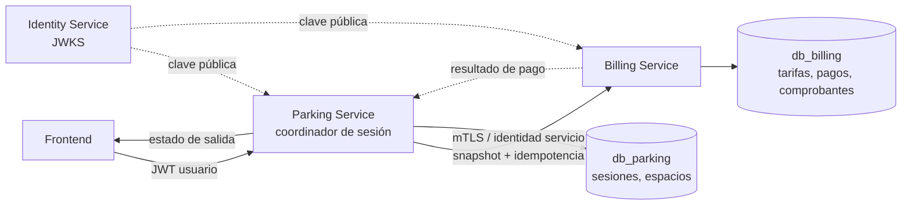

# Diseño propuesto — Billing Service

**Estado:** propuesta para revisión. No se implementó Billing y no se modificaron ni ejecutaron migraciones. Las rutas y el protocolo interno siguientes son contratos propuestos, pendientes de aprobación y coordinación con Parking.

## 1. Alcance y arquitectura

Billing será propietario de tarifas, pagos y comprobantes en su base independiente. Parking coordina entradas y salidas y es el único servicio que conoce el ciclo de vida de la sesión. Billing no consulta Parking ni comparte transacciones con él. Los identificadores de sesión, operador y resolvedor se guardan como UUID externos sin claves foráneas entre bases.

Componentes sugeridos: Spring Boot Web, Validation, Data JPA, Security Resource Server, PostgreSQL driver y Flyway, siguiendo el patrón de empaquetado de migraciones ya usado por Identity. Hibernate debe usar `ddl-auto=validate`; migraciones existentes permanecen como fuente de verdad. No se propone broker, Redis ni una nueva dependencia de infraestructura.

### Modelo

| Entidad | Responsabilidad y relaciones |
|---|---|
| `Tarifa` | Tipo CARRO/MOTO, unidad de minutos, gracia, valor, moneda y estado. Las tarifas históricas son inmutables; `Pago` conserva la tarifa aplicada. |
| `Pago` | Idempotencia, identificadores externos, snapshot de sesión y tarifa, cálculo, estado y resolución. FK local a `Tarifa`; no hay FK a Parking ni Identity. |
| `Comprobante` | Comprobante emitido para un pago aprobado. FK local a `Pago`; único por pago. |

Los estados definidos por SQL son `PENDIENTE`, `APROBADO` y `RECHAZADO`. No agregar estados/columnas desde Hibernate. Un pago resuelto es terminal. Cada aprobación debe crear su comprobante en la misma transacción, como exige el constraint diferido de la migración.

### Capas y clases sugeridas

- Dominio: `Tarifa`, `Pago`, `Comprobante` y enums de estado/tipo/método.
- Aplicación: `TarifaService`, `LiquidacionService`, `ResolucionPagoService`, `ConsultaPagoService`, `ComprobanteService`.
- Persistencia: repositorios JPA para tarifa vigente, pagos por clave idempotente/sesión, bloqueo de pago pendiente y comprobantes.
- API: controladores separados para API de operador y API privada de integración; DTOs validados y mapeo uniforme a `application/problem+json`.
- Adaptador de pago: política explícita para efectivo y, cuando aplique, proveedor de tarjeta. No fingir una aprobación de tarjeta real en producción. `SIN_COSTO` solo puede aplicarse a total cero, según el constraint SQL.

No mantener transacciones de base abiertas durante llamadas HTTP. El bloqueo pesimista aplica solo a la transacción local de resolución; la migración no tiene columna `@Version`.

## 2. Cálculo de liquidación

Parking captura la hora de corte y envía el snapshot confiable. Billing selecciona la tarifa vigente por tipo al crear el intento y guarda todos los datos usados en el cálculo; cambios futuros de tarifa no alteran pagos existentes.

1. Minutos transcurridos = parte entera de los segundos entre entrada y corte divididos por 60, sin permitir un valor negativo.
2. Minutos cobrables = `max(0, minutos_transcurridos - minutos_gracia)`.
3. Unidades = techo de minutos cobrables / minutos por unidad.
4. Total = unidades × valor de unidad, con `BigDecimal` y escala/moneda de SQL.

Ejemplos de la prueba SQL con unidad 60 y gracia 10: 8 minutos → 0 unidades; 30, 60 o 70 → 1; 71 o 130 → 2; 131 → 3. Las tarifas de seed (CARRO 5000 COP, MOTO 2500 COP, 60/10) son datos de prueba, no política productiva.

La hora de corte debe provenir del servidor Parking, no del navegador. Hay que acordar si cada intento nuevo tras rechazo captura una nueva hora de corte o reutiliza la hora original; el hash de idempotencia definido en SQL no incluye el corte, por lo que el retry de una misma clave recupera el primer snapshot.

## 3. Contratos HTTP propuestos

Las rutas públicas se exponen finalmente mediante Gateway; las rutas `/internal` solo estarán en red privada y exigirán autenticación servicio-a-servicio. Rutas finales deben ajustarse a los controladores reales y al diseño API versionado.

### API para operadores (JWT de usuario)

| Método y ruta propuesta | Uso |
|---|---|
| `GET /api/billing/tarifas?tipoVehiculo=CARRO` | Consultar tarifa vigente (y, según permiso, historial). |
| `PUT /api/billing/tarifas/vigentes/{tipoVehiculo}` | Reemplazar tarifa vigente; ADMINISTRADOR. Desactivar e insertar dentro de una sola transacción. |
| `GET /api/billing/pagos/{id}` | Consultar detalle permitido al operador/admin según política acordada. |
| `GET /api/billing/comprobantes/{id}` | Consultar/descargar comprobante según acceso al pago. |

No exponer públicamente la creación o resolución interna del pago: la salida debe coordinarse mediante Parking.

### Integración privada Parking → Billing

`POST /internal/v1/liquidaciones` — cabecera `Idempotency-Key: <UUID>`; cuerpo propuesto:

```json
{
  "sesionId": "uuid",
  "numeroTicket": "PF-2026-000001",
  "tipoVehiculo": "CARRO",
  "placa": "ABC123",
  "fechaEntrada": "2026-11-04T13:00:00Z",
  "fechaCorte": "2026-11-04T15:10:00Z",
  "operadorId": "uuid"
}
```

Respuesta inicial `201 Created` o retry `200 OK` con `{ pagoId, estado, tarifaSnapshot, minutos, unidades, valorTotal, moneda, fechaCorte }`. El `operadorId` lo deriva Parking del `sub` validado, nunca de un campo libre confiado del frontend.

| Método y ruta interna propuesta | Uso |
|---|---|
| `GET /internal/v1/liquidaciones/by-idempotency-key/{key}` | Recuperación segura tras timeout. |
| `POST /internal/v1/pagos/{id}/resolver` | Confirmar método y resolver intento mediante adaptador controlado por Billing. No recibe un booleano de aprobación del cliente. |
| `POST /internal/v1/pagos/{id}/rechazar` | Resolver como rechazado con motivo controlado; sin método en el registro rechazado. |
| `GET /internal/v1/pagos?sesionId={uuid}` | Consultar intentos de esa sesión para reintento/reconciliación de Parking. |

Los DTO de resolución llevan método permitido y referencia del proveedor si existe. La respuesta terminal incluye `estado`, `pagoId` y, si aprobó, datos del comprobante. Errores: `400` validación, `401/403` autenticación/autorización, `404` inexistente, `409` misma clave con contenido distinto o sesión con otro pago vigente, `422` transición/método no admisible, `503` dependencia temporalmente no disponible. Usar `application/problem+json`.

## 4. Idempotencia y concurrencia

- `idempotency_key` es globalmente única. La migración/fixture define la representación exacta: UTF-8 de `sesionId|numeroTicket|placa|tipoVehiculo|fechaEntrada`, donde fecha de entrada se normaliza a UTC ISO-8601 con `Z`; aplicar SHA-256 y codificar hexadecimal minúsculo (64 caracteres). `fechaCorte`, operador y tarifa no forman parte del hash. Ejemplo SQL V900: `e1000000-0000-0000-0000-000000000001|PF-2026-000001|ABC123|CARRO|2026-11-02T13:00:00Z` → `7eb1ebde8ec392b757f03f9dc1da7bafd0a314fc2df0a600f53591df153d0816`. Java deberá tener una prueba de vector que replique exactamente este resultado. Misma clave y mismo hash devuelve el pago original; misma clave con hash distinto devuelve `409`.
- Si dos claves diferentes intentan abrir pago vigente para la misma sesión, la restricción parcial deja ganar a una. La transacción perdedora debe hacer rollback y consultar el pago existente en una transacción nueva; no continuar usando la transacción abortada.
- Después de rechazo se permite un nuevo intento con clave nueva. Un intento pendiente o aprobado impide otro pago vigente para la sesión.
- Repetir una resolución terminal idéntica devuelve el resultado original; intentar cambiar resolución devuelve conflicto. Restricciones y trigger SQL son la autoridad final.
- `PENDIENTE` no tiene vencimiento ni estado cancelado en el esquema actual. No expirar automáticamente sin ampliar el esquema/decidir una identidad de sistema; por ahora el operador debe reanudar o rechazar explícitamente un intento abandonado.

## 5. Modelo de estados y política por método

La base permite solamente estas transiciones; una vez resuelto el pago no se reabre ni se cambia de resultado:

```text
PENDIENTE ── confirmación válida ──> APROBADO + comprobante en la misma transacción
PENDIENTE ── rechazo/cancelación justificada ──> RECHAZADO
APROBADO  ──> terminal
RECHAZADO ──> terminal; un nuevo intento requiere otra clave idempotente
```

- **EFECTIVO:** la confirmación es una declaración autenticada del operador de que recibió el monto exacto mostrado por la liquidación. Solo la acción explícita de confirmación en la operación de salida permite marcarlo APROBADO. El backend guarda el usuario que resolvió; la migración no registra turno/caja ni permite auditar monto recibido distinto, por lo que diferencias de caja/cierre de turno quedan fuera del alcance actual.
- **TARJETA:** no se aceptará en la primera versión ejecutable mientras no haya un proveedor real y su protocolo de confirmación/webhook o consulta de estado. Un timeout del proveedor es resultado desconocido: no se debe marcar aprobado ni rechazado hasta consultar/reconciliarlo. La base acepta el valor `TARJETA`, pero esa enumeración no constituye integración. No crear adaptador simulado que afirme una autorización bancaria.
- **SIN_COSTO:** solo es posible cuando `valor_total = 0`; SQL exige equivalencia estricta entre `metodo = SIN_COSTO` y total cero. La primera versión puede confirmar automáticamente este método para liquidaciones de total cero, sin habilitar condonación/cortesía de importes positivos. La migración actual no guarda un motivo de cortesía.
- **RECHAZADO:** se usa cuando la operación no se cobró (por ejemplo, efectivo no recibido o rechazo definitivo del proveedor) o para liberar explícitamente un intento pendiente con un motivo no vacío. No usarlo para un resultado de tarjeta incierto. Después se permite crear otra liquidación con nueva clave.

Los endpoints deben derivar `operador_resolucion_id` del `sub` validado, nunca aceptar ese identificador desde el cuerpo del cliente. Respetar permisos en Identity: la resolución manual de efectivo corresponde a un OPERADOR autenticado en su operación; resolución administrativa de intentos requiere ADMINISTRADOR. El backend debe validar de nuevo el estado/roles del usuario según la estrategia de Identity y mantener el actor verificado en el contexto de la llamada.

## 6. Flujo distribuido y recuperación

1. Frontend solicita salida a Parking con JWT e `Idempotency-Key`.
2. Parking valida actor y sesión, obtiene snapshot/corte en transacción local breve y confirma esa transacción.
3. Parking llama a Billing con identidad servicio-a-servicio y el actor autenticado; Billing crea snapshot y devuelve liquidación. Reintentos usan la misma clave.
4. El operador confirma recepción del efectivo a través de Parking; Parking invoca la resolución interna de Billing con el actor autenticado. Para importe cero se resuelve `SIN_COSTO`. `TARJETA` se rechaza como no disponible hasta integrar un proveedor real y verificar su resultado.
5. Billing resuelve pago y, si aprueba, inserta comprobante en la misma transacción. Luego devuelve resultado.
6. Parking cierra la sesión en su base solo tras aprobación. No existe transacción distribuida: si Billing aprueba pero Parking falla al cerrar, el pago queda aprobado y la sesión puede seguir activa temporalmente.
7. Para recuperarse, Parking repite la llamada idempotente/consulta Billing y reintenta el cierre local. El cierre de Parking debe ser idempotente para el mismo `pagoId`; un pago distinto sobre sesión ya cerrada devuelve conflicto. Una tarea de reconciliación en Parking puede buscar sesiones activas con intento aprobado y completar el cierre.

No hacer que Billing llame a Parking para cerrar sesión: Parking sigue siendo coordinador y se evita dependencia circular. Recuperación: ante timeout al resolver, consultar/repetir la misma resolución idempotente; si Billing confirma aprobado pero falla el cierre, Parking consulta el pago por sesión/ID y repite cierre con el mismo `pagoId`; Parking debe considerar repetición del cierre con ese mismo pago como éxito y otro pago como conflicto. Una tarea/reintento de reconciliación en Parking busca sesiones activas cuyo pago está aprobado y termina el cierre sin volver a cobrar. El esquema actual no almacena estado de reconciliación en Billing; no se necesita para que Billing preserve el estado terminal, pero Parking debe usar datos existentes y su propia estrategia de reintentos. No usar timeout para inferir rechazo.

## 7. Seguridad y configuración

- JWT de usuario: validar RS256, firma, issuer, audience, expiración y roles; Identity sigue siendo propietario de usuarios/roles. El actor para auditoría deriva del `sub` validado.
- Servicio a servicio: `/internal/**` no permite acceso anónimo y solo acepta la identidad de Parking autenticada y autorizada, mediante mTLS o credencial de cliente de corta duración (preferencia por mTLS en red privada). El token de usuario reenviado sirve para identificar/autorizar al actor cuando una acción requiere operador, pero no sustituye la identidad del servicio. Billing valida ambas identidades: servicio llamante en el canal/credencial y usuario en JWT RS256 (firma, issuer, audience, exp, roles y estado vigente) para resolución humana. No confiar en cabeceras de Gateway ni exponer `/internal` a Internet. La creación de liquidación también debe validar Parking como llamante autorizado; el snapshot no puede enviarse desde el navegador.
- Autorización propuesta: ADMINISTRADOR gestiona tarifas; OPERADOR consulta y participa en operaciones asignadas; pagos/comprobantes se consultan solo bajo política autorizada. Las reglas exactas de alcance por operador deben acordarse.
- Base `db_billing` independiente y credencial exclusiva. Aplicar V1/V2 en etapa de integración aprobada; la cuenta runtime debe respetar grants existentes (sin DELETE). No guardar secretos en Git.

## 8. Migraciones inspeccionadas y restricciones

- V1 define tarifas, pagos, comprobantes, secuencia, índices únicos/parciales, checks y triggers de inmutabilidad/transición/consistencia.
- V2 concede a `billing_app` SELECT/INSERT/UPDATE y uso/lectura de secuencia; no concede DELETE.
- Las pruebas SQL cubren fórmulas, claves idempotentes, exclusividad por sesión, estados, comprobantes y privilegios. No se ejecutaron en esta revisión.
- Los importes, moneda, restricciones de ticket/placa, campos de snapshot y estados deben mapearse exactamente. No añadir tablas/campos ni editar SQL en la implementación inicial sin revisión aprobada.

## 9. Riesgos y decisiones pendientes

1. Confirmar el contrato real de salida/sesión de Parking y acordar `Idempotency-Key`, actor y formato de hora.
2. Confirmar el alcance inicial de pago: efectivo y `SIN_COSTO` (solo total cero); tarjeta queda deshabilitada hasta proveedor real.
3. Decidir permisos de consulta para operadores y el alcance de comprobantes.
4. Definir atención de liquidaciones pendientes abandonadas; SQL no tiene TTL/cancelación. No expirar en automático.
5. Definir mTLS/credenciales de servicio y configuración de red antes de despliegue.
6. Probar constraints, triggers, aislamiento, carreras y migraciones contra PostgreSQL descartable antes de afirmar persistencia válida.
7. La consistencia entre aprobación de pago y cierre de sesión es eventual; requiere reintentos/reconciliación desde Parking.
8. Decidir antes de ampliar el esquema si ParkFlow será una instalación para un parqueadero, una organización con varias sedes o un SaaS multiempresa. El SQL actual no incluye `empresa_id`, `sede_id`, aislamiento de tenant ni mapeo de usuarios a sedes; no debe asumirse que ya soporta esos escenarios. La decisión puede afectar Parking, Identity, Billing, permisos y filtros de consultas.

## 10. Pruebas que deben implementarse cuando se apruebe Billing

Sin PostgreSQL, pruebas unitarias y de API con dobles verifican reglas y contratos; no sustituyen la validación de constraints/triggers. Tras aprobar y disponer de PostgreSQL descartable, pruebas de integración deberán cubrir migraciones y concurrencia real.

- Unitarias: cálculo y bordes de minutos/gracia/unidad/precisión; snapshot inmutable; tabla de transiciones; política de efectivo, total cero y tarjeta no disponible; permisos/actor.
- Idempotencia: vector SHA-256 exacto anterior; misma clave mismo hash; misma clave/hash distinto `409`; retry tras timeout; clave nueva tras rechazo; carrera de dos claves sobre la misma sesión.
- API/seguridad: JWT inválido/inactivo/rol insuficiente; `/internal` sin credencial y con servicio no autorizado denegado; llamada válida Parking + usuario; no aceptar `operadorId` del body como actor.
- Atomicidad: aprobación y comprobante en una transacción; fallo al insertar comprobante revierte la aprobación; resolución terminal no modificable.
- Recuperación entre servicios: Billing aprobado + respuesta perdida; Parking no cierra; reintento/consulta termina cierre con el mismo pago y no duplica cobro/recibo; resultados desconocidos no se convierten en rechazo.
- PostgreSQL: Flyway V1/V2, Hibernate `validate`, grants runtime, checks, índices parciales, triggers, secuencia, carreras y constraint diferido del comprobante.

## Diagrama



**Aprobación requerida antes de implementar Billing.** Este documento propone arquitectura y contratos; no crea aplicación Java, rutas ejecutables ni cambios de infraestructura. La decisión de uno/múltiples parqueaderos debe cerrarse antes de cambios de esquema o de terminar los contratos de producto.
