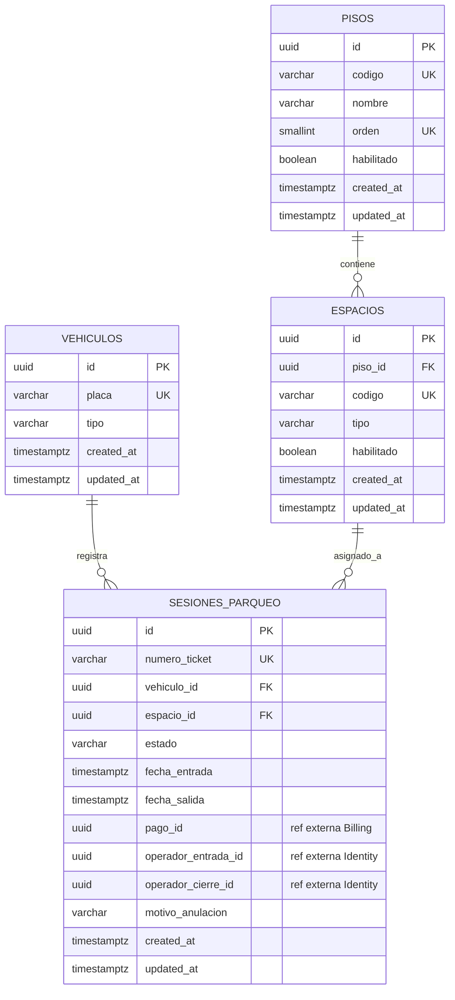
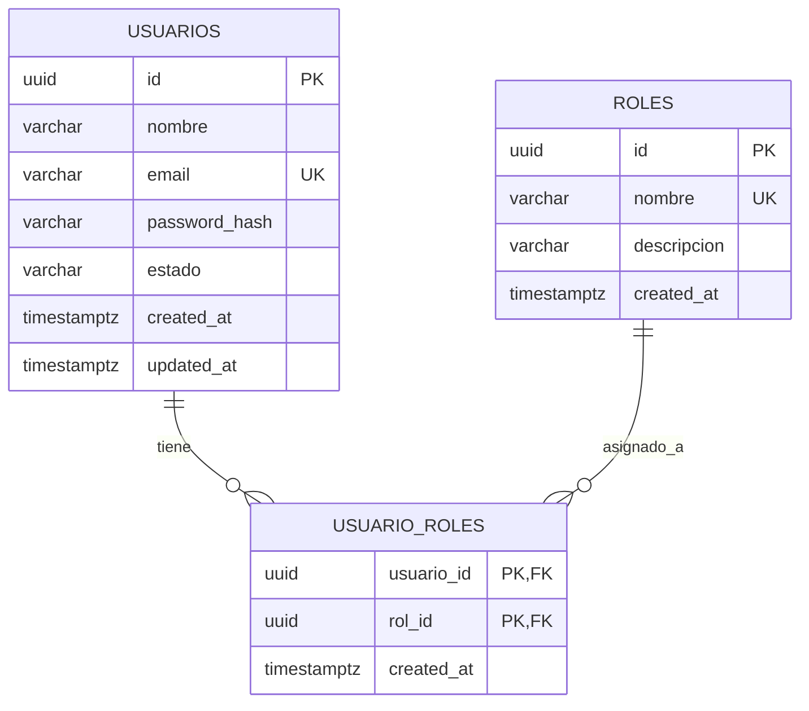
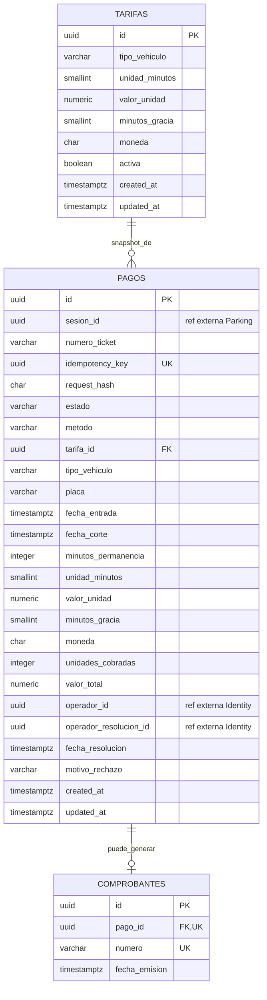

# ParkFlow — modelos de bases de datos

Este documento refleja las migraciones Flyway V1/V2. Una migración describe el esquema esperado; no prueba que se haya aplicado en un entorno. Las bases son independientes y no se crean FKs entre ellas.

## 1. Inventario

| Base | Tablas | Secuencias |
|---|---|---|
| `db_parking` | `pisos`, `espacios`, `vehiculos`, `sesiones_parqueo` | `seq_ticket` |
| `db_identity` | `usuarios`, `roles`, `usuario_roles` | — |
| `db_billing` | `tarifas`, `pagos`, `comprobantes` | `seq_comprobante` |

Las tablas son propiedad de sus respectivos dominios. Identificadores UUID hacia otro servicio son referencias por valor, sin FK.

## 2. `db_parking`

Cardinalidades: un piso contiene cero o más espacios; vehículo y espacio pueden aparecer en cero o más sesiones históricas. La unicidad parcial reduce a una sesión activa por vehículo y por espacio.

| Tabla | Columnas y tipos (todas las declaradas) | PK/FK y restricciones principales |
|---|---|---|
| `pisos` | `id uuid`, `codigo varchar(10)`, `nombre varchar(60)`, `orden smallint`, `habilitado boolean`, `created_at timestamptz`, `updated_at timestamptz` | PK `id`; UNIQUE `codigo`, `orden`; código/nombre no vacíos y recortados; `orden > 0`; habilitado no nulo, default true; UUID y timestamps tienen defaults |
| `espacios` | `id uuid`, `piso_id uuid`, `codigo varchar(10)`, `tipo varchar(20)`, `habilitado boolean`, `created_at timestamptz`, `updated_at timestamptz` | PK `id`; FK `piso_id → pisos.id ON DELETE RESTRICT`; UNIQUE global `codigo`; código no vacío/recortado; tipo `CARRO` o `MOTO`; índice `idx_espacios_piso`; parcial `idx_espacios_asignacion(piso_id,tipo,codigo) WHERE habilitado` |
| `vehiculos` | `id uuid`, `placa varchar(10)`, `tipo varchar(20)`, `created_at timestamptz`, `updated_at timestamptz` | PK `id`; UNIQUE `placa`; placa `^[A-Z0-9]{4,10}$`; tipo `CARRO` o `MOTO` |
| `sesiones_parqueo` | `id uuid`, `numero_ticket varchar(30)`, `vehiculo_id uuid`, `espacio_id uuid`, `estado varchar(20)`, `fecha_entrada timestamptz`, `fecha_salida timestamptz`, `pago_id uuid`, `operador_entrada_id uuid`, `operador_cierre_id uuid`, `motivo_anulacion varchar(200)`, `created_at timestamptz`, `updated_at timestamptz` | PK `id`; FKs locales `vehiculo_id`, `espacio_id` a sus tablas con RESTRICT; UNIQUE ticket; ticket `^PF-[0-9]{4}-[0-9]{6,}$`; estados ACTIVA/CERRADA/ANULADA; salida no anterior a entrada; CHECK de coherencia entre estado, fechas, pago, operador y motivo; `pago_id` no nulo es único; índices parciales únicos de sesión activa por vehículo y espacio; índices de historial por vehículo/fecha y por fecha de entrada |

Los campos obligatorios de cada tabla son NOT NULL en la migración; los campos listados como nullable son `fecha_salida`, `pago_id`, `operador_cierre_id` y `motivo_anulacion` en sesión. En sesiones, `estado` default ACTIVA, `fecha_entrada` y timestamps default `now()`; UUIDs default `gen_random_uuid()`.

### 2.1 Funciones, triggers y concurrencia

- `fn_sesion_validar_insert()` (BEFORE INSERT): bloquea espacio y piso con `FOR SHARE`, valida que el tipo de vehículo sea compatible con el espacio y, para sesión activa, que espacio y piso estén habilitados.
- `fn_sesion_inmutable()` (BEFORE UPDATE): las sesiones cerradas/anuladas son terminales; en sesión activa protege identidad, ticket, vehículo, espacio, entrada y operador de entrada.
- `fn_espacio_deshabilitar()` y `fn_piso_deshabilitar()` (BEFORE UPDATE de habilitación): impiden deshabilitar el recurso si tiene sesiones activas.
- `seq_ticket`: secuencia bigint. La migración no define función/trigger que construya el ticket `PF-...`.
- La sesión activa se deriva de `sesiones_parqueo`; no hay tabla de ocupación.

## 3. `db_identity`

| Tabla | Columnas y tipos (todas las declaradas) | PK/FK y restricciones principales |
|---|---|---|
| `usuarios` | `id uuid`, `nombre varchar(120)`, `email varchar(120)`, `password_hash varchar(255)`, `estado varchar(20)`, `created_at timestamptz`, `updated_at timestamptz` | PK `id`; índice único `uq_usuarios_email` sobre `lower(email)`; nombre/hash/correo no vacíos; email debe contener `@` después del primer carácter; estado ACTIVO/INACTIVO |
| `roles` | `id uuid`, `nombre varchar(30)`, `descripcion varchar(120)`, `created_at timestamptz` | PK `id`; UNIQUE `nombre`; nombre no vacío; descripción nullable |
| `usuario_roles` | `usuario_id uuid`, `rol_id uuid`, `created_at timestamptz` | PK compuesta `(usuario_id, rol_id)`; FKs a `usuarios` y `roles`, ambas ON DELETE RESTRICT; índice `idx_ur_rol(rol_id)` |

Los UUIDs y timestamps tienen defaults según V1; `estado` de usuario default ACTIVO. V1 inserta roles de referencia `ADMINISTRADOR` y `OPERADOR`. SQL no impone un algoritmo de hash de contraseña ni implementa autenticación.

## 4. `db_billing`

Cardinalidad `PAGOS`–`COMPROBANTES`: cada comprobante corresponde a exactamente un pago; un pago puede tener cero o un comprobante. Además, un pago aprobado debe tener comprobante al commit. La FK no exige comprobante para pagos pendientes/rechazados.

| Tabla | Columnas y tipos (todas las declaradas) | PK/FK y restricciones principales |
|---|---|---|
| `tarifas` | `id uuid`, `tipo_vehiculo varchar(20)`, `unidad_minutos smallint`, `valor_unidad numeric(12,2)`, `minutos_gracia smallint`, `moneda char(3)`, `activa boolean`, `created_at timestamptz`, `updated_at timestamptz` | PK `id`; tipo CARRO/MOTO; unidad > 0; valor y gracia >= 0; moneda `^[A-Z]{3}$`; índice único parcial `uq_tarifa_vigente(tipo_vehiculo) WHERE activa` |
| `pagos` | `id uuid`, `sesion_id uuid`, `numero_ticket varchar(30)`, `idempotency_key uuid`, `request_hash char(64)`, `estado varchar(20)`, `metodo varchar(20)`, `tarifa_id uuid`, `tipo_vehiculo varchar(20)`, `placa varchar(10)`, `fecha_entrada timestamptz`, `fecha_corte timestamptz`, `minutos_permanencia integer`, `unidad_minutos smallint`, `valor_unidad numeric(12,2)`, `minutos_gracia smallint`, `moneda char(3)`, `unidades_cobradas integer`, `valor_total numeric(12,2)`, `operador_id uuid`, `operador_resolucion_id uuid`, `fecha_resolucion timestamptz`, `motivo_rechazo varchar(200)`, `created_at timestamptz`, `updated_at timestamptz` | PK `id`; FK local `tarifa_id → tarifas.id ON DELETE RESTRICT`; UNIQUE idempotency key; hash hexadecimal de 64 caracteres; estados PENDIENTE/APROBADO/RECHAZADO; método nullable o EFECTIVO/TARJETA/SIN_COSTO; ticket `^PF-[0-9]{4}-[0-9]{6,}$`; placa mayúscula/dígitos; corte >= entrada; CHECK de minutos, unidad, valor, gracia, moneda, unidades, total y coherencia de estado; índice parcial único `uq_pago_sesion_vigente(sesion_id) WHERE estado IN ('PENDIENTE','APROBADO')`; índices por sesión y resolución |
| `comprobantes` | `id uuid`, `pago_id uuid`, `numero varchar(30)`, `fecha_emision timestamptz` | PK `id`; FK local `pago_id → pagos.id ON DELETE RESTRICT`; UNIQUE de pago y número; formato `^PF-CMP-[0-9]{4}-[0-9]{6,}$` |

`sesion_id`, `operador_id` y `operador_resolucion_id` son referencias externas sin FK. El resto de columnas indicadas como no nullable se declara NOT NULL; los campos opcionales de `pagos` incluyen método, operador de resolución, fecha de resolución y motivo. UUID y timestamps usan defaults descritos en V1; pago inicia PENDIENTE.

### 4.1 Reglas, funciones y secuencias

- Los checks verifican `minutos_permanencia = floor(epoch(fecha_corte - fecha_entrada)/60)`, `unidades_cobradas = ceil(greatest(0,minutos_permanencia-minutos_gracia)/unidad_minutos)` y `valor_total = unidades_cobradas * valor_unidad`.
- `fn_tarifa_inmutable()` protege tarifas referenciadas y permite desactivar una tarifa vigente; no permite reactivarla.
- `fn_pago_inmutable()` protege snapshot, clave/hash y transiciones: solo PENDIENTE puede resolverse como APROBADO o RECHAZADO; estados resueltos son terminales.
- `fn_comprobante_validar()` permite insertar comprobante solo para pago aprobado y hace inmutable el comprobante.
- `ctrg_pago_aprobado_con_comprobante` es constraint trigger diferido; al commit exige comprobante para todo pago aprobado.
- `seq_comprobante` es bigint; la migración no genera automáticamente el folio mediante función/trigger.
- El valor enum `TARJETA` no representa integración con proveedor de pagos.

## 5. Grants, migraciones y scripts

Cada dominio tiene `V1__create_initial_schema.sql` y `V2__grants.sql` bajo `parkflow-db/<servicio>/src/main/resources/db/migration/`. V2 solo otorga grants si el rol de aplicación correspondiente ya existe. Parking y Billing reciben uso de esquema, SELECT/INSERT/UPDATE en tablas y uso/lectura de secuencias; no DELETE. Identity recibe esos permisos y DELETE únicamente sobre `usuario_roles`.

El aprovisionamiento de roles y los scripts raíz `00_init_local.sql`, `01_db_parking.sql`, `02_db_billing.sql`, `03_db_identity.sql` son rutas de desarrollo/conveniencia. `run_local.sh` y `run_tests.sh` pueden borrar y recrear bases; no son migraciones seguras para entornos compartidos. Los datos de prueba están en `parkflow-db/<servicio>/src/main/resources/db/dev/`. No se ejecutaron scripts ni se verificó una base en esta actualización documental.

## 6. Referencias cruzadas conceptuales (no FK)

| Columna | Identificador referenciado | Propietario remoto | Restricción SQL cross-database |
|---|---|---|---|
| `sesiones_parqueo.pago_id` | `pagos.id` | Billing | Ninguna |
| `sesiones_parqueo.operador_entrada_id`, `operador_cierre_id` | `usuarios.id` | Identity | Ninguna |
| `pagos.sesion_id` | `sesiones_parqueo.id` | Parking | Ninguna |
| `pagos.operador_id`, `operador_resolucion_id` | `usuarios.id` | Identity | Ninguna |

La validación de existencia y consistencia de esas referencias depende de contratos entre servicios y lógica de aplicación que aún no está implementada.
