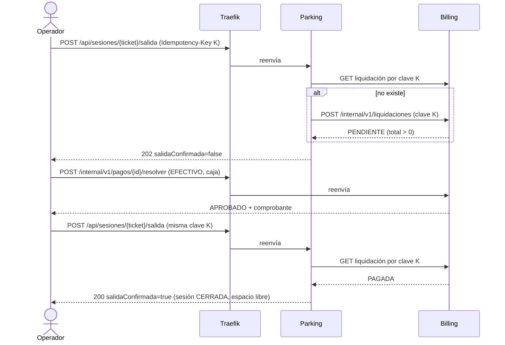
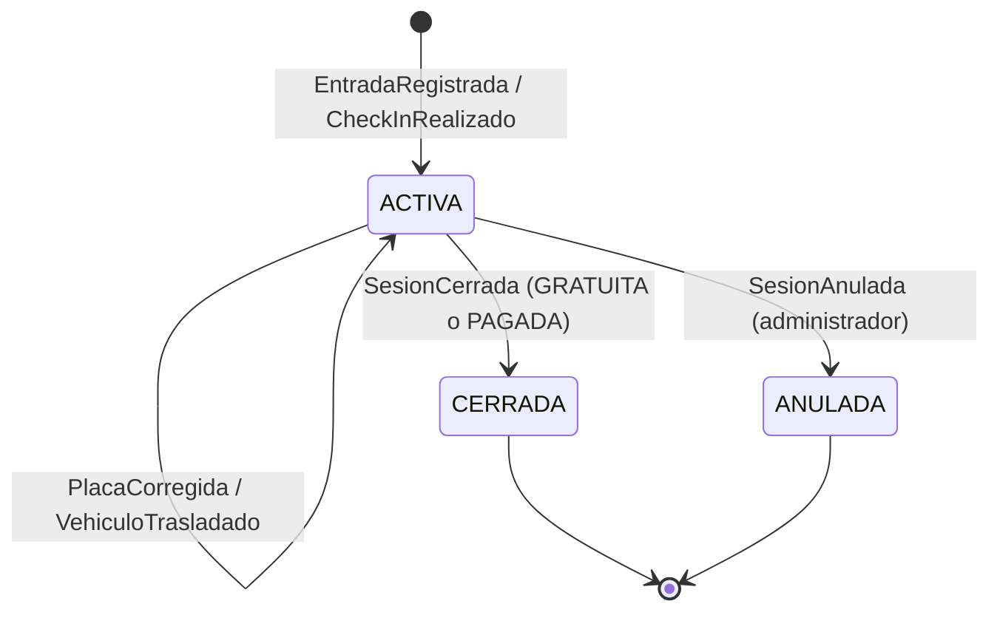
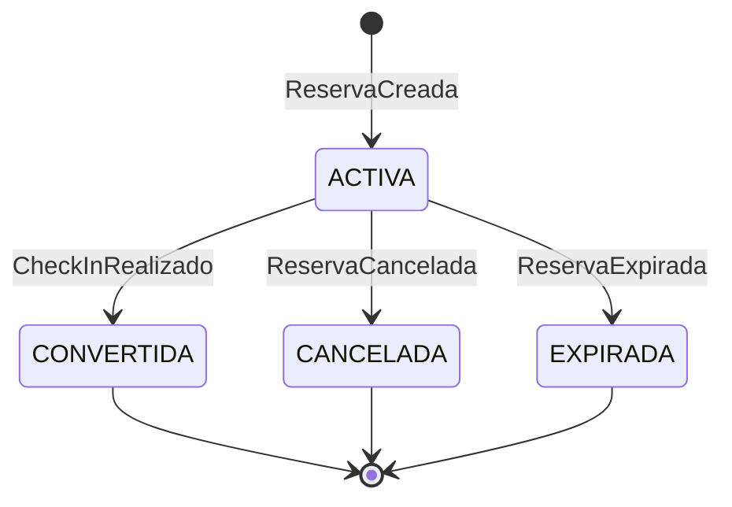
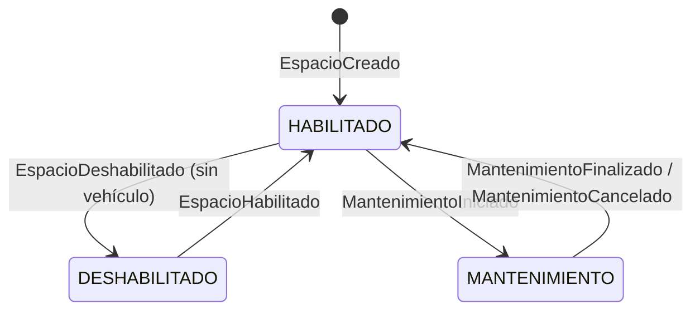
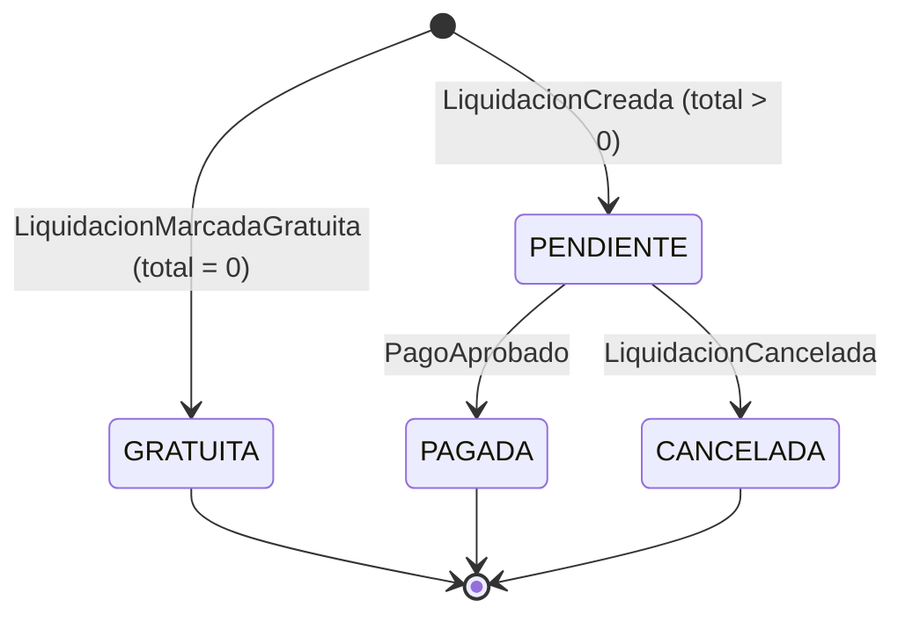
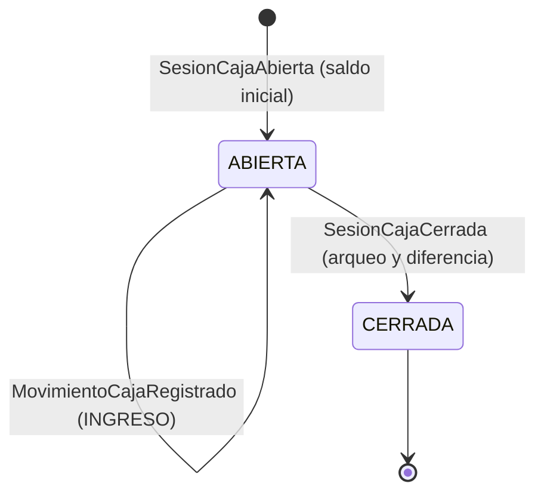
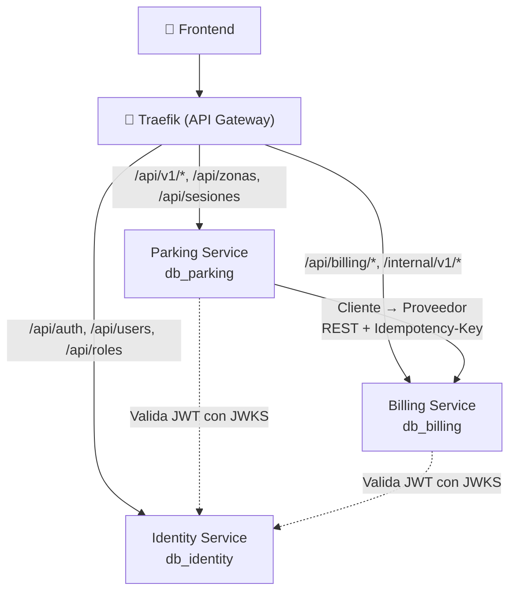

# ParkFlow — Event Storming de los microservicios

> **Fuente:** código de la rama `main` del repositorio `BACKEND_TECH` (3 microservicios Spring Boot + migraciones Flyway en `parkflow-db-definitivo`).
> **Alcance:** solo lo que el código implementa hoy. Lo que existe en las tablas pero no en el código aparece como *punto caliente* (sección 9).

## Contenido

1. [Leyenda](#1-leyenda)
2. [Actores y sistemas externos](#2-actores-y-sistemas-externos)
3. [Big picture: línea de tiempo del negocio](#3-big-picture-línea-de-tiempo-del-negocio)
4. [Identity Service](#4-identity-service--identidad-y-acceso)
5. [Parking Service](#5-parking-service--operación-del-parqueadero)
6. [Billing Service](#6-billing-service--facturación-y-caja)
7. [Políticas entre microservicios](#7-políticas-reacciones-cuando-x-entonces-y)
8. [Ciclos de vida de los agregados](#8-ciclos-de-vida-de-los-agregados)
9. [Puntos calientes](#9-puntos-calientes-hotspots)
10. [Mapa de contextos e integración](#10-mapa-de-contextos-e-integración)
11. [Trazabilidad: dónde queda guardado cada evento](#11-trazabilidad-dónde-queda-guardado-cada-evento)

---

## 1. Leyenda

| Nota | Elemento | Significado en ParkFlow |
|---|---|---|
| 🟧 | **Evento de dominio** | Algo que ya pasó, en pasado (`EntradaRegistrada`) |
| 🟦 | **Comando** | Una intención: lo que un actor pide (`RegistrarEntrada`) → un endpoint REST |
| 🟨 | **Actor** | Quién ejecuta el comando (rol del JWT) |
| 🟫 | **Agregado** | Entidad que valida el comando y protege sus reglas |
| 🟪 | **Política** | Reacción automática: *cuando* ocurre un evento, *entonces* se ejecuta un comando |
| 🟩 | **Modelo de lectura** | Consulta que el actor usa para decidir (`GET`) |
| 🩷 | **Sistema externo** | Otro microservicio o componente fuera del contexto |
| 🟥 | **Punto caliente** | Duda, regla sin definir o riesgo |

> En ParkFlow los eventos **no se publican en un broker** (no hay Kafka ni RabbitMQ). Cada evento es un cambio de estado que queda guardado en la base del microservicio dueño. La comunicación entre servicios es **REST síncrona con `Idempotency-Key`**.

---

## 2. Actores y sistemas externos

### 🟨 Actores

| Actor | Rol en el JWT | Qué puede hacer |
|---|---|---|
| **Administrador** | `ADMINISTRADOR` | Todo: usuarios, configuración del parqueadero, tarifas, cajas, mantenimiento, anulaciones y la operación diaria |
| **Operador** | `OPERADOR` | Operación diaria: entradas, salidas, traslados, reservas, cobros y su propia sesión de caja |
| **Primer usuario** | Sin token | Solo `register`, y solo con la base vacía: queda como administrador inicial |

### 🩷 Sistemas externos

| Sistema | Función |
|---|---|
| **Traefik** (API Gateway) | Única puerta de entrada (puerto 80). Enruta por prefijo de URL a cada microservicio |
| **Frontend** (React + nginx) | Interfaz web del operador y del administrador |
| **PostgreSQL** | Una base por microservicio: `db_identity`, `db_parking`, `db_billing` |
| **Reloj del negocio** | Zona horaria `America/Bogota` para tickets, bloques de hora y ciclos diarios |

---

## 3. Big picture: línea de tiempo del negocio

El recorrido principal de un vehículo, de izquierda a derecha. Cada caja naranja es un evento; el color de la columna indica el microservicio que lo produce.

```mermaid
flowchart LR
    subgraph ID["Identity"]
        E1["🟧 SesionIniciada<br/>(token JWT emitido)"]
    end
    subgraph PK1["Parking: preparación"]
        E2["🟧 ParqueaderoConfigurado"]
        E3["🟧 ReservaCreada"]
    end
    subgraph PK2["Parking: operación"]
        E4["🟧 EntradaRegistrada<br/>TiqueteEmitido"]
        E5["🟧 PlacaCorregida /<br/>VehiculoTrasladado"]
        E6["🟧 SalidaSolicitada"]
    end
    subgraph BL["Billing"]
        E7["🟧 LiquidacionCreada"]
        E8["🟧 PagoAprobado<br/>ComprobanteEmitido"]
    end
    subgraph PK3["Parking: cierre"]
        E9["🟧 SesionCerrada<br/>EspacioLiberado"]
    end
    subgraph BL2["Billing: fin de turno"]
        E10["🟧 SesionCajaCerrada"]
    end
    E1 --> E2 --> E3 --> E4 --> E5 --> E6 --> E7 --> E8 --> E9 --> E10
```

**Flujos alternos sobre la misma línea:**

- **Salida gratuita:** `SalidaSolicitada` → `LiquidacionMarcadaGratuita` (≤ 15 min) → `SesionCerrada`. No pasa por caja.
- **Reserva:** `ReservaCreada` → `CheckInRealizado` → `EntradaRegistrada`. También puede terminar en `ReservaCancelada` o `ReservaExpirada`.
- **Anulación:** `EntradaRegistrada` → `SesionAnulada` → `EspacioLiberado`, sin liquidación.
- **Mantenimiento:** `MantenimientoIniciado` bloquea el espacio hasta `MantenimientoFinalizado` o `MantenimientoCancelado`.

---

## 4. Identity Service — Identidad y acceso

**Responde a:** ¿quién es el usuario y qué puede hacer?
**Base:** `db_identity` · **Rutas:** `/api/auth`, `/api/users`, `/api/roles`, `/.well-known/jwks.json`
**Agregados:** 🟫 `Usuario`, 🟫 `Rol`

| 🟨 Actor | 🟦 Comando | Endpoint | 🟫 Agregado | 🟧 Evento | Reglas que se validan |
|---|---|---|---|---|---|
| Primer usuario | RegistrarAdministradorInicial | `POST /api/auth/register` | Usuario | `AdministradorInicialRegistrado` | Solo si no existe ningún usuario (bloqueo `identity_bootstrap_lock`); si no, 409 |
| Cualquiera | IniciarSesion | `POST /api/auth/login` | Usuario | `SesionIniciada` / `InicioSesionRechazado` | Usuario `ACTIVO` y clave BCrypt correcta; si no, 401 |
| Administrador | CrearUsuario | `POST /api/users` | Usuario | `UsuarioCreado`, `RolesAsignados` | Correo único (409); clave de 12+ caracteres |
| Administrador | ActualizarUsuario | `PUT /api/users/{id}` | Usuario | `UsuarioActualizado` | Correo único |
| Administrador | CambiarEstadoUsuario | `PATCH /api/users/{id}/status` | Usuario | `UsuarioActivado` / `UsuarioDesactivado` | Un usuario `INACTIVO` ya no puede iniciar sesión |
| Administrador | AsignarRoles | `PUT /api/users/{id}/roles` | Usuario, Rol | `RolesAsignados` | Los roles deben existir |

**🟩 Modelos de lectura:** perfil propio (`GET /api/auth/me`), lista de usuarios, lista de roles, llave pública **JWKS**.

**Token emitido:** JWT firmado con **RS256**, válido por **8 horas**. Incluye el id del usuario y sus roles. Parking y Billing lo validan con la JWKS, sin llamar a Identity en cada petición.

---

## 5. Parking Service — Operación del parqueadero

**Responde a:** ¿qué espacios existen y qué vehículo ocupa cada uno?
**Base:** `db_parking` · **Rutas:** `/api/v1/pisos`, `/api/zonas`, `/api/v1/espacios`, `/api/v1/parqueadero/configuracion`, `/api/sesiones`, `/api/v1/reservas`
**Agregados:** 🟫 `Piso`, 🟫 `Zona`, 🟫 `Espacio`, 🟫 `SesionParqueo`, 🟫 `Reserva`, 🟫 `Mantenimiento`

### 5.1 Configuración del parqueadero

| 🟨 Actor | 🟦 Comando | Endpoint | 🟫 Agregado | 🟧 Evento | Reglas que se validan |
|---|---|---|---|---|---|
| Administrador | ConfigurarParqueadero | `POST /api/v1/parqueadero/configuracion` | Piso, Zona, Espacio | `ParqueaderoConfigurado` (`PisoCreado`, `ZonaCreada`, `EspaciosGenerados`) | Código de piso y nivel únicos; genera códigos `PISO-ZONA-C01` y `PISO-ZONA-M01` de máximo 20 caracteres |
| Administrador | CrearPiso / ActualizarPiso | `POST`, `PUT /api/v1/pisos` | Piso | `PisoCreado` / `PisoActualizado` | Código y orden únicos |
| Administrador | HabilitarPiso | `PATCH /api/v1/pisos/{id}/habilitado` | Piso | `PisoHabilitado` / `PisoDeshabilitado` | — |
| Administrador | CrearZona / ActualizarZona | `POST`, `PUT /api/zonas` | Zona | `ZonaCreada` / `ZonaActualizada` | Código único dentro del piso |
| Administrador | HabilitarZona | `PATCH /api/zonas/{id}/habilitada` | Zona | `ZonaHabilitada` / `ZonaDeshabilitada` | — |
| Administrador | CrearEspacio / ActualizarEspacio | `POST`, `PUT /api/v1/espacios` | Espacio | `EspacioCreado` / `EspacioActualizado` | Código único; tipo `CARRO` o `MOTO` |
| Administrador | HabilitarEspacio | `PATCH /api/v1/espacios/{id}/habilitado` | Espacio | `EspacioHabilitado` / `EspacioDeshabilitado` | No se puede deshabilitar con un vehículo adentro ni durante un mantenimiento (409) |

### 5.2 Entrada, modificaciones y salida

| 🟨 Actor | 🟦 Comando | Endpoint | 🟫 Agregado | 🟧 Evento | Reglas que se validan |
|---|---|---|---|---|---|
| Operador / Admin | RegistrarEntrada | `POST /api/sesiones/entradas` + `Idempotency-Key` | SesionParqueo, Espacio | `EntradaRegistrada`, `TiqueteEmitido` (`PF-AAAA-NNNNNN`), `EspacioOcupado` | Espacio, zona y piso habilitados; espacio libre, sin mantenimiento y sin reserva vigente; tipo de vehículo = tipo de espacio; placa sin otra sesión activa; misma clave = mismo ticket |
| Operador / Admin | CorregirPlaca | `PUT /api/sesiones/{ticket}/placa` + `Idempotency-Key` | SesionParqueo | `PlacaCorregida` | Sesión `ACTIVA`; se conserva `placa_ingreso` y se audita el cambio |
| Operador / Admin | TrasladarVehiculo | `POST /api/sesiones/{ticket}/traslado` + `Idempotency-Key` | SesionParqueo, Espacio ×2 | `VehiculoTrasladado`, `EspacioLiberado` (origen), `EspacioOcupado` (destino) | Sesión `ACTIVA`; destino distinto del origen (400), del mismo tipo, habilitado, libre, sin mantenimiento ni reserva vigente (409); bloqueo de ambos espacios en orden fijo |
| Operador / Admin | SolicitarSalida | `POST /api/sesiones/{ticket}/salida` + `Idempotency-Key` | SesionParqueo | `SalidaSolicitada` → `SesionCerrada` + `EspacioLiberado` si la liquidación es `GRATUITA` o `PAGADA`; si es `PENDIENTE` responde 202 y no cierra | Llama a 🩷 Billing (sección 7); misma clave = misma liquidación |
| Administrador | AnularSesion | `POST /api/sesiones/{ticket}/anular` + `Idempotency-Key` | SesionParqueo | `SesionAnulada`, `EspacioLiberado` | Solo administrador (403); solo sesiones `ACTIVA`; segunda anulación → 409 |

### 5.3 Reservas

| 🟨 Actor | 🟦 Comando | Endpoint | 🟫 Agregado | 🟧 Evento | Reglas que se validan |
|---|---|---|---|---|---|
| Operador / Admin | CrearReserva | `POST /api/v1/reservas` + `Idempotency-Key` | Reserva, Espacio | `ReservaCreada` (`PF-RES-AAAA-NNNNNN`) | Fin en el futuro y mayor que el inicio (400); sin cruce de horario en el mismo espacio (409); una sola reserva activa por placa y sin sesión activa; espacio habilitado, sin mantenimiento y del mismo tipo; una reserva que empieza ya no puede ir en un espacio ocupado |
| Operador / Admin | HacerCheckIn | `POST /api/v1/reservas/{id}/check-in` + `Idempotency-Key` | Reserva, SesionParqueo | `CheckInRealizado` → `ReservaConvertida` + `EntradaRegistrada` | Reserva `ACTIVA` y no vencida; cancelada o expirada → 409 |
| Operador / Admin | CancelarReserva | `PATCH /api/v1/reservas/{id}/cancelar` | Reserva | `ReservaCancelada` | Solo reservas `ACTIVA` |
| (sistema) | — | — | Reserva | `ReservaExpirada` | Se marca al consultar o al intentar el check-in después de `fecha_fin` (no hay tarea programada) |

### 5.4 Mantenimiento de espacios

| 🟨 Actor | 🟦 Comando | Endpoint | 🟫 Agregado | 🟧 Evento | Reglas que se validan |
|---|---|---|---|---|---|
| Administrador | IniciarMantenimiento | `POST /api/v1/espacios/{id}/mantenimientos` | Mantenimiento, Espacio | `MantenimientoIniciado`, `EspacioBloqueado` | Espacio habilitado, sin vehículo y sin reserva vigente; un solo mantenimiento `EN_PROCESO` por espacio (índice único); motivo `DANO`, `LIMPIEZA`, `REPARACION`, `REVISION` u `OTRO` |
| Administrador | FinalizarMantenimiento | `POST .../mantenimientos/finalizar` | Mantenimiento, Espacio | `MantenimientoFinalizado`, `EspacioDesbloqueado` | Debe haber uno `EN_PROCESO` |
| Administrador | CancelarMantenimiento | `POST .../mantenimientos/cancelar` | Mantenimiento, Espacio | `MantenimientoCancelado`, `EspacioDesbloqueado` | Debe haber uno `EN_PROCESO` |

**🟩 Modelos de lectura:** disponibilidad de espacios (`ocupado`, `reservado`, `enMantenimiento`, `disponible`), vehículos activos, búsqueda por placa, sesión por ticket, reservas por estado, historial de mantenimientos.

---

## 6. Billing Service — Facturación y caja

**Responde a:** ¿cuánto se cobra, cómo se paga y cómo se registra el dinero?
**Base:** `db_billing` · **Rutas:** `/api/billing/*` (público) e `/internal/v1/*` (llamadas entre servicios)
**Agregados:** 🟫 `Tarifa`, 🟫 `Liquidacion`, 🟫 `Pago`, 🟫 `Comprobante`, 🟫 `Caja`, 🟫 `SesionCaja`

| 🟨 Actor | 🟦 Comando | Endpoint | 🟫 Agregado | 🟧 Evento | Reglas que se validan |
|---|---|---|---|---|---|
| Administrador | ReemplazarTarifaVigente | `PUT /api/billing/tarifas/vigentes/{tipo}/{concepto}` | Tarifa | `VigenciaTarifaCerrada`, `TarifaPublicada` | Una sola tarifa vigente por tipo y concepto; la anterior se conserva como historial |
| 🩷 Parking | CrearLiquidacion | `POST /internal/v1/liquidaciones` + `Idempotency-Key` | Liquidacion, Pago | `LiquidacionCreada` + `PagoPendienteCreado`, o `LiquidacionMarcadaGratuita` + `ComprobanteEmitido` (`SALIDA_GRATUITA`) | Misma clave con datos distintos → 409 (hash de la solicitud); corte no anterior a la entrada |
| Operador / Admin | CancelarLiquidacion | `POST /internal/v1/liquidaciones/{id}/cancelar` | Liquidacion, Pago | `LiquidacionCancelada`, `PagoRechazado` | Solo si está `PENDIENTE` |
| Administrador | CrearCaja | `POST /api/billing/cajas` | Caja | `CajaCreada` | Código único |
| Operador / Admin | AbrirSesionCaja | `POST /api/billing/cajas/sesiones` + `Idempotency-Key` | SesionCaja | `SesionCajaAbierta` | Misma clave con otros datos → 409 |
| Operador / Admin | AprobarPago | `POST /internal/v1/pagos/{id}/resolver` | Pago, Liquidacion, SesionCaja | `PagoAprobado`, `LiquidacionPagada`, `MovimientoCajaRegistrado` (INGRESO), `ComprobanteEmitido` (`PAGO_EFECTIVO`) | Caja `ABIERTA` y abierta por el mismo operador; un pago rechazado no se aprueba; un pago aprobado es inmutable |
| Operador / Admin | RechazarPago | `POST /internal/v1/pagos/{id}/rechazar` | Pago | `PagoRechazado` | Un pago aprobado no se rechaza (409) |
| Operador / Admin | CerrarSesionCaja | `POST /api/billing/cajas/sesiones/{id}/cerrar` | SesionCaja | `SesionCajaCerrada`, `ArqueoRegistrado` | Solo el operador que la abrió; calcula `diferencia = contado − esperado` |

### Cómo se calcula una liquidación

| Tiempo cobrable (permanencia − 15 min de gracia) | Resultado | Valor |
|---|---|---|
| 0 minutos | `GRATUITA` | $0 |
| 1 a 180 minutos | Cobro por horas | Tarifa `HORA` × bloques de hora en punto (hora de Bogotá) |
| Más de 180 minutos | Tarifa diaria | Tarifa `DIA` × ciclos diarios |

**🟩 Modelos de lectura:** tarifas vigentes, liquidación por id o por clave, pago, comprobante, cajas, sesión de caja con saldo esperado.

---

## 7. Políticas (reacciones "cuando X, entonces Y")

| 🟪 Política | Cuando… | …entonces | Dónde vive |
|---|---|---|---|
| **Liquidar al salir** | 🟧 `SalidaSolicitada` | 🟦 `CrearLiquidacion` en Billing con la misma `Idempotency-Key` | Parking → Billing (REST) |
| **Cerrar si no hay deuda** | 🟧 `LiquidacionMarcadaGratuita` o liquidación `PAGADA` | 🟦 `CerrarSesion` y liberar el espacio | Parking |
| **No salir sin pagar** | 🟧 `LiquidacionCreada` en estado `PENDIENTE` | La salida responde 202 y el espacio sigue ocupado | Parking |
| **Reintento seguro** | Se repite la salida con la misma clave | Billing devuelve la liquidación existente; no se crea otra | Parking + Billing |
| **Registrar el dinero** | 🟧 `PagoAprobado` | 🟦 `RegistrarMovimientoCaja` (INGRESO) + 🟦 `EmitirComprobante` + liquidación `PAGADA` | Billing |
| **Constancia de salida gratis** | 🟧 `LiquidacionMarcadaGratuita` | 🟦 `EmitirComprobante` (`SALIDA_GRATUITA`) | Billing |
| **Liberar al anular** | 🟧 `SesionAnulada` | El espacio vuelve a estar disponible | Parking |
| **Bloquear por mantenimiento** | 🟧 `MantenimientoIniciado` | Se rechazan entradas, reservas, check-in y traslados a ese espacio | Parking |
| **Proteger la reserva** | 🟧 `ReservaCreada` y su horario está vigente | Otro vehículo no puede entrar a ese espacio | Parking |
| **Reserva a sesión** | 🟧 `CheckInRealizado` | 🟦 `RegistrarEntrada` y reserva `CONVERTIDA` | Parking |
| **Vencer reserva** | Se consulta o se hace check-in después de `fecha_fin` | Reserva `EXPIRADA` | Parking |
| **Validar identidad** | Llega cualquier petición con token | Parking y Billing validan la firma con la JWKS de Identity | Todos |

### Secuencia de la salida con cobro (integración Parking → Billing)

---

## 8. Ciclos de vida de los agregados

### SesionParqueo (Parking)

### Reserva (Parking)

### Espacio y Mantenimiento (Parking)

### Liquidación y Pago (Billing)

| Pago | Transición |
|---|---|
| `PENDIENTE` → `APROBADO` | `PagoAprobado` (inmutable desde ese momento) |
| `PENDIENTE` → `RECHAZADO` | `PagoRechazado` (también cuando se cancela la liquidación) |

### Sesión de caja (Billing)

---

## 9. Puntos calientes (hotspots)

🟥 Reglas o funciones que existen en el diseño o en las tablas, pero que el código todavía no resuelve.

| # | Tema | Situación actual | Pregunta abierta |
|---|---|---|---|
| H1 | **Recargo nocturno** | El concepto `RECARGO_NOCTURNO` existe en tarifas, pero el cálculo no lo aplica | ¿Cómo se cobra una estadía que cruza las 22:00? ¿Una vez o por noche? |
| H2 | **Salidas excepcionales** | Tablas `solicitudes_salida_excepcional`, `salidas_excepcionales` y `autorizaciones_excepcionales` sin endpoints | ¿Quién autoriza, con qué vigencia y qué constancia se emite? |
| H3 | **Vehículos abandonados** | Tablas `casos_abandono`, `evidencias_abandono`, `retiros_vehiculo`, `cargos_abandono` sin endpoints | ¿Cuándo se declara abandono, qué se cobra y qué pasa si el dueño no aparece? |
| H4 | **Egresos y ajustes de caja** | `movimientos_caja` admite `EGRESO`, pero solo se registran ingresos por pago | ¿Qué retiros se permiten y quién los aprueba? |
| H5 | **Auditoría de seguridad** | La tabla `auditoria_seguridad` existe, pero Identity no escribe en ella | ¿Qué eventos de login y de cambios de usuario deben quedar auditados? |
| H6 | **Llamada remota dentro de la salida** | Parking mantiene la transacción y el bloqueo mientras llama a Billing | ¿Se debe separar en dos pasos o usar un patrón saga/outbox? |
| H7 | **Expiración de reservas** | Una reserva vence solo cuando alguien la consulta o intenta el check-in | ¿Hace falta una tarea programada que las venza a tiempo? |
| H8 | **Anulación con pago en curso** | Parking anula una sesión `ACTIVA` sin preguntar a Billing si ya hay un pago aprobado | ¿Debe Parking consultar a Billing antes de anular? |
| H9 | **Eventos sin publicar** | Los eventos solo quedan como filas en cada base; nadie más se entera | ¿Se necesitarán notificaciones o reportes que justifiquen un broker? |
| H10 | **Privacidad de placas** | Placas y sesiones se guardan sin límite de tiempo | ¿Cuál es el plazo de conservación y de anonimización? |

---

## 10. Mapa de contextos e integración

| Origen | Destino | Relación | Cómo se integran |
|---|---|---|---|
| Parking | Billing | **Cliente – Proveedor** | Parking pide la liquidación por REST con `Idempotency-Key` y solo cierra la sesión con un resultado `GRATUITA` o `PAGADA` |
| Parking, Billing | Identity | **Servicio de host abierto** | Identity publica la JWKS y un JWT estándar; los demás validan la firma localmente |
| Frontend | Los tres | **Conformista** | Consume los contratos REST tal como los publica cada servicio, a través de Traefik |
| Cada servicio | Su base | **Base de datos por servicio** | Ningún servicio lee la base de otro; cada uno tiene su propio usuario de PostgreSQL |

---

## 11. Trazabilidad: dónde queda guardado cada evento

| 🟧 Evento | Microservicio | Tabla | Cómo verificarlo |
|---|---|---|---|
| AdministradorInicialRegistrado, UsuarioCreado | Identity | `usuarios`, `usuario_roles` | `SELECT email, estado FROM usuarios;` |
| ParqueaderoConfigurado, EspacioCreado | Parking | `pisos`, `zonas`, `espacios` | `SELECT codigo, tipo_vehiculo, estado FROM espacios;` |
| EntradaRegistrada, SesionCerrada | Parking | `sesiones_parqueo` | `SELECT numero_tiquete, estado, tipo_cierre FROM sesiones_parqueo;` |
| PlacaCorregida, VehiculoTrasladado, SesionAnulada | Parking | `eventos_operativos` | `SELECT tipo_evento, datos_anteriores, datos_nuevos FROM eventos_operativos;` |
| VehiculoTrasladado | Parking | `traslados_espacio` | `SELECT * FROM traslados_espacio;` |
| SesionAnulada | Parking | `anulaciones_sesion` | `SELECT motivo FROM anulaciones_sesion;` |
| ReservaCreada, CheckInRealizado, ReservaCancelada | Parking | `reservas` | `SELECT codigo_reserva, estado FROM reservas;` |
| MantenimientoIniciado, MantenimientoFinalizado | Parking | `mantenimientos_espacio` | `SELECT motivo, estado FROM mantenimientos_espacio;` |
| TarifaPublicada | Billing | `tarifas` | `SELECT tipo_vehiculo, concepto, valor FROM tarifas;` |
| LiquidacionCreada, LiquidacionPagada | Billing | `liquidaciones`, `detalles_liquidacion` | `SELECT numero_tiquete, total, estado FROM liquidaciones;` |
| PagoAprobado, PagoRechazado | Billing | `pagos` | `SELECT estado, monto, metodo FROM pagos;` |
| MovimientoCajaRegistrado | Billing | `movimientos_caja` | `SELECT tipo_movimiento, concepto, monto FROM movimientos_caja;` |
| ComprobanteEmitido | Billing | `comprobantes` | `SELECT numero, tipo FROM comprobantes;` |
| SesionCajaAbierta, SesionCajaCerrada | Billing | `sesiones_caja` | `SELECT estado, saldo_esperado, diferencia FROM sesiones_caja;` |