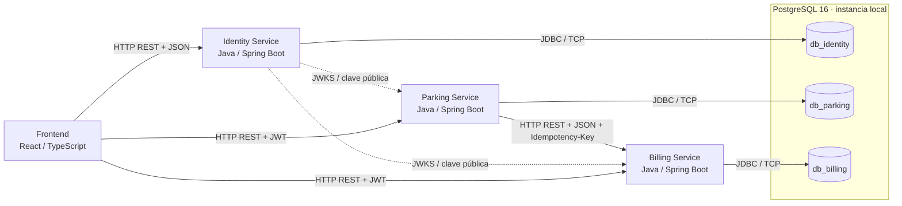

# ParkFlow — Informe técnico del proyecto

**Arquitectura de microservicios, persistencia y estado de implementación**

**Equipo:** Sebastián Santos · Sebastián Urbano · Samuel Grajales
**Fecha:** noviembre de 2026

Esta versión Markdown presenta el contenido técnico del informe para lectura directa en GitHub. No requiere descargar el documento Word.

## Arquitectura en una vista

Las bases no se conectan directamente entre sí. Cada servicio accede a su propia base; los intercambios entre dominios ocurren mediante APIs.

---

## 01  /  RESUMEN

### Descripción del proyecto

Propósito, contexto funcional y alcance de esta revisión técnica.

ParkFlow es un sistema web para gestionar la operación de un parqueadero. El personal administra la configuración física del establecimiento, registra ingresos, controla la caja y realiza liquidaciones y salidas. La solución separa autenticación, operación de estacionamiento y facturación en tres microservicios.

#### Objetivo

Describir cómo se organizan los componentes de software y sus datos, cómo colaboran los servicios sin acceder a las bases de otros dominios, cómo se aplica el flujo de cobro en efectivo y qué funcionalidades y limitaciones existen en la versión revisada.

#### Alcance

- Frontend web para administradores y operadores.
- Servicios Identity, Parking y Billing, cada uno con responsabilidad funcional y persistencia propias.
- Tres bases PostgreSQL lógicas, migraciones Flyway y despliegue local con Docker Compose.
- Análisis de reglas comerciales, seguridad, integridad, operación y pendientes de implementación.

#### Resumen de tecnologías

| Capa | Tecnología / versión |
| --- | --- |
| Interfaz | React, TypeScript y Vite |
| Servicios | Java 21 y Spring Boot 3.5.14 |
| Persistencia | PostgreSQL 16; Flyway para versionar el esquema |
| Entorno de desarrollo | Docker Compose; cinco contenedores en el stack local activo |

> **Estado**
> El sistema ofrece un flujo local funcional de autenticación, configuración del parqueadero, entrada, liquidación, pago en efectivo, comprobante y cierre de salida. El alcance no equivale a un despliegue de producción.

## 02  /  ARQUITECTURA

### Servicios y propiedad de los datos

Cada microservicio controla la información de su propio dominio.

| Componente | Responsabilidad | Datos / salida principal |
| --- | --- | --- |
| Frontend | Interfaz para operación, consulta y configuración. | Solicitudes HTTP a las APIs; token de acceso en llamadas protegidas. |
| Identity Service | Usuarios, roles, autenticación y autorización. | db_identity; JWT RS256 y endpoint JWKS público. |
| Parking Service | Pisos, zonas, espacios, reservas y sesiones. | db_parking; coordina la solicitud de liquidación con Billing. |
| Billing Service | Tarifas, liquidaciones, pagos, cajas y comprobantes. | db_billing; devuelve el resultado de la liquidación y el pago. |
| PostgreSQL | Motor relacional de persistencia. | Una instancia local contiene las tres bases lógicas separadas. |

#### Topología del entorno local

| Origen | Destino / puerto host | Conexión interna y propietario de datos |
| --- | --- | --- |
| Navegador | Frontend · 5173 | Interfaz React servida por contenedor web. |
| Navegador | Identity · 8081 | HTTP; identidad usa db_identity. |
| Navegador | Parking · 8080 | HTTP; Parking usa db_parking. |
| Navegador | Billing · 8083 | HTTP; Billing usa db_billing. |
| Servicios | PostgreSQL · 55433 host / 5432 contenedor | JDBC/TCP dentro de la red Docker; cada servicio usa su base propia. |

> **Límite arquitectónico**
> El diseño no crea claves foráneas entre db_identity, db_parking y db_billing. Las referencias a UUID de otro dominio se coordinan mediante APIs y contratos; dentro de cada base sí se usan relaciones y restricciones locales. Cada servicio usa roles propios de aplicación y migración.

El stack local activo no incluye un API Gateway. El navegador accede a las URLs configuradas para cada servicio. Existe una composición alternativa con Traefik; ambas topologías no deben considerarse simultáneamente activas.

## 03  /  COMUNICACIÓN

### Intercambio entre microservicios

Las bases no se invocan: los servicios envían solicitudes HTTP REST con JSON.

| Trayecto | Mensaje / validación | Resultado |
| --- | --- | --- |
| Frontend → Identity | Credenciales para iniciar sesión. | Identity consulta db_identity y devuelve un JWT firmado. |
| Frontend → Parking | JSON operativo y Authorization: Bearer JWT. | Parking valida el token y opera sobre db_parking. |
| Parking → Billing | JSON con snapshot de sesión y clave Idempotency-Key. | Billing calcula y persiste la liquidación en db_billing. |
| Servicios → Identity/JWKS | Consulta de clave pública. | Parking y Billing verifican la firma del JWT sin acceder a db_identity. |

#### Información temporal y persistente

| Elemento | Mientras se procesa | Persistencia |
| --- | --- | --- |
| Solicitud / respuesta JSON | Memoria de los procesos y buffers de red durante la llamada. | No hay una cola común ni una base intermedia en el flujo normal. |
| Datos de la sesión | Parking crea un snapshot local para continuar después de la petición HTTP. | La sesión, el tiquete y el estado de ocupación se guardan en db_parking. |
| Liquidación y pago | Billing prepara los cambios dentro de su transacción local. | Liquidación, pago, movimiento y comprobante se guardan en db_billing. |
| Clave idempotente | Se envía con la operación para identificar un reintento. | Queda asociada a los registros relevantes y evita crear operaciones duplicadas. |

#### Seguridad y recuperación

Identity firma tokens JWT con RS256 y publica la clave pública mediante JWKS. Los servicios validan firma, emisor, audiencia y permisos. La clave idempotente permite consultar o repetir una solicitud cuando se pierde una respuesta; no es una copia del mensaje ni un mecanismo de almacenamiento temporal.

> **Consistencia**
> No existe una transacción PostgreSQL distribuida. Cada servicio confirma sus propias transacciones. Si se pierde la respuesta final, el estado puede quedar temporalmente pendiente de coordinación; el flujo recuperable reintenta con la misma clave y evita registrar un segundo pago.

## 04  /  BASE DB_IDENTITY

### Inventario de Identity

Esquema administrado exclusivamente por Identity Service.

| Tabla | Propósito |
| --- | --- |
| usuarios | Cuentas de acceso, estado y hash de contraseña. |
| roles | Roles disponibles para autorizar operaciones. |
| usuario_roles | Relación entre usuarios y roles. |
| identity_bootstrap_lock | Control concurrente para crear al primer administrador. |
| autorizaciones_excepcionales | Modelo para autorizar operaciones excepcionales de un solo uso. |
| autorizaciones_cargo_abandono | Autorizaciones administrativas vinculadas a cargos de abandono. |
| auditoria_seguridad | Eventos relevantes de identidad, acceso y seguridad. |

#### Migraciones y controles

- Flyway Identity V1–V3 crean el esquema, invariantes, índices, permisos y datos de referencia.
- El correo tiene unicidad sin distinguir mayúsculas; la relación usuario–rol es local a esta base.
- La contraseña se conserva como hash BCrypt; no se almacena en texto plano ni se comparte con Parking o Billing.
- Identity entrega la clave pública por JWKS; las otras aplicaciones validan el token mediante esa clave.
> **Alcance actual**
> El alta inicial de administrador, inicio de sesión, gestión de usuarios/roles y emisión/verificación de JWT forman parte del servicio. El consumo integrado de autorizaciones excepcionales y cargos por abandono sigue pendiente.

## 05  /  BASE DB_PARKING

### Inventario de Parking

Esquema operacional para la estructura física y la permanencia de vehículos.

| Grupo funcional | Tablas y propósito |
| --- | --- |
| Estructura | pisos: niveles; zonas: agrupación por piso; espacios: espacios físicos, tipo y estado. |
| Operación | sesiones_parqueo: ingreso, tiquete, vehículo y ocupación; eventos_operativos: registro de cambios; traslados_espacio: historial de cambios de espacio. |
| Anulaciones | anulaciones_sesion: motivo, administrador y clave idempotente para una sesión anulada. |
| Reservas y mantenimiento | reservas: ventana de reserva y vehículo; mantenimientos_espacio: motivo, estado y fechas de indisponibilidad. |
| Salidas excepcionales | solicitudes_salida_excepcional: solicitud y motivo; salidas_excepcionales: autorización y evidencia del cierre excepcional. |
| Abandono y retiro | casos_abandono: expediente; contactos_autoridad: gestiones; evidencias_abandono: evidencias; retiros_vehiculo: retiro físico. |

#### Restricciones e integridad local

- Las tablas de pisos, zonas y espacios se relacionan dentro de db_parking.
- Índices únicos parciales impiden que una placa o un espacio tenga más de una sesión activa y limitan reservas o mantenimientos activos duplicados.
- La migración V5 acepta niveles inferiores hasta -5. Sin embargo, el esquema/API todavía admiten valores positivos; si la regla final es exclusivamente 0 a -5, falta imponer el máximo 0 también en el backend y en la base.
- Flyway Parking V1–V6 incorporan el esquema, invariantes, permisos, idempotencia de entrada, niveles de sótano y reservas.
> **Decisión de propiedad**
> Parking no conserva un catálogo permanente de vehículos ni un registro de clientes. La sesión almacena la información operativa necesaria para una estadía.

## 06  /  BASE DB_BILLING

### Inventario de Billing

Esquema responsable de precios, dinero recibido y trazabilidad financiera.

| Grupo funcional | Tablas y propósito |
| --- | --- |
| Configuración de cobro | parametros_facturacion: parámetros de cálculo; tarifas: valores vigentes e historial de tarifas. |
| Liquidación | liquidaciones: snapshot de sesión, tiempos, valores y estado; detalles_liquidacion: conceptos y tarifas usados. |
| Pagos | pagos: pago pendiente/aprobado/rechazado; comprobantes: constancia asociada al pago o salida gratuita. |
| Caja | cajas: puntos de recaudo; sesiones_caja: turnos y arqueos; movimientos_caja: ingresos y ajustes trazables. |
| Abandono | cargos_abandono: cargo autorizado; eventos_cargo_abandono: cambios y autorizaciones del cargo. |
| Anulaciones | anulaciones_liquidacion: evidencia administrativa de una anulación permitida. |

#### Reglas de integridad financiera

- Índices únicos parciales mantienen una sola tarifa vigente por tipo y concepto y conservan el historial tarifario.
- Una sesión no puede tener dos liquidaciones pendientes simultáneas; se limita el pago pendiente o aprobado por liquidación.
- Los estados, importes y tipos de operación se protegen mediante restricciones locales e invariantes de PostgreSQL.
- Billing confirma pago aprobado, movimiento de caja y comprobante dentro de una transacción local para que los registros financieros queden consistentes.
- Los pagos aprobados son terminales: no se modifican ni se devuelven. Una liquidación pendiente puede cancelarse conservando la sesión y el espacio en Parking.
> **Historial**
> Al actualizar una tarifa se conserva su versión histórica; las liquidaciones guardan el valor aplicado como snapshot y no dependen de que la tarifa continúe vigente.

## 07  /  REGLAS COMERCIALES

### Cálculo y operación del parqueadero

Las reglas de negocio se calculan en Java; PostgreSQL conserva estados, valores y restricciones de integridad.

| Regla | Carro | Moto |
| --- | --- | --- |
| Horario regular | 08:00–22:00 | 08:00–22:00 |
| Gracia inicial | 15 minutos | 15 minutos |
| Hora o fracción | $6.000 por bloque | $3.500 por bloque |
| Tarifa diaria por ciclo | $18.000 | $10.000 |
| Recargo posterior al cierre definido | $15.000 | $8.000 |

#### Umbral de tarifa diaria

Los primeros 15 minutos son gratuitos. Después se cuenta el tiempo facturable. Hasta 180 minutos facturables se cobra hora o fracción; por ejemplo, 1 h 10 min facturables equivalen a dos horas. Cuando el tiempo facturable supera 180 minutos, se aplica la tarifa diaria en reemplazo del cálculo por horas; las dos tarifas no se acumulan. El ciclo diario comienza a las 08:00 y cada ciclo diario aplicado se cobra completo, sin prorrateo.

| Permanencia total | Tiempo facturable | Regla aplicada |
| --- | --- | --- |
| 3 h 00 min | 2 h 45 min | Por horas |
| 3 h 15 min | 3 h 00 min | Por horas; umbral exacto |
| 3 h 16 min | 3 h 01 min | Tarifa diaria; reemplaza horas |
| 4 h 00 min | 3 h 45 min | Tarifa diaria; reemplaza horas |

#### Otras reglas de operación

- Solo CARRO y MOTO; asignación de espacios manual.
- Únicamente se acepta efectivo y no hay pagos parciales.
- No se registra información de clientes ni catálogo permanente de vehículos de trabajadores.
- La caja puede cerrarse aunque queden vehículos dentro del parqueadero.
- La liquidación solo se solicita cuando el cliente pide salir. La salida excepcional requiere autorización administrativa.
- Si se pierde el tiquete, se localiza la sesión por placa y se solicita la tarjeta de propiedad para verificar el vehículo.
> **Regla aún no activada**
> Los importes del recargo posterior a las 22:00 están definidos, pero la frecuencia y el criterio de aplicación siguen pendientes. El parámetro local se verificó deshabilitado; no debe presentarse como un cobro automático ya operativo.

## 08  /  FLUJOS

### Ingreso, liquidación, pago y cierre

Descripción del ciclo normal y de dos escenarios importantes para la integridad.

| Etapa | Servicio | Resultado persistido |
| --- | --- | --- |
| Autenticación | Identity | Usuario validado y token JWT firmado entregado al navegador. |
| Ingreso | Parking | Sesión activa, tiquete y espacio ocupado en db_parking. |
| Solicitud de salida | Parking → Billing | Petición idempotente de liquidación; Parking espera sin mantener abierta una transacción de base durante el HTTP. |
| Liquidación | Billing | Cálculo en Java, detalle y pago pendiente en db_billing. |
| Recepción de efectivo | Billing | Pago aprobado, liquidación pagada, movimiento de caja y comprobante en transacción local. |
| Confirmación de salida | Parking | Cierre de la sesión y liberación del espacio tras confirmar el resultado financiero. |

#### Liquidación pendiente cancelada

Cancelar una liquidación pendiente no cierra la sesión, no registra dinero recibido y no libera el espacio. El vehículo permanece estacionado y puede solicitarse una nueva liquidación posteriormente.

#### Cierre de caja con vehículos dentro

La sesión de caja pertenece a Billing; la permanencia y ocupación pertenecen a Parking. Por esa separación, cerrar el turno de caja no exige que el estacionamiento esté vacío y no cierra las sesiones activas.

#### Reintentos y pagos

La clave idempotente identifica una operación ya solicitada. Si se pierde la respuesta después de aprobar el pago, Parking puede consultar/reintentar la misma operación para completar su cierre sin generar otro cobro. Como no existe transacción distribuida, la consistencia entre servicios se logra por estados, contratos, idempotencia y recuperación.

> **Salida gratuita**
> Dentro de la gracia, Billing puede registrar una liquidación gratuita con constancia operativa; no se crea un pago de cero ni movimiento de efectivo. La sesión se cierra como gratuita, separada de una salida pagada o excepcional.

## 09  /  IMPLEMENTACIÓN

### Funcionalidades disponibles y alcance pendiente

La existencia de una tabla o endpoint no implica que todo el flujo esté disponible desde la interfaz.

| Área | Estado verificado | Límite / pendiente |
| --- | --- | --- |
| Identity | Alta inicial, login, JWT/JWKS, usuarios y roles. | Integración completa de autorizaciones excepcionales y de abandono. |
| Configuración | CRUD operativo de pisos, zonas y espacios; restauración/habilitación. | Validar el límite superior de niveles 0 a -5 también en API y SQL. |
| Parking normal | Entradas, búsquedas por placa, sesiones y salida coordinada con Billing. | Coordinación de anulación con liquidaciones pendientes. |
| Billing y caja | Tarifas, liquidaciones, efectivo, movimientos, caja y comprobantes. | Recargo nocturno deshabilitado; retiros/ajustes avanzados pendientes. |
| Reservas | API y vista para crear, consultar, convertir a ingreso y cancelar. | Ampliar pruebas de concurrencia y casos de recuperación. |
| Mantenimiento | Endpoints para iniciar, consultar, finalizar y cancelar. | Falta interfaz; falta identificar al actor que finaliza/cancela. |
| Traslados | Backend valida origen/destino y registra historial. | Falta interfaz y pruebas específicas del flujo. |
| Anulación de sesión | Backend restringe a administrador y registra motivo/idempotencia. | Falta interfaz; verificar liquidación pendiente antes de anular. |
| Abandono / salida excepcional | Estructura de datos y parte del modelo de autorización. | Integración operativa completa entre Identity, Parking y Billing pendiente. |

> **Riesgo de coordinación**
> La anulación de una sesión activa en Parking no consulta actualmente Billing para comprobar si existe una liquidación pendiente. En ese escenario podría quedar una liquidación sin sesión activa asociada al flujo operativo; debe bloquearse o cancelarse de forma coordinada antes de habilitar el proceso completo.

## 10  /  ENTORNO Y VALIDACIÓN

### Ejecución local y pruebas registradas

Resultados reportados para el entorno de desarrollo; no constituyen certificación de producción.

| Elemento | Configuración local |
| --- | --- |
| Frontend | Contenedor web; puerto host 5173. |
| Identity Service | Puerto 8081; conexión exclusiva con db_identity. |
| Parking Service | Puerto 8080; conexión exclusiva con db_parking. |
| Billing Service | Puerto 8083; conexión exclusiva con db_billing. |
| PostgreSQL | Versión 16.15 en el entorno revisado; puerto host 55433, puerto de contenedor 5432. |
| Persistencia | Volumen Docker parkflow_pg16_data para datos PostgreSQL. |

#### Migraciones

| Base | Servicio | Flyway |
| --- | --- | --- |
| db_identity | Identity | V1–V3 |
| db_parking | Parking | V1–V6 |
| db_billing | Billing | V1–V4 |

#### Verificaciones registradas

- El 26 de noviembre de 2026, cinco contenedores del stack local se reportaron activos; PostgreSQL estaba saludable y los servicios/frontend/JWKS devolvieron HTTP 200.
- Parking validó Flyway V1–V6 y no informó migraciones pendientes en esa ejecución.
- En una suite posterior del backend Parking se reportaron 42 pruebas, cero fallos y una omitida. La prueba no cubre por sí sola todos los nuevos flujos administrativos.
- En una ejecución de suites Testcontainers se reportaron Identity 27, Parking 36 y Billing 27 pruebas, sin fallos ni errores y una omitida por servicio. Una revisión posterior de Parking tras integrar el Paquete A reportó 42 pruebas, cero fallos y una omitida.
- La compilación de producción del frontend pasó. Una validación de integración previa confirmó entrada, liquidación, pago en efectivo, movimiento, comprobante, cierre y reintento idempotente sin duplicar el cobro.
- También se verificó cerrar una caja mientras quedaba un vehículo en Parking y cancelar una liquidación pendiente conservando activa la sesión y el espacio.
> **Alcance de la evidencia**
> Las verificaciones corresponden a un entorno local/temporal. Se requieren más pruebas de concurrencia, caídas de red, reintentos simultáneos, reconciliación y flujos administrativos antes de considerar un despliegue de producción.

## 11  /  CONCLUSIONES

### Riesgos y trabajo siguiente

El diseño separa los dominios y conserva integridad local; algunos flujos aún necesitan cierre funcional.

#### Pendientes prioritarios

| Prioridad | Trabajo requerido |
| --- | --- |
| Alta | Impedir que la anulación de Parking deje una liquidación pendiente en Billing; definir el contrato coordinado. |
| Alta | Completar autorizaciones de un solo uso y los flujos de salida excepcional entre los servicios. |
| Alta | Completar expediente de abandono/retiro, política del cargo y validaciones de entrega sin automatizar deudas o pagos no aprobados. |
| Media | Agregar UI para mantenimiento, traslados y anulaciones; guardar actor de cierre en mantenimiento. |
| Media | Aplicar en API y PostgreSQL el intervalo de pisos exigido por el producto: niveles 0, -1, -2, -3, -4 y -5. |
| Media | Definir cuándo y cuántas veces se cobra el recargo posterior a las 22:00 y activar la regla solo después de aprobarla. |
| Media | Completar pruebas de concurrencia, red, reintentos, auditoría, ajustes de caja y recuperación. |
| Operación | Alinear la composición Compose predeterminada con la topología documentada y definir observabilidad, secretos y respaldos para despliegues compartidos. |

#### Conclusión

ParkFlow presenta una arquitectura de microservicios con límites de datos explícitos: Identity, Parking y Billing son propietarios de sus bases PostgreSQL lógicas y cooperan mediante APIs HTTP. No se requieren bases no relacionales para cumplir esa separación. El flujo central de ingreso, liquidación y pago mantiene la integridad financiera local en Billing y la operación del espacio en Parking; idempotencia y reintentos permiten recuperar respuestas perdidas sin duplicar el cobro.

La versión revisada ofrece un entorno local funcional y evidencia de pruebas, pero no debe describirse como terminada para producción. La interfaz y la integración de algunos flujos administrativos, la coordinación de anulaciones y liquidaciones, el recargo nocturno y la gestión completa del abandono son áreas explícitas de trabajo futuro.

#### Fuentes técnicas revisadas

Código de los servicios Java y del frontend React; migraciones Flyway de Identity, Parking y Billing; configuración Docker Compose; documentación de arquitectura, comunicación entre servicios, integridad de datos, reglas de negocio y estado de implementación.

---

*Esta versión Markdown reproduce el contenido técnico y agrega un diagrama que GitHub puede visualizar directamente. Se omitieron las capturas de terminal para mantener el informe legible en el navegador.*
