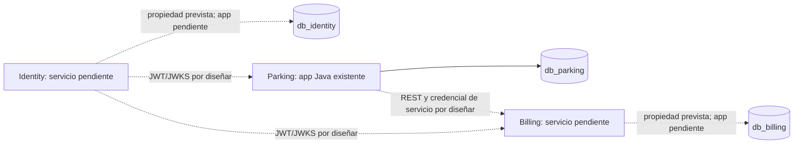

# Catálogo de microservicios ParkFlow

Referencia del estado observado en el repositorio. Un puerto o contrato no se considera existente por aparecer en documentación de diseño.

## 1. Resumen

| Servicio | Puerto | Tecnología observada | Base propia | Estado |
|---|---|---|---|---|
| Parking | `PORT`, predeterminado `8080` en configuración | Java 21, Spring Boot 3.5.14, Maven, JPA, PostgreSQL, Flyway | `db_parking` | Aplicación ejecutable; salud, pisos y espacios |
| Identity | No configurado | Sin aplicación Java localizada | `db_identity` (definida por migraciones) | SQL; servicio pendiente |
| Billing | No configurado | Sin aplicación Java localizada | `db_billing` (definida por migraciones) | SQL; servicio pendiente |

El frontend heredado no forma parte del backend ParkFlow integrado y no se documenta un puerto suyo como parte de esta arquitectura.

## 2. Parking Service

- **Ubicación:** `services/parking-service/`.
- **Responsabilidad:** administrar configuración física del parqueadero; la responsabilidad prevista también cubre vehículos y sesiones, aún pendientes.
- **Tablas propietarias previstas:** `pisos`, `espacios`, `vehiculos`, `sesiones_parqueo`. Java actualmente modela `pisos` y `espacios`.
- **Rutas implementadas:** `GET /api/v1/health`; CRUD parcial de `/api/v1/pisos` y `/api/v1/espacios` (POST, GET colección, GET/PUT por id, PATCH `/{id}/habilitado`; el listado de espacios admite `pisoId`). Detalle de métodos en [`ARCHITECTURE_AND_DATA_MODEL.md`](ARCHITECTURE_AND_DATA_MODEL.md#21-parking-service).
- **Rutas pendientes:** vehículos, entradas/salidas, sesiones/tickets y comunicación de liquidación. No hay rutas HTTP de Billing/Identity confirmadas.
- **Dependencias:** Spring Web, Data JPA, Validation, PostgreSQL, Flyway. No se encontró Spring Security.
- **Comunicación:** no se localizaron clientes HTTP ni autenticación JWT.
- **Configuración DB:** variables `PARKING_DB_*`; PostgreSQL predeterminado de desarrollo en localhost. No se reproducen valores de credenciales.

## 3. Identity Service

- **Responsabilidad prevista:** usuarios, roles, autenticación, emisión de tokens y política de autorización.
- **Base/tablas SQL:** `db_identity`: `usuarios`, `roles`, `usuario_roles`.
- **Puerto, dependencias, endpoints y comunicación:** no configurados/implementados en Java.
- **Estado:** V1/V2 SQL presentes; servicio ejecutable, login, JWT y JWKS pendientes.

## 4. Billing Service

- **Responsabilidad prevista:** tarifas, snapshots de liquidación, pagos idempotentes y comprobantes.
- **Base/tablas SQL:** `db_billing`: `tarifas`, `pagos`, `comprobantes`.
- **Puerto, dependencias, endpoints y comunicación:** no configurados/implementados en Java.
- **Estado:** V1/V2 SQL presentes; servicio ejecutable y contrato con Parking pendientes. No hay integración de procesador externo definida.

## 5. Dependencias entre servicios

Las flechas discontinuas son dependencias propuestas, no tráfico verificado. No hay relación SQL entre las tres bases.
