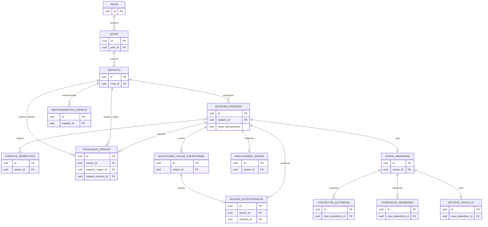

# Modelo de datos de Parking

## Fuente y alcance

Fuente estructural: `parkflow-db-definitivo/parking/V1` a `V5`. En el directorio hay **14 tablas**, **16 FK locales** y una secuencia. La V4 agrega idempotencia de entrada; la V5 cambia el CHECK del nivel de piso. Los permisos y triggers están en V2–V3. El uso de estas tablas por la API está limitado por las entidades JPA y servicios indicados en `06_COMPONENTES_INTERNOS.md`.

## Diagrama entidad-relación

En este ERD las aristas representan FK declaradas en Parking. `operador_*_id`, `administrador_*_id`, `autorizacion_identity_id` y `liquidacion_id` son UUID externos sin FK. La tabla `traslados_espacio` tiene dos FK separadas a `espacios`; cada FK es N:1 desde el traslado, una para origen y otra para destino.

## Tablas

| Tabla | Descripción y claves |
|---|---|
| `pisos` | Nivel; PK `id`. Unicidad `numero`, `codigo`; nombres no vacíos. V1 exige `numero > 0`; V5 elimina ese CHECK y crea `numero >= -5`, sin máximo superior. |
| `zonas` | Zona de piso; PK `id`, FK `piso_id → pisos.id`; UNIQUE `(piso_id,codigo)` y `(id,piso_id)`. |
| `espacios` | Espacio de zona; PK `id`, FK `zona_id → zonas.id`; UNIQUE `(zona_id,codigo)`, `(id,tipo_vehiculo)`. CHECK para tipo y estado. |
| `sesiones_parqueo` | Sesión, ticket, placa y tipo; PK `id`, FK compuesta `(espacio_id,tipo_vehiculo) → espacios(id,tipo_vehiculo)`. `liquidacion_id` es externo. UNIQUE ticket y `operacion_cierre_id`; V4 agrega `clave_idempotencia` nullable y un índice único parcial. |
| `anulaciones_sesion` | Evidencia de anulación; PK `id`, FK `sesion_id`; una por sesión; `administrador_id` externo. |
| `solicitudes_salida_excepcional` | Solicitud y resolución; PK `id`, FK `sesion_id`; IDs de Identity/usuarios son externos. `operacion_id` UNIQUE; `jti` y autorización UNIQUE cuando presentes. |
| `salidas_excepcionales` | Evidencia ejecutada; PK `id`; FK `sesion_id` y `solicitud_id`; `operacion_id`, autorización y JTI únicos. IDs de actores externos. |
| `mantenimientos_espacio` | Mantenimiento de espacio; PK `id`, FK `espacio_id`; CHECK de motivo, estado, fechas. |
| `eventos_operativos` | Auditoría operativa JSONB; PK `id`, FK opcional `sesion_id`; `clave_idempotencia` UNIQUE nullable. |
| `traslados_espacio` | Cambio entre espacios; PK `id`, FK a sesión y a dos filas de `espacios`; CHECK origen distinto a destino. |
| `casos_abandono` | Expediente; PK `id`, FK `sesion_id` UNIQUE; `cargo_billing_id` y `autorizacion_identity_id` son externos; `operacion_cierre_id` UNIQUE nullable. |
| `contactos_autoridad` | Contacto por caso; PK `id`, FK `caso_abandono_id`; actores externos. |
| `evidencias_abandono` | Evidencia por caso; PK `id`, FK `caso_abandono_id`; referencia a archivo/checksum no es FK. |
| `retiros_vehiculo` | Retiro físico; PK `id`, FK `caso_abandono_id` UNIQUE; actor/entregador externos. |

El diccionario íntegro, con cada columna, tipo, nulabilidad y default, está en `04_DICCIONARIO_DATOS_COMPLETO.md`.

## Restricciones, índices y triggers

- Checks de placas normalizadas, tipos de vehículo, estados, motivos, fechas de ciclo y estados terminales de sesión/caso.
- `uq_sesion_placa_activa`, `uq_sesion_espacio_activo`: impiden duplicar placa o espacio en sesiones `ACTIVA`.
- `uq_solicitud_excepcional_pendiente`: una solicitud pendiente por sesión.
- `uq_mantenimiento_activo_espacio`: un mantenimiento `EN_PROCESO` por espacio.
- `uq_sesiones_clave_idempotencia`: clave idempotente única cuando no es NULL.
- Índices de consulta por estado/fecha, placa/fecha, disponibilidad, eventos, mantenimientos, abandono, contactos, evidencias y traslados.
- Nombres SQL exactos: `uq_sesion_placa_activa`, `uq_sesion_espacio_activo`, `uq_solicitud_excepcional_pendiente`, `uq_mantenimiento_activo_espacio`, `uq_sesiones_clave_idempotencia`, `ix_sesiones_estado_entrada`, `ix_sesiones_placa_entrada`, `ix_espacios_zona_estado`, `ix_eventos_sesion_fecha`, `ix_mantenimientos_espacio_fecha`, `ix_abandono_estado_fecha`, `ix_contactos_caso_fecha`, `ix_evidencias_caso_fecha`, `ix_traslados_sesion_fecha`.
- `ct_validar_cierre_sesion` (deferred): exige evidencia de salida excepcional/anulación y caso + retiro al cerrar por abandono.
- `trg_transicion_sesion`: impide cambios a estados terminales y exige liquidación o evidencia según el cierre.
- `trg_transicion_caso_abandono`: obliga progresión secuencial y retiro antes del estado `CERRADO`.
- Triggers `trg_no_delete_*` bloquean borrado de eventos, traslados y evidencia histórica designada.
- Triggers exactos: `ct_validar_cierre_sesion`, `trg_transicion_sesion`, `trg_transicion_caso_abandono`, `trg_no_delete_eventos`, `trg_no_delete_traslados`, `trg_no_delete_abandono`, `trg_no_delete_evidencias`, `trg_no_delete_retiros`.
- V3 concede SELECT/INSERT/UPDATE al rol `parking_app`, revoca DELETE; migrador separado.

## Cobertura en Java

JPA mapea `pisos`, `zonas`, `espacios` y `sesiones_parqueo`. Las demás tablas están definidas por DDL, pero no aparecen como entidades JPA en el código inspeccionado; varios flujos asociados figuran como pendientes en el roadmap. Detalles en `10_DIFERENCIAS_ENTRE_DISENO_E_IMPLEMENTACION.md`.
