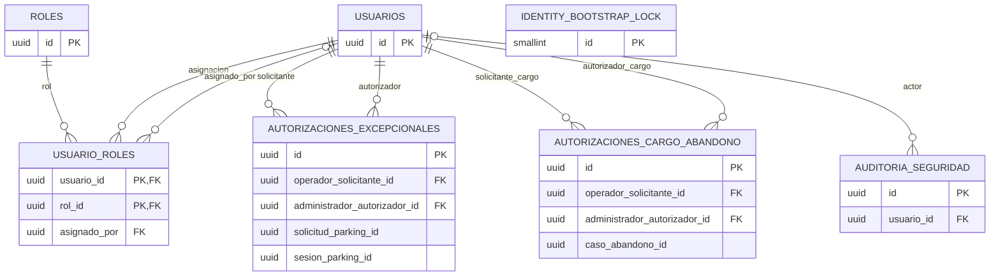

# Modelo de datos de Identity

## Fuente y alcance

Fuente estructural: `parkflow-db-definitivo/identity/V1` a `V3`. Hay **7 tablas** y **8 FK locales**. Identity es dueño de credenciales, roles, autorización y auditoría de seguridad.

## Diagrama entidad-relación

Los roles de solicitante/autorizador son dos FK distintas de una misma tabla. `solicitud_parking_id`, `sesion_parking_id`, `caso_abandono_id` y `operacion_id` no tienen FK local: son identificadores externos o correlacionales.

## Tablas

| Tabla | Descripción y claves |
|---|---|
| `usuarios` | Cuenta y credenciales; PK `id`; índice único por `lower(email)`. CHECK email normalizado, estado e intentos. Hash BCrypt guardado en `password_hash`. |
| `identity_bootstrap_lock` | Fila singleton con PK/CHECK `id=1` para coordinar bootstrap. |
| `roles` | Catálogo; PK `id`; nombre único limitado a `ADMINISTRADOR` y `OPERADOR`. |
| `usuario_roles` | Asociación N:M; PK compuesta `(usuario_id,rol_id)`; FK a `usuarios` por `usuario_id` y `asignado_por`, y a `roles`. |
| `autorizaciones_excepcionales` | Autorización de salida; PK `id`; FK a usuarios solicitante/autorizador. JTI, solicitud y operación UNIQUE. IDs de Parking externos. CHECK estado, finalidad, vigencia y consumo. |
| `autorizaciones_cargo_abandono` | Autorización de cargo; PK `id`; FK a usuarios solicitante/autorizador. Caso externo. Importe positivo COP, clave idempotente UNIQUE y CHECK de revocación. |
| `auditoria_seguridad` | Registro append-only; PK `id`; FK nullable `usuario_id`; IP `INET`, detalle `JSONB`. |

## Índices, triggers y permisos

- Índices por rol asignado, estado/vencimiento de autorización, caso/fecha de cargo, usuario/fecha y evento/fecha de auditoría.
- Nombres SQL exactos: `uq_usuarios_email_lower`, `ix_usuario_roles_rol`, `ix_autorizaciones_ex_estado_expira`, `ix_autorizaciones_cargo_caso`, `ix_auditoria_usuario_fecha`, `ix_auditoria_evento_fecha`.
- `trg_consumir_autorizacion`: limita transiciones y mantiene sesión/operación autorizadas al consumir/revocar/expirar.
- `trg_auditoria_no_update_delete`: auditoría append-only; `trg_autorizacion_cargo_no_delete` bloquea borrado de autorizaciones de cargo.
- Funciones asociadas: `fn_consumir_autorizacion`, `fn_proteger_auditoria`.
- V3 grants a `identity_app`: SELECT/INSERT/UPDATE y no DELETE; defaults equivalentes para objetos creados por `identity_migrator`.
- La tabla `identity_bootstrap_lock` contiene un renglón inicial insertado por migración.

## Cobertura en Java

JPA mapea `usuarios`, `roles` y la relación N:M `usuario_roles`. Las tablas de autorizaciones y auditoría existen en DDL, pero no tienen entidades JPA dentro del servicio inspeccionado; el consumo integrado de autorizaciones aparece pendiente en el roadmap. El diccionario íntegro está en `04_DICCIONARIO_DATOS_COMPLETO.md`.
