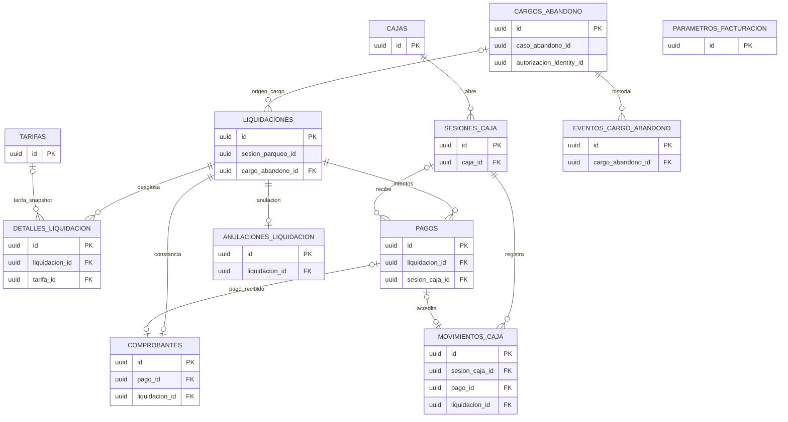

# Modelo de datos de Billing

## Fuente y alcance

Fuente estructural: `parkflow-db-definitivo/billing/V1` a `V4`. Hay **12 tablas** y **13 FK locales**, dos secuencias, índices parciales y triggers de integridad. Billing es dueño del cálculo, tarifas, caja, pagos y comprobantes.

## Diagrama entidad-relación

La FK `liquidaciones.sesion_parqueo_id` es externa a Parking, no una arista local. `cargos_abandono.caso_abandono_id` y `autorizacion_identity_id` también son UUID externos. Los triggers diferidos añaden condiciones de integridad financiera que no equivalen a FK.

## Tablas

| Tabla | Descripción y claves |
|---|---|
| `parametros_facturacion` | Parámetros con vigencia; PK `id`; UNIQUE `(clave,vigente_desde)`. |
| `tarifas` | Tipo/concepto/importe y vigencia; PK `id`; UNIQUE compuesta para FK desde detalle. |
| `cargos_abandono` | Cargo autorizado; PK `id`; autorización y clave idempotente UNIQUE; caso externo. |
| `liquidaciones` | Snapshot de solicitud/cálculo; PK `id`; FK nullable `cargo_abandono_id`; exactamente uno entre sesión externa y cargo local. UNIQUE `(id,total)` para FK compuesta. |
| `detalles_liquidacion` | Conceptos, tarifa opcional y snapshots JSONB; PK `id`; FK liquidación y tarifa. |
| `cajas` | Catálogo de caja; PK `id`; código UNIQUE. |
| `sesiones_caja` | Apertura/cierre de operador; PK `id`; FK a caja; estado/saldos e idempotencia. `operador_id` externo. |
| `pagos` | Intentos y resultado; PK `id`; FK obligatoria a liquidación y nullable a sesión de caja; UNIQUE compuestas para referencias financieras. |
| `movimientos_caja` | Ingreso/egreso; PK `id`; FK a sesión y FK compuesta opcional a pago/liq/sesión/importe. `pago_id` UNIQUE. |
| `comprobantes` | Recibo o constancia gratis; PK `id`; FK a liquidación y FK compuestas opcionales/obligatorias a pago y total; `numero` UNIQUE. |
| `anulaciones_liquidacion` | Evidencia administrativa; PK `id`; una por liquidación; clave idempotente UNIQUE. Actor externo. |
| `eventos_cargo_abandono` | Historial del cargo; PK `id`; FK local a cargo. `actor_id` externo. |

## Restricciones, índices y triggers

- Checks de moneda COP, tipos y conceptos, estados, importes, origen exclusivo de liquidación, cálculo de total, pago exacto completo y caja ABIERTA al aprobar.
- Índice parcial: una tarifa activa de vigencia abierta por tipo/concepto; un cargo AUTORIZADO/LIQUIDADO por caso; una liquidación PENDIENTE por sesión o cargo; un pago APROBADO y un PENDIENTE por liquidación.
- Índices de historial tarifario, liquidación/estado/placa, pagos, movimientos, detalles y eventos del cargo.
- Nombres SQL exactos: `uq_tarifa_vigente_abierta`, `ix_tarifas_historial`, `uq_cargo_vigente_caso`, `uq_liquidacion_pendiente_sesion`, `uq_liquidacion_pendiente_cargo`, `ix_liquidaciones_estado_fecha`, `ix_liquidaciones_placa_fecha`, `uq_pago_aprobado_liquidacion`, `uq_pago_pendiente_liquidacion`, `ix_pagos_estado_fecha`, `ix_movimientos_caja_fecha`, `ix_detalles_liquidacion`, `ix_cargo_eventos_fecha`.
- `trg_no_solapar_tarifas`: impide solapamiento de vigencias activas.
- `trg_transicion_cargo_abandono`: sólo AUTORIZADO→REVOCADO/LIQUIDADO y LIQUIDADO→PAGADO; exige liquidación/pago real para estados consiguientes.
- `trg_validar_pago`: exige total exacto, liquidación pendiente y caja abierta al aprobar; pago aprobado/rechazado terminal.
- `trg_validar_movimiento_caja`: requiere caja abierta y coherencia con pago aprobado; mantiene saldo esperado no negativo.
- `trg_transicion_liquidacion`: impide alterar estado terminal; PAGADA exige pago aprobado; GRATUITA no admite intentos de pago.
- `trg_validar_comprobante`: diferencia comprobante de pago y constancia gratuita.
- Triggers de restricción diferidos exigen liquidación pagada, exactamente un movimiento y comprobante por pago aprobado (V4 corrige la identificación del pago en el trigger).
- Triggers protegen registros financieros y eventos históricos; cierre de caja bloquea pagos pendientes.
- Funciones/triggers exactos: `fn_proteger_vigencia_tarifa` / `trg_no_solapar_tarifas`; `fn_validar_cargo_abandono` / `trg_transicion_cargo_abandono`; `fn_validar_pago` / `trg_validar_pago`; `fn_validar_movimiento_caja` / `trg_validar_movimiento_caja`; `fn_validar_transicion_liquidacion` / `trg_transicion_liquidacion`; `fn_validar_comprobante` / `trg_validar_comprobante`; `fn_validar_pago_completo` / `ct_pago_integridad`, `ct_movimiento_integridad`, `ct_comprobante_integridad`; `fn_proteger_finanzas` / `trg_no_delete_pagos`, `trg_no_update_comprobantes`, `trg_no_update_movimientos`, `trg_no_delete_eventos_cargo`; `fn_cerrar_caja_segura` / `trg_cerrar_caja_segura`.
- V3 otorga a `billing_app` SELECT/INSERT/UPDATE y uso de secuencias, sin DELETE.

## Cobertura en Java

JPA mapea 7 entidades: Caja, Comprobante, DetalleLiquidacion, Liquidacion, Pago, SesionCaja y Tarifa. `parametros_facturacion`, cargos e historial de cargos y anulaciones no están mapeados por entidades JPA observadas; algunos pueden accederse con SQL directo, pero sus flujos completos no están integrados según el roadmap. Ver diccionario completo y análisis de cobertura.
