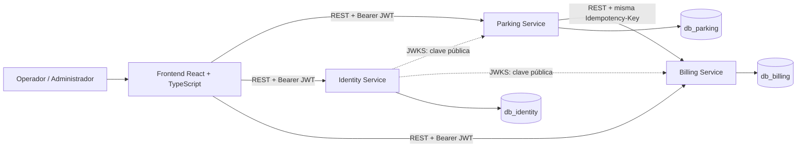

# Modelo de arquitectura de microservicios

## Vista general verificada

El backend está compuesto por tres proyectos Maven/Spring Boot: `parking-service`, `identity-service` y `billing-service`. Cada uno declara Java 21 y Spring Boot 3.5.14 en sus POM. Cada servicio tiene PostgreSQL propio, migraciones Flyway empaquetadas desde `parkflow-db-definitivo`, configuración de seguridad JWT y puerto definido por configuración. El frontend React/TypeScript está en un proyecto separado. Su `package.json` declara React/React DOM `^19.2.0`, TypeScript `~5.9.3`, Vite `^7.2.2` y React Router `^7.9.6`; su Dockerfile usa Node 22 Alpine y Nginx 1.27 Alpine. Los Dockerfiles backend compilan con Maven 3.9.11 y Eclipse Temurin 21.

La flecha punteada representa distribución de claves para verificación; Parking y Billing validan JWT con `issuer`, `audience` y algoritmo RS256. No se identificó Gateway ni broker de eventos en el despliegue actual.

## Propiedad de datos

| Dominio/dato | Propietario | Persistencia |
|---|---|---|
| Pisos, zonas, espacios, sesiones, placas y tiquetes | Parking | `db_parking` |
| Credenciales, cuentas, roles y autorización | Identity | `db_identity` |
| Tarifas, liquidaciones, pagos, caja y comprobantes | Billing | `db_billing` |

UUID de operador/administrador, sesión Parking, cargo y autorización que aparecen en otra base son referencias externas, salvo que una migración explícitamente defina FK local. No hay FK PostgreSQL cross-database.

## Funcionalidades por estado

| Estado | Capacidades observadas |
|---|---|
| Implementado en aplicación | Login/usuarios/roles; configuración de pisos, zonas y espacios; entrada manual; tiquete; búsqueda/corrección de placa; liquidación y pago en efectivo; caja; recibos; salida coordinada e idempotente. |
| Tablas/DDL presentes, flujo no integrado | Autorizaciones de salida excepcional; autorizaciones/cargos de abandono; mantenimiento, traslados y registros de retiro; algunas estructuras de anulaciones. Revisar roadmap antes de reportarlas como funcionalidad ejecutable. |
| No presente en Compose actual | API Gateway; Kafka; Redis; sensor físico; reservas; alta disponibilidad/replicación explícita. |

## Decisiones técnicas observadas

- Una base por servicio y roles separados de migración y aplicación.
- Flyway es la fuente de evolución del esquema. Los POM configuran el copiado de SQL definitivos a `db/migration`.
- Hibernate usa validación de esquema (`ddl-auto=validate`) según configuración documentada.
- REST síncrono para la comunicación necesaria, sin transacción distribuida.
- El frontend se configura con URLs `VITE_IDENTITY_URL`, `VITE_PARKING_URL`, `VITE_BILLING_URL`.
- En Compose, PostgreSQL del contenedor escucha 5432 y se publica por defecto en host 55433. Servicios: Identity 8081, Parking 8080, Billing 8083, frontend 5173.
- Compose usa red bridge predeterminada del proyecto. Solo PostgreSQL tiene healthcheck explícito; dependencias de servicios esperan `service_started`, no un healthcheck de aplicación.

## Límites

La separación de bases reduce dependencia de esquema, pero implica consistencia eventual entre llamadas. Si la respuesta de Billing se pierde, Parking recupera por la misma clave idempotente. Un fallo de comunicación durante el proceso de salida deja la sesión abierta y responde conflicto/reintento en la lógica actual. La consistencia completa de pago se impone dentro de Billing; el cierre de Parking es una operación separada y recuperable, no una transacción global.
