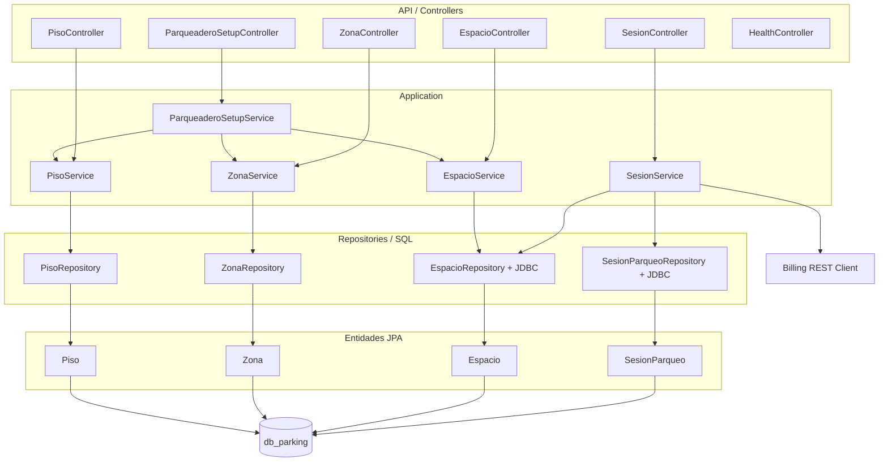
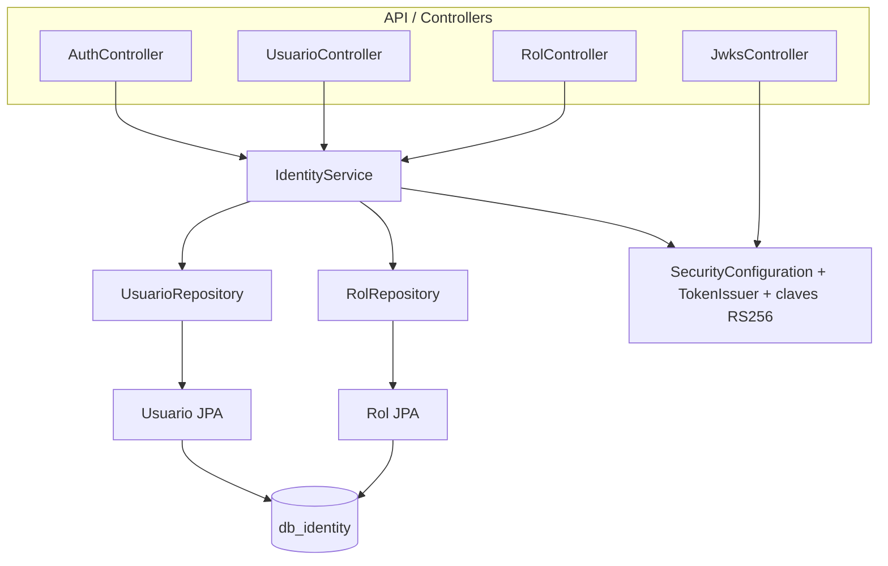
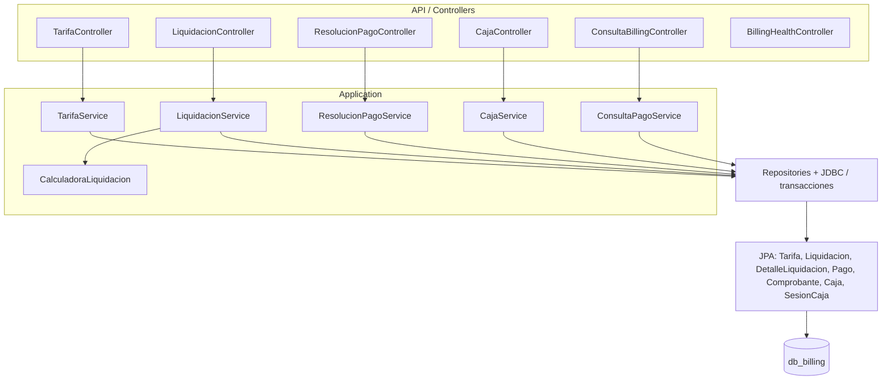

# Componentes internos de los microservicios

## Convenciones

Los diagramas resumen dependencias de código encontradas en `services/*/src/main/java`. No implican que todas las tablas migradas tengan entidades. Los componentes entre corchetes se explican abajo; los controladores HTTP llaman servicios de aplicación, que llaman repositorios o JDBC.

## Parking Service

Módulos/repositorios verificados: pisos, zonas, espacios y sesiones. SesionService también ejecuta SQL para secuencia de tiquete/eventos y usa `RestClient` hacia Billing. Configuración compuesta coordina creación de pisos, zonas y espacios.

## Identity Service

`IdentityService` implementa operaciones de usuario/rol, login/registro, bootstrap y emisión de tokens. Hay JPA para `Usuario`, `Rol` y la relación Many-to-Many. Las tablas de autorización/auditoría de DDL no tienen entidades JPA en el código listado; no se debe asumir que están expuestas en APIs.

## Billing Service

`LiquidacionService` usa hash de solicitud, `TransactionTemplate`, repositorios y JDBC para preservar idempotencia y snapshots. `ResolucionPagoService` realiza pago, transición de liquidación, movimiento de caja y comprobante dentro de transacción local. Las tablas `parametros_facturacion`, `cargos_abandono`, `eventos_cargo_abandono` y `anulaciones_liquidacion` están en DDL, pero no tienen entidades JPA encontradas en el listado.

## Cobertura JPA resumida

| Servicio | Entidades JPA actuales | Tablas DDL de esa base | Tablas no mapeadas por entidad JPA observada |
|---|---:|---:|---:|
| Parking | 4 | 14 | 10 |
| Identity | 2 | 7 | 4 |
| Billing | 7 | 12 | 5 |

La tabla `usuario_roles` es tabla de unión JPA, pero no entidad independiente; por eso se cuentan 3 tablas mapeadas de Identity (2 entidades + join table) y 4 no mapeadas. El conteo de entidades no equivale a cobertura funcional. Los números de tablas y mapeos se contrastaron con migraciones y anotaciones `@Entity`/`@JoinTable`.
