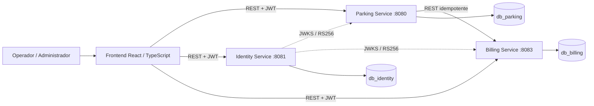
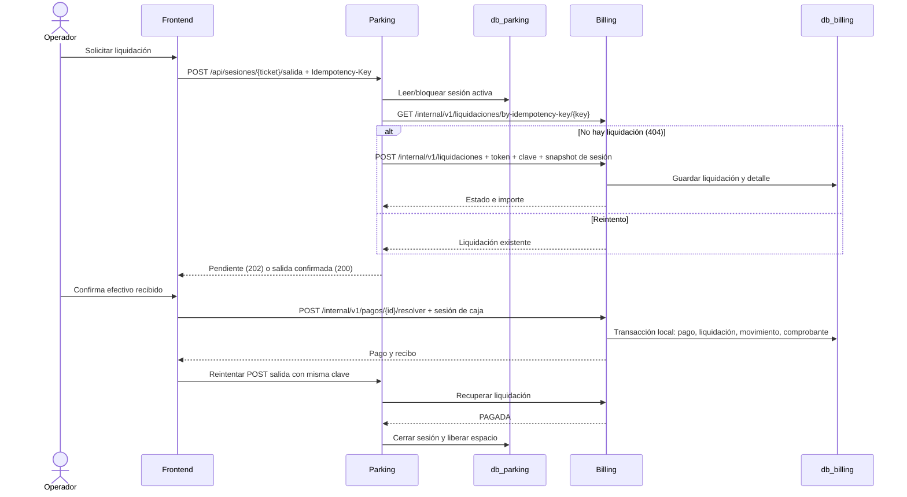
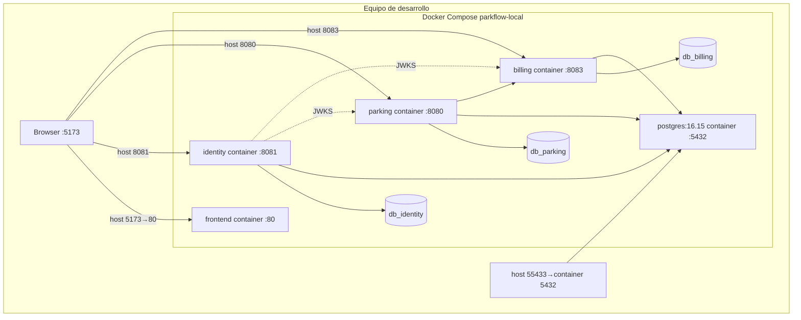

# Fuentes de diagramas ParkFlow

Todos los diagramas son código fuente editable. Los ERD detallados están separados por base en `01_MODELO_DB_PARKING.md`, `02_MODELO_DB_IDENTITY.md` y `03_MODELO_DB_BILLING.md`.

## 1. Arquitectura general (Mermaid)

## 2. Componentes internos

Los diagramas Controller→Service→Repository→Entity→Database por servicio están en `06_COMPONENTES_INTERNOS.md`. Muestran las clases presentes, las relaciones JPA observadas y los puntos JDBC/REST, sin representar como entidad las tablas que solo están en migraciones.

## 3. Comunicación de salida (Mermaid)

`SesionService.solicitarSalida` mantiene anotación `@Transactional` durante llamadas Billing; el diagrama muestra el orden lógico y no oculta esa diferencia de implementación.

## 4. Diagrama de despliegue (Mermaid)

## 5. ERD: reglas de lectura

Los tres ERD son locales a cada base. Las referencias UUID externas no se muestran como relaciones FK; están etiquetadas en los documentos respectivos. Para regenerar diagramas Mermaid, copiar el bloque `mermaid` a un renderer compatible. No se requiere herramienta de generación para alterar el modelo fuente.
