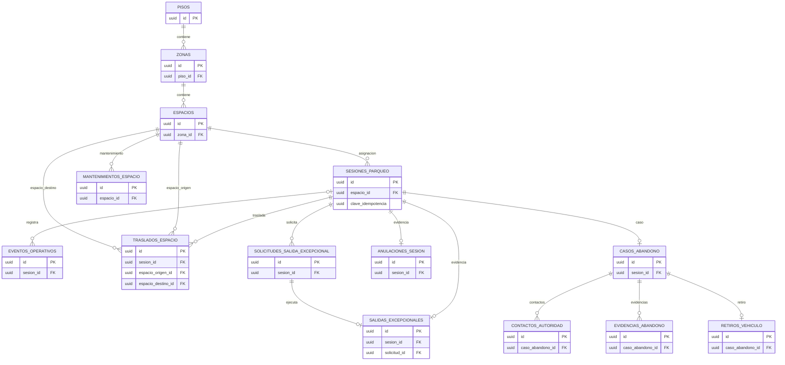
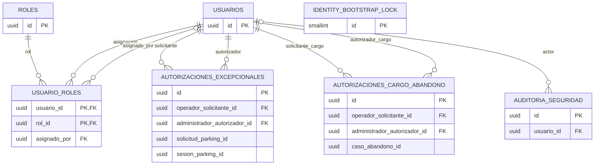
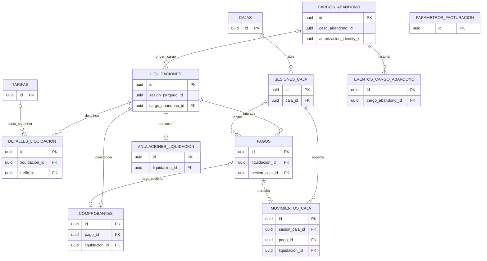
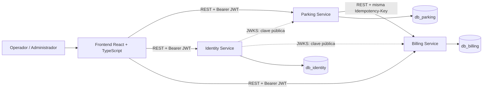
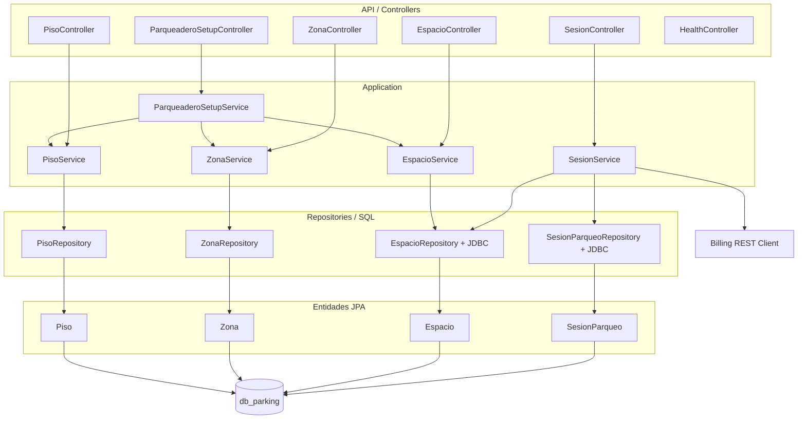
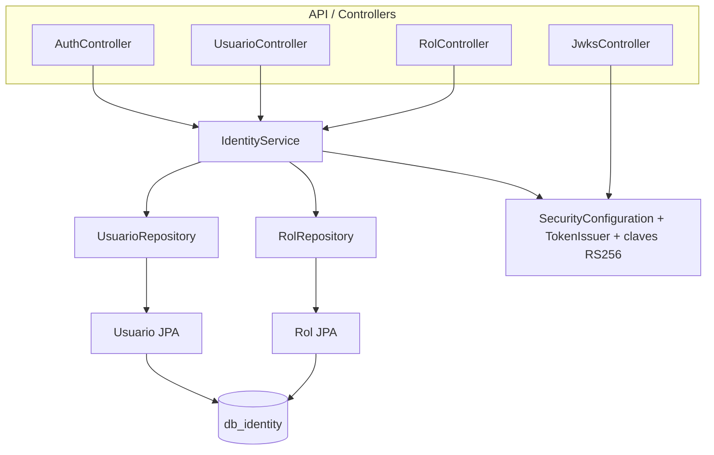
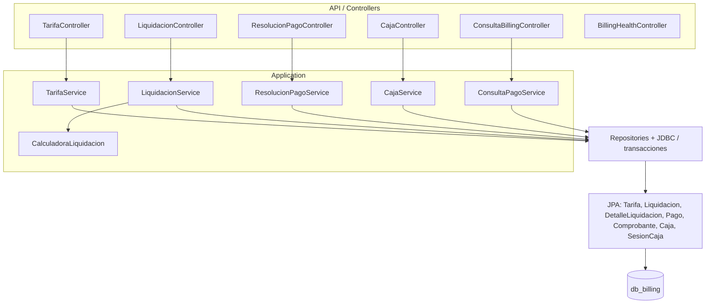
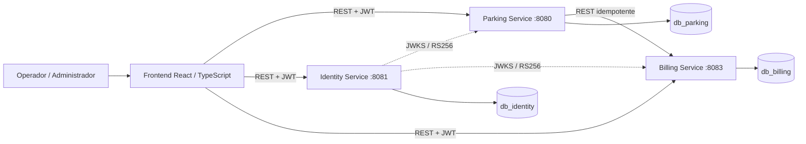
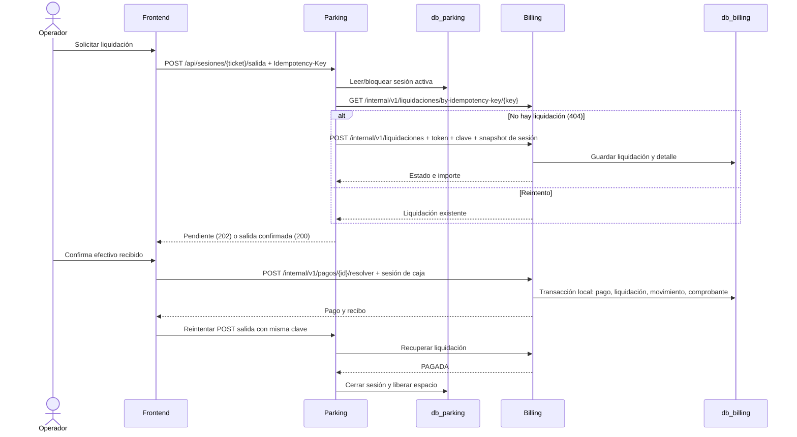
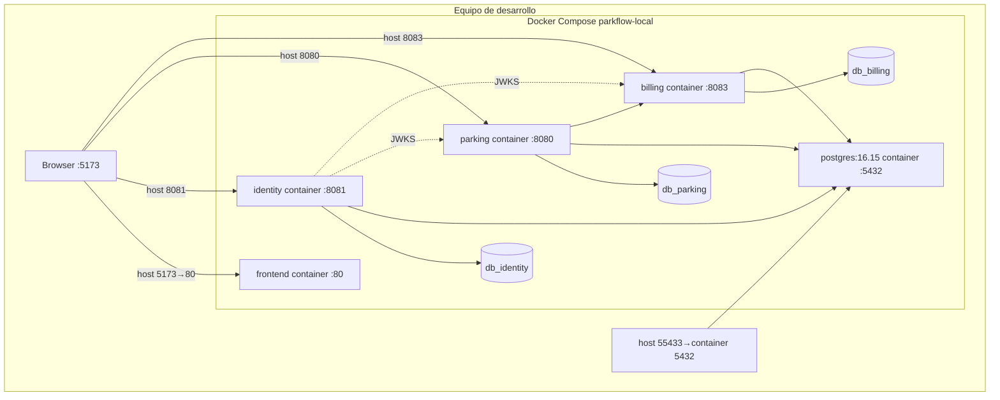

# Modelado técnico completo de ParkFlow
Documento consolidado generado a partir de los diez módulos de `docs/modelado/`. Fuente estructural: código actual, migraciones Flyway, configuraciones y contratos REST comprobados.

# Modelo de datos de Parking

## Fuente y alcance

Fuente estructural: `parkflow-db-definitivo/parking/V1` a `V5`. En el directorio hay **14 tablas**, **16 FK locales** y una secuencia. La V4 agrega idempotencia de entrada; la V5 cambia el CHECK del nivel de piso. Los permisos y triggers están en V2–V3. El uso de estas tablas por la API está limitado por las entidades JPA y servicios indicados en `06_COMPONENTES_INTERNOS.md`.

## Diagrama entidad-relación

En este ERD las aristas representan FK declaradas en Parking. `operador_*_id`, `administrador_*_id`, `autorizacion_identity_id` y `liquidacion_id` son UUID externos sin FK. La tabla `traslados_espacio` tiene dos FK separadas a `espacios`; cada FK es N:1 desde el traslado, una para origen y otra para destino.

## Tablas

| Tabla | Descripción y claves |
|---|---|
| `pisos` | Nivel; PK `id`. Unicidad `numero`, `codigo`; nombres no vacíos. V1 exige `numero > 0`; V5 elimina ese CHECK y crea `numero >= -5`, sin máximo superior. |
| `zonas` | Zona de piso; PK `id`, FK `piso_id → pisos.id`; UNIQUE `(piso_id,codigo)` y `(id,piso_id)`. |
| `espacios` | Espacio de zona; PK `id`, FK `zona_id → zonas.id`; UNIQUE `(zona_id,codigo)`, `(id,tipo_vehiculo)`. CHECK para tipo y estado. |
| `sesiones_parqueo` | Sesión, ticket, placa y tipo; PK `id`, FK compuesta `(espacio_id,tipo_vehiculo) → espacios(id,tipo_vehiculo)`. `liquidacion_id` es externo. UNIQUE ticket y `operacion_cierre_id`; V4 agrega `clave_idempotencia` nullable y un índice único parcial. |
| `anulaciones_sesion` | Evidencia de anulación; PK `id`, FK `sesion_id`; una por sesión; `administrador_id` externo. |
| `solicitudes_salida_excepcional` | Solicitud y resolución; PK `id`, FK `sesion_id`; IDs de Identity/usuarios son externos. `operacion_id` UNIQUE; `jti` y autorización UNIQUE cuando presentes. |
| `salidas_excepcionales` | Evidencia ejecutada; PK `id`; FK `sesion_id` y `solicitud_id`; `operacion_id`, autorización y JTI únicos. IDs de actores externos. |
| `mantenimientos_espacio` | Mantenimiento de espacio; PK `id`, FK `espacio_id`; CHECK de motivo, estado, fechas. |
| `eventos_operativos` | Auditoría operativa JSONB; PK `id`, FK opcional `sesion_id`; `clave_idempotencia` UNIQUE nullable. |
| `traslados_espacio` | Cambio entre espacios; PK `id`, FK a sesión y a dos filas de `espacios`; CHECK origen distinto a destino. |
| `casos_abandono` | Expediente; PK `id`, FK `sesion_id` UNIQUE; `cargo_billing_id` y `autorizacion_identity_id` son externos; `operacion_cierre_id` UNIQUE nullable. |
| `contactos_autoridad` | Contacto por caso; PK `id`, FK `caso_abandono_id`; actores externos. |
| `evidencias_abandono` | Evidencia por caso; PK `id`, FK `caso_abandono_id`; referencia a archivo/checksum no es FK. |
| `retiros_vehiculo` | Retiro físico; PK `id`, FK `caso_abandono_id` UNIQUE; actor/entregador externos. |

El diccionario íntegro, con cada columna, tipo, nulabilidad y default, está en `04_DICCIONARIO_DATOS_COMPLETO.md`.

## Restricciones, índices y triggers

- Checks de placas normalizadas, tipos de vehículo, estados, motivos, fechas de ciclo y estados terminales de sesión/caso.
- `uq_sesion_placa_activa`, `uq_sesion_espacio_activo`: impiden duplicar placa o espacio en sesiones `ACTIVA`.
- `uq_solicitud_excepcional_pendiente`: una solicitud pendiente por sesión.
- `uq_mantenimiento_activo_espacio`: un mantenimiento `EN_PROCESO` por espacio.
- `uq_sesiones_clave_idempotencia`: clave idempotente única cuando no es NULL.
- Índices de consulta por estado/fecha, placa/fecha, disponibilidad, eventos, mantenimientos, abandono, contactos, evidencias y traslados.
- Nombres SQL exactos: `uq_sesion_placa_activa`, `uq_sesion_espacio_activo`, `uq_solicitud_excepcional_pendiente`, `uq_mantenimiento_activo_espacio`, `uq_sesiones_clave_idempotencia`, `ix_sesiones_estado_entrada`, `ix_sesiones_placa_entrada`, `ix_espacios_zona_estado`, `ix_eventos_sesion_fecha`, `ix_mantenimientos_espacio_fecha`, `ix_abandono_estado_fecha`, `ix_contactos_caso_fecha`, `ix_evidencias_caso_fecha`, `ix_traslados_sesion_fecha`.
- `ct_validar_cierre_sesion` (deferred): exige evidencia de salida excepcional/anulación y caso + retiro al cerrar por abandono.
- `trg_transicion_sesion`: impide cambios a estados terminales y exige liquidación o evidencia según el cierre.
- `trg_transicion_caso_abandono`: obliga progresión secuencial y retiro antes del estado `CERRADO`.
- Triggers `trg_no_delete_*` bloquean borrado de eventos, traslados y evidencia histórica designada.
- Triggers exactos: `ct_validar_cierre_sesion`, `trg_transicion_sesion`, `trg_transicion_caso_abandono`, `trg_no_delete_eventos`, `trg_no_delete_traslados`, `trg_no_delete_abandono`, `trg_no_delete_evidencias`, `trg_no_delete_retiros`.
- V3 concede SELECT/INSERT/UPDATE al rol `parking_app`, revoca DELETE; migrador separado.

## Cobertura en Java

JPA mapea `pisos`, `zonas`, `espacios` y `sesiones_parqueo`. Las demás tablas están definidas por DDL, pero no aparecen como entidades JPA en el código inspeccionado; varios flujos asociados figuran como pendientes en el roadmap. Detalles en `10_DIFERENCIAS_ENTRE_DISENO_E_IMPLEMENTACION.md`.

# Modelo de datos de Identity

## Fuente y alcance

Fuente estructural: `parkflow-db-definitivo/identity/V1` a `V3`. Hay **7 tablas** y **8 FK locales**. Identity es dueño de credenciales, roles, autorización y auditoría de seguridad.

## Diagrama entidad-relación

Los roles de solicitante/autorizador son dos FK distintas de una misma tabla. `solicitud_parking_id`, `sesion_parking_id`, `caso_abandono_id` y `operacion_id` no tienen FK local: son identificadores externos o correlacionales.

## Tablas

| Tabla | Descripción y claves |
|---|---|
| `usuarios` | Cuenta y credenciales; PK `id`; índice único por `lower(email)`. CHECK email normalizado, estado e intentos. Hash BCrypt guardado en `password_hash`. |
| `identity_bootstrap_lock` | Fila singleton con PK/CHECK `id=1` para coordinar bootstrap. |
| `roles` | Catálogo; PK `id`; nombre único limitado a `ADMINISTRADOR` y `OPERADOR`. |
| `usuario_roles` | Asociación N:M; PK compuesta `(usuario_id,rol_id)`; FK a `usuarios` por `usuario_id` y `asignado_por`, y a `roles`. |
| `autorizaciones_excepcionales` | Autorización de salida; PK `id`; FK a usuarios solicitante/autorizador. JTI, solicitud y operación UNIQUE. IDs de Parking externos. CHECK estado, finalidad, vigencia y consumo. |
| `autorizaciones_cargo_abandono` | Autorización de cargo; PK `id`; FK a usuarios solicitante/autorizador. Caso externo. Importe positivo COP, clave idempotente UNIQUE y CHECK de revocación. |
| `auditoria_seguridad` | Registro append-only; PK `id`; FK nullable `usuario_id`; IP `INET`, detalle `JSONB`. |

## Índices, triggers y permisos

- Índices por rol asignado, estado/vencimiento de autorización, caso/fecha de cargo, usuario/fecha y evento/fecha de auditoría.
- Nombres SQL exactos: `uq_usuarios_email_lower`, `ix_usuario_roles_rol`, `ix_autorizaciones_ex_estado_expira`, `ix_autorizaciones_cargo_caso`, `ix_auditoria_usuario_fecha`, `ix_auditoria_evento_fecha`.
- `trg_consumir_autorizacion`: limita transiciones y mantiene sesión/operación autorizadas al consumir/revocar/expirar.
- `trg_auditoria_no_update_delete`: auditoría append-only; `trg_autorizacion_cargo_no_delete` bloquea borrado de autorizaciones de cargo.
- Funciones asociadas: `fn_consumir_autorizacion`, `fn_proteger_auditoria`.
- V3 grants a `identity_app`: SELECT/INSERT/UPDATE y no DELETE; defaults equivalentes para objetos creados por `identity_migrator`.
- La tabla `identity_bootstrap_lock` contiene un renglón inicial insertado por migración.

## Cobertura en Java

JPA mapea `usuarios`, `roles` y la relación N:M `usuario_roles`. Las tablas de autorizaciones y auditoría existen en DDL, pero no tienen entidades JPA dentro del servicio inspeccionado; el consumo integrado de autorizaciones aparece pendiente en el roadmap. El diccionario íntegro está en `04_DICCIONARIO_DATOS_COMPLETO.md`.

# Modelo de datos de Billing

## Fuente y alcance

Fuente estructural: `parkflow-db-definitivo/billing/V1` a `V4`. Hay **12 tablas** y **13 FK locales**, dos secuencias, índices parciales y triggers de integridad. Billing es dueño del cálculo, tarifas, caja, pagos y comprobantes.

## Diagrama entidad-relación

La FK `liquidaciones.sesion_parqueo_id` es externa a Parking, no una arista local. `cargos_abandono.caso_abandono_id` y `autorizacion_identity_id` también son UUID externos. Los triggers diferidos añaden condiciones de integridad financiera que no equivalen a FK.

## Tablas

| Tabla | Descripción y claves |
|---|---|
| `parametros_facturacion` | Parámetros con vigencia; PK `id`; UNIQUE `(clave,vigente_desde)`. |
| `tarifas` | Tipo/concepto/importe y vigencia; PK `id`; UNIQUE compuesta para FK desde detalle. |
| `cargos_abandono` | Cargo autorizado; PK `id`; autorización y clave idempotente UNIQUE; caso externo. |
| `liquidaciones` | Snapshot de solicitud/cálculo; PK `id`; FK nullable `cargo_abandono_id`; exactamente uno entre sesión externa y cargo local. UNIQUE `(id,total)` para FK compuesta. |
| `detalles_liquidacion` | Conceptos, tarifa opcional y snapshots JSONB; PK `id`; FK liquidación y tarifa. |
| `cajas` | Catálogo de caja; PK `id`; código UNIQUE. |
| `sesiones_caja` | Apertura/cierre de operador; PK `id`; FK a caja; estado/saldos e idempotencia. `operador_id` externo. |
| `pagos` | Intentos y resultado; PK `id`; FK obligatoria a liquidación y nullable a sesión de caja; UNIQUE compuestas para referencias financieras. |
| `movimientos_caja` | Ingreso/egreso; PK `id`; FK a sesión y FK compuesta opcional a pago/liq/sesión/importe. `pago_id` UNIQUE. |
| `comprobantes` | Recibo o constancia gratis; PK `id`; FK a liquidación y FK compuestas opcionales/obligatorias a pago y total; `numero` UNIQUE. |
| `anulaciones_liquidacion` | Evidencia administrativa; PK `id`; una por liquidación; clave idempotente UNIQUE. Actor externo. |
| `eventos_cargo_abandono` | Historial del cargo; PK `id`; FK local a cargo. `actor_id` externo. |

## Restricciones, índices y triggers

- Checks de moneda COP, tipos y conceptos, estados, importes, origen exclusivo de liquidación, cálculo de total, pago exacto completo y caja ABIERTA al aprobar.
- Índice parcial: una tarifa activa de vigencia abierta por tipo/concepto; un cargo AUTORIZADO/LIQUIDADO por caso; una liquidación PENDIENTE por sesión o cargo; un pago APROBADO y un PENDIENTE por liquidación.
- Índices de historial tarifario, liquidación/estado/placa, pagos, movimientos, detalles y eventos del cargo.
- Nombres SQL exactos: `uq_tarifa_vigente_abierta`, `ix_tarifas_historial`, `uq_cargo_vigente_caso`, `uq_liquidacion_pendiente_sesion`, `uq_liquidacion_pendiente_cargo`, `ix_liquidaciones_estado_fecha`, `ix_liquidaciones_placa_fecha`, `uq_pago_aprobado_liquidacion`, `uq_pago_pendiente_liquidacion`, `ix_pagos_estado_fecha`, `ix_movimientos_caja_fecha`, `ix_detalles_liquidacion`, `ix_cargo_eventos_fecha`.
- `trg_no_solapar_tarifas`: impide solapamiento de vigencias activas.
- `trg_transicion_cargo_abandono`: sólo AUTORIZADO→REVOCADO/LIQUIDADO y LIQUIDADO→PAGADO; exige liquidación/pago real para estados consiguientes.
- `trg_validar_pago`: exige total exacto, liquidación pendiente y caja abierta al aprobar; pago aprobado/rechazado terminal.
- `trg_validar_movimiento_caja`: requiere caja abierta y coherencia con pago aprobado; mantiene saldo esperado no negativo.
- `trg_transicion_liquidacion`: impide alterar estado terminal; PAGADA exige pago aprobado; GRATUITA no admite intentos de pago.
- `trg_validar_comprobante`: diferencia comprobante de pago y constancia gratuita.
- Triggers de restricción diferidos exigen liquidación pagada, exactamente un movimiento y comprobante por pago aprobado (V4 corrige la identificación del pago en el trigger).
- Triggers protegen registros financieros y eventos históricos; cierre de caja bloquea pagos pendientes.
- Funciones/triggers exactos: `fn_proteger_vigencia_tarifa` / `trg_no_solapar_tarifas`; `fn_validar_cargo_abandono` / `trg_transicion_cargo_abandono`; `fn_validar_pago` / `trg_validar_pago`; `fn_validar_movimiento_caja` / `trg_validar_movimiento_caja`; `fn_validar_transicion_liquidacion` / `trg_transicion_liquidacion`; `fn_validar_comprobante` / `trg_validar_comprobante`; `fn_validar_pago_completo` / `ct_pago_integridad`, `ct_movimiento_integridad`, `ct_comprobante_integridad`; `fn_proteger_finanzas` / `trg_no_delete_pagos`, `trg_no_update_comprobantes`, `trg_no_update_movimientos`, `trg_no_delete_eventos_cargo`; `fn_cerrar_caja_segura` / `trg_cerrar_caja_segura`.
- V3 otorga a `billing_app` SELECT/INSERT/UPDATE y uso de secuencias, sin DELETE.

## Cobertura en Java

JPA mapea 7 entidades: Caja, Comprobante, DetalleLiquidacion, Liquidacion, Pago, SesionCaja y Tarifa. `parametros_facturacion`, cargos e historial de cargos y anulaciones no están mapeados por entidades JPA observadas; algunos pueden accederse con SQL directo, pero sus flujos completos no están integrados según el roadmap. Ver diccionario completo y análisis de cobertura.

# Diccionario de datos completo de ParkFlow

Extracción del DDL en `parkflow-db-definitivo`. Incluye columnas declaradas en V1 y las columnas añadidas mediante ALTER en migraciones posteriores. `—` en FK indica que no hay FK local; los UUID de otros servicios son referencias externas. Las descripciones son síntesis semánticas a partir del nombre y el esquema, no reglas adicionales.

## db_parking

| Tabla | Campo | Tipo de dato | PK | FK | Nulo | Default | Descripción |
|---|---|---|---|---|---|---|---|
| anulaciones_sesion | administrador_id | UUID | No | — | No | — | Identificador de referencia administrador id; confirmar FK en columna FK. |
| anulaciones_sesion | clave_idempotencia | UUID | No | — | No | — | Campo clave idempotencia de anulaciones_sesion. |
| anulaciones_sesion | creado_en | TIMESTAMPTZ | No | — | No | now() | Fecha/hora asociada a creado en. |
| anulaciones_sesion | id | UUID | Sí | — | No | gen_random_uuid() | Identificador único de la fila. |
| anulaciones_sesion | motivo | TEXT | No | — | No | — | Campo motivo de anulaciones_sesion. |
| anulaciones_sesion | sesion_id | UUID | No | sesiones_parqueo.id | No | — | Identificador de referencia sesion id; confirmar FK en columna FK. |
| casos_abandono | actualizado_en | TIMESTAMPTZ | No | — | No | now() | Fecha/hora asociada a actualizado en. |
| casos_abandono | creado_en | TIMESTAMPTZ | No | — | No | now() | Fecha/hora asociada a creado en. |
| casos_abandono | estado | VARCHAR(30) | No | — | No | 'ABANDONO_REPORTADO' | Campo estado de casos_abandono. |
| casos_abandono | id | UUID | Sí | — | No | gen_random_uuid() | Identificador único de la fila. |
| casos_abandono | motivo | TEXT | No | — | No | — | Campo motivo de casos_abandono. |
| casos_abandono | operacion_cierre_id | UUID | No | — | Sí | — | Identificador de referencia operacion cierre id; confirmar FK en columna FK. |
| casos_abandono | operador_reporta_id | UUID | No | — | No | — | Identificador de referencia operador reporta id; confirmar FK en columna FK. |
| casos_abandono | reportado_en | TIMESTAMPTZ | No | — | No | now() | Fecha/hora asociada a reportado en. |
| casos_abandono | sesion_id | UUID | No | sesiones_parqueo.id | No | — | Identificador de referencia sesion id; confirmar FK en columna FK. |
| contactos_autoridad | caso_abandono_id | UUID | No | casos_abandono.id | No | — | Identificador de referencia caso abandono id; confirmar FK en columna FK. |
| contactos_autoridad | contactado_en | TIMESTAMPTZ | No | — | No | now() | Fecha/hora asociada a contactado en. |
| contactos_autoridad | id | UUID | Sí | — | No | gen_random_uuid() | Identificador único de la fila. |
| contactos_autoridad | institucion | VARCHAR(100) | No | — | No | — | Campo institucion de contactos_autoridad. |
| contactos_autoridad | operador_id | UUID | No | — | No | — | Identificador de referencia operador id; confirmar FK en columna FK. |
| contactos_autoridad | resultado | TEXT | No | — | Sí | — | Campo resultado de contactos_autoridad. |
| espacios | actualizado_en | TIMESTAMPTZ | No | — | No | now() | Fecha/hora asociada a actualizado en. |
| espacios | codigo | VARCHAR(20) | No | — | No | — | Campo codigo de espacios. |
| espacios | creado_en | TIMESTAMPTZ | No | — | No | now() | Fecha/hora asociada a creado en. |
| espacios | estado | VARCHAR(20) | No | — | No | 'HABILITADO' | Campo estado de espacios. |
| espacios | id | UUID | Sí | — | No | gen_random_uuid() | Identificador único de la fila. |
| espacios | tipo_vehiculo | VARCHAR(10) | No | — | No | — | Campo tipo vehiculo de espacios. |
| espacios | zona_id | UUID | No | zonas.id | No | — | Identificador de referencia zona id; confirmar FK en columna FK. |
| eventos_operativos | clave_idempotencia | UUID | No | — | Sí | — | Campo clave idempotencia de eventos_operativos. |
| eventos_operativos | creado_en | TIMESTAMPTZ | No | — | No | now() | Fecha/hora asociada a creado en. |
| eventos_operativos | id | UUID | Sí | — | No | gen_random_uuid() | Identificador único de la fila. |
| eventos_operativos | operador_id | UUID | No | — | No | — | Identificador de referencia operador id; confirmar FK en columna FK. |
| eventos_operativos | sesion_id | UUID | No | sesiones_parqueo.id | Sí | — | Identificador de referencia sesion id; confirmar FK en columna FK. |
| eventos_operativos | tipo_evento | VARCHAR(40) | No | — | No | — | Campo tipo evento de eventos_operativos. |
| evidencias_abandono | caso_abandono_id | UUID | No | casos_abandono.id | No | — | Identificador de referencia caso abandono id; confirmar FK en columna FK. |
| evidencias_abandono | creado_en | TIMESTAMPTZ | No | — | No | now() | Fecha/hora asociada a creado en. |
| evidencias_abandono | id | UUID | Sí | — | No | gen_random_uuid() | Identificador único de la fila. |
| evidencias_abandono | registrado_por | UUID | No | — | No | — | Campo registrado por de evidencias_abandono. |
| evidencias_abandono | tipo | VARCHAR(30) | No | — | No | — | Campo tipo de evidencias_abandono. |
| mantenimientos_espacio | creado_en | TIMESTAMPTZ | No | — | No | now() | Fecha/hora asociada a creado en. |
| mantenimientos_espacio | descripcion | TEXT | No | — | No | — | Campo descripcion de mantenimientos_espacio. |
| mantenimientos_espacio | espacio_id | UUID | No | espacios.id | No | — | Identificador de referencia espacio id; confirmar FK en columna FK. |
| mantenimientos_espacio | estado | VARCHAR(15) | No | — | No | 'EN_PROCESO' | Campo estado de mantenimientos_espacio. |
| mantenimientos_espacio | id | UUID | Sí | — | No | gen_random_uuid() | Identificador único de la fila. |
| mantenimientos_espacio | iniciado_en | TIMESTAMPTZ | No | — | No | now() | Fecha/hora asociada a iniciado en. |
| mantenimientos_espacio | motivo | VARCHAR(20) | No | — | No | — | Campo motivo de mantenimientos_espacio. |
| mantenimientos_espacio | operador_responsable_id | UUID | No | — | No | — | Identificador de referencia operador responsable id; confirmar FK en columna FK. |
| pisos | activo | BOOLEAN | No | — | No | TRUE | Campo activo de pisos. |
| pisos | actualizado_en | TIMESTAMPTZ | No | — | No | now() | Fecha/hora asociada a actualizado en. |
| pisos | codigo | VARCHAR(15) | No | — | No | — | Campo codigo de pisos. |
| pisos | creado_en | TIMESTAMPTZ | No | — | No | now() | Fecha/hora asociada a creado en. |
| pisos | id | UUID | Sí | — | No | gen_random_uuid() | Identificador único de la fila. |
| pisos | nombre | VARCHAR(80) | No | — | No | — | Campo nombre de pisos. |
| pisos | numero | SMALLINT | No | — | No | — | Campo numero de pisos. |
| retiros_vehiculo | caso_abandono_id | UUID | No | casos_abandono.id | No | — | Identificador de referencia caso abandono id; confirmar FK en columna FK. |
| retiros_vehiculo | creado_en | TIMESTAMPTZ | No | — | No | now() | Fecha/hora asociada a creado en. |
| retiros_vehiculo | id | UUID | Sí | — | No | gen_random_uuid() | Identificador único de la fila. |
| retiros_vehiculo | operador_entrega_id | UUID | No | — | No | — | Identificador de referencia operador entrega id; confirmar FK en columna FK. |
| retiros_vehiculo | responsable_retiro | VARCHAR(150) | No | — | No | — | Campo responsable retiro de retiros_vehiculo. |
| retiros_vehiculo | retirado_en | TIMESTAMPTZ | No | — | No | — | Fecha/hora asociada a retirado en. |
| retiros_vehiculo | tipo_responsable | VARCHAR(30) | No | — | No | — | Campo tipo responsable de retiros_vehiculo. |
| salidas_excepcionales | administrador_autorizador_id | UUID | No | — | No | — | Identificador de referencia administrador autorizador id; confirmar FK en columna FK. |
| salidas_excepcionales | autorizacion_identity_id | UUID | No | — | No | — | Identificador de referencia autorizacion identity id; confirmar FK en columna FK. |
| salidas_excepcionales | ejecutada_en | TIMESTAMPTZ | No | — | No | now() | Fecha/hora asociada a ejecutada en. |
| salidas_excepcionales | id | UUID | Sí | — | No | gen_random_uuid() | Identificador único de la fila. |
| salidas_excepcionales | jti | UUID | No | — | No | — | Campo jti de salidas_excepcionales. |
| salidas_excepcionales | motivo | TEXT | No | — | No | — | Campo motivo de salidas_excepcionales. |
| salidas_excepcionales | operacion_id | UUID | No | — | No | — | Identificador de referencia operacion id; confirmar FK en columna FK. |
| salidas_excepcionales | operador_ejecutor_id | UUID | No | — | No | — | Identificador de referencia operador ejecutor id; confirmar FK en columna FK. |
| salidas_excepcionales | sesion_id | UUID | No | sesiones_parqueo.id | No | — | Identificador de referencia sesion id; confirmar FK en columna FK. |
| salidas_excepcionales | solicitud_id | UUID | No | solicitudes_salida_excepcional.id | No | — | Identificador de referencia solicitud id; confirmar FK en columna FK. |
| sesiones_parqueo | actualizado_en | TIMESTAMPTZ | No | — | No | now() | Fecha/hora asociada a actualizado en. |
| sesiones_parqueo | clave_idempotencia | UUID | No | — | Sí | — | Clave de idempotencia de la entrada, agregada por V4. |
| sesiones_parqueo | creado_en | TIMESTAMPTZ | No | — | No | now() | Fecha/hora asociada a creado en. |
| sesiones_parqueo | espacio_id | UUID | No | espacios.id | No | — | Identificador de referencia espacio id; confirmar FK en columna FK. |
| sesiones_parqueo | estado | VARCHAR(15) | No | — | No | 'ACTIVA' | Campo estado de sesiones_parqueo. |
| sesiones_parqueo | hora_entrada | TIMESTAMPTZ | No | — | No | now() | Campo hora entrada de sesiones_parqueo. |
| sesiones_parqueo | id | UUID | Sí | — | No | gen_random_uuid() | Identificador único de la fila. |
| sesiones_parqueo | numero_tiquete | VARCHAR(30) | No | — | No | — | Campo numero tiquete de sesiones_parqueo. |
| sesiones_parqueo | operacion_cierre_id | UUID | No | — | Sí | — | Identificador de referencia operacion cierre id; confirmar FK en columna FK. |
| sesiones_parqueo | operador_entrada_id | UUID | No | — | No | — | Identificador de referencia operador entrada id; confirmar FK en columna FK. |
| sesiones_parqueo | placa_actual | VARCHAR(10) | No | — | No | — | Campo placa actual de sesiones_parqueo. |
| sesiones_parqueo | placa_ingreso | VARCHAR(10) | No | — | No | — | Campo placa ingreso de sesiones_parqueo. |
| sesiones_parqueo | tipo_cierre | VARCHAR(15) | No | — | Sí | — | Campo tipo cierre de sesiones_parqueo. |
| sesiones_parqueo | tipo_vehiculo | VARCHAR(10) | No | espacios.tipo_vehiculo | No | — | Campo tipo vehiculo de sesiones_parqueo. |
| solicitudes_salida_excepcional | autorizacion_identity_id | UUID | No | — | Sí | — | Identificador de referencia autorizacion identity id; confirmar FK en columna FK. |
| solicitudes_salida_excepcional | creado_en | TIMESTAMPTZ | No | — | No | now() | Fecha/hora asociada a creado en. |
| solicitudes_salida_excepcional | estado | VARCHAR(15) | No | — | No | 'PENDIENTE' | Campo estado de solicitudes_salida_excepcional. |
| solicitudes_salida_excepcional | id | UUID | Sí | — | No | gen_random_uuid() | Identificador único de la fila. |
| solicitudes_salida_excepcional | jti | UUID | No | — | Sí | — | Campo jti de solicitudes_salida_excepcional. |
| solicitudes_salida_excepcional | motivo | TEXT | No | — | No | — | Campo motivo de solicitudes_salida_excepcional. |
| solicitudes_salida_excepcional | operacion_id | UUID | No | — | No | — | Identificador de referencia operacion id; confirmar FK en columna FK. |
| solicitudes_salida_excepcional | operador_solicitante_id | UUID | No | — | No | — | Identificador de referencia operador solicitante id; confirmar FK en columna FK. |
| solicitudes_salida_excepcional | sesion_id | UUID | No | sesiones_parqueo.id | No | — | Identificador de referencia sesion id; confirmar FK en columna FK. |
| traslados_espacio | espacio_destino_id | UUID | No | espacios.id | No | — | Identificador de referencia espacio destino id; confirmar FK en columna FK. |
| traslados_espacio | espacio_origen_id | UUID | No | espacios.id | No | — | Identificador de referencia espacio origen id; confirmar FK en columna FK. |
| traslados_espacio | id | UUID | Sí | — | No | gen_random_uuid() | Identificador único de la fila. |
| traslados_espacio | motivo | TEXT | No | — | No | — | Campo motivo de traslados_espacio. |
| traslados_espacio | operador_id | UUID | No | — | No | — | Identificador de referencia operador id; confirmar FK en columna FK. |
| traslados_espacio | sesion_id | UUID | No | sesiones_parqueo.id | No | — | Identificador de referencia sesion id; confirmar FK en columna FK. |
| traslados_espacio | trasladado_en | TIMESTAMPTZ | No | — | No | now() | Fecha/hora asociada a trasladado en. |
| zonas | activa | BOOLEAN | No | — | No | TRUE | Campo activa de zonas. |
| zonas | actualizado_en | TIMESTAMPTZ | No | — | No | now() | Fecha/hora asociada a actualizado en. |
| zonas | codigo | VARCHAR(15) | No | — | No | — | Campo codigo de zonas. |
| zonas | creado_en | TIMESTAMPTZ | No | — | No | now() | Fecha/hora asociada a creado en. |
| zonas | id | UUID | Sí | — | No | gen_random_uuid() | Identificador único de la fila. |
| zonas | nombre | VARCHAR(80) | No | — | No | — | Campo nombre de zonas. |
| zonas | piso_id | UUID | No | pisos.id | No | — | Identificador de referencia piso id; confirmar FK en columna FK. |

## db_identity

| Tabla | Campo | Tipo de dato | PK | FK | Nulo | Default | Descripción |
|---|---|---|---|---|---|---|---|
| auditoria_seguridad | creado_en | TIMESTAMPTZ | No | — | No | now() | Fecha/hora asociada a creado en. |
| auditoria_seguridad | evento | VARCHAR(50) | No | — | No | — | Campo evento de auditoria_seguridad. |
| auditoria_seguridad | id | UUID | Sí | — | No | gen_random_uuid() | Identificador único de la fila. |
| auditoria_seguridad | usuario_id | UUID | No | usuarios.id | Sí | — | Identificador de referencia usuario id; confirmar FK en columna FK. |
| autorizaciones_cargo_abandono | administrador_autorizador_id | UUID | No | usuarios.id | No | — | Identificador de referencia administrador autorizador id; confirmar FK en columna FK. |
| autorizaciones_cargo_abandono | autorizada_en | TIMESTAMPTZ | No | — | No | now() | Fecha/hora asociada a autorizada en. |
| autorizaciones_cargo_abandono | caso_abandono_id | UUID | No | — | No | — | Identificador de referencia caso abandono id; confirmar FK en columna FK. |
| autorizaciones_cargo_abandono | clave_idempotencia | UUID | No | — | No | — | Campo clave idempotencia de autorizaciones_cargo_abandono. |
| autorizaciones_cargo_abandono | estado | VARCHAR(15) | No | — | No | — | Campo estado de autorizaciones_cargo_abandono. |
| autorizaciones_cargo_abandono | id | UUID | Sí | — | No | gen_random_uuid() | Identificador único de la fila. |
| autorizaciones_cargo_abandono | importe_autorizado | NUMERIC(12,2) | No | — | No | — | Valor monetario o cantidad de importe autorizado. |
| autorizaciones_cargo_abandono | moneda | CHAR(3) | No | — | No | 'COP' | Campo moneda de autorizaciones_cargo_abandono. |
| autorizaciones_cargo_abandono | motivo | TEXT | No | — | No | — | Campo motivo de autorizaciones_cargo_abandono. |
| autorizaciones_cargo_abandono | operacion_id | UUID | No | — | No | — | Identificador de referencia operacion id; confirmar FK en columna FK. |
| autorizaciones_cargo_abandono | operador_solicitante_id | UUID | No | usuarios.id | No | — | Identificador de referencia operador solicitante id; confirmar FK en columna FK. |
| autorizaciones_cargo_abandono | roles_verificados | JSONB | No | — | No | — | Campo roles verificados de autorizaciones_cargo_abandono. |
| autorizaciones_excepcionales | administrador_autorizador_id | UUID | No | usuarios.id | No | — | Identificador de referencia administrador autorizador id; confirmar FK en columna FK. |
| autorizaciones_excepcionales | emitida_en | TIMESTAMPTZ | No | — | No | now() | Fecha/hora asociada a emitida en. |
| autorizaciones_excepcionales | estado | VARCHAR(15) | No | — | No | — | Campo estado de autorizaciones_excepcionales. |
| autorizaciones_excepcionales | expira_en | TIMESTAMPTZ | No | — | No | — | Fecha/hora asociada a expira en. |
| autorizaciones_excepcionales | finalidad | VARCHAR(40) | No | — | No | — | Campo finalidad de autorizaciones_excepcionales. |
| autorizaciones_excepcionales | id | UUID | Sí | — | No | gen_random_uuid() | Identificador único de la fila. |
| autorizaciones_excepcionales | jti | UUID | No | — | No | — | Campo jti de autorizaciones_excepcionales. |
| autorizaciones_excepcionales | motivo | TEXT | No | — | No | — | Campo motivo de autorizaciones_excepcionales. |
| autorizaciones_excepcionales | operacion_id | UUID | No | — | No | — | Identificador de referencia operacion id; confirmar FK en columna FK. |
| autorizaciones_excepcionales | operador_solicitante_id | UUID | No | usuarios.id | No | — | Identificador de referencia operador solicitante id; confirmar FK en columna FK. |
| autorizaciones_excepcionales | roles_verificados | JSONB | No | — | No | — | Campo roles verificados de autorizaciones_excepcionales. |
| autorizaciones_excepcionales | sesion_parking_id | UUID | No | — | No | — | Identificador de referencia sesion parking id; confirmar FK en columna FK. |
| autorizaciones_excepcionales | solicitud_parking_id | UUID | No | — | No | — | Identificador de referencia solicitud parking id; confirmar FK en columna FK. |
| identity_bootstrap_lock | id | SMALLINT | Sí | — | No | — | Identificador único de la fila. |
| roles | creado_en | TIMESTAMPTZ | No | — | No | now() | Fecha/hora asociada a creado en. |
| roles | id | UUID | Sí | — | No | gen_random_uuid() | Identificador único de la fila. |
| roles | nombre | VARCHAR(30) | No | — | No | — | Campo nombre de roles. |
| usuario_roles | asignado_por | UUID | No | usuarios.id | Sí | — | Campo asignado por de usuario_roles. |
| usuario_roles | creado_en | TIMESTAMPTZ | No | — | No | now() | Fecha/hora asociada a creado en. |
| usuario_roles | rol_id | UUID | Sí | roles.id | No | — | Identificador de referencia rol id; confirmar FK en columna FK. |
| usuario_roles | usuario_id | UUID | Sí | usuarios.id | No | — | Identificador de referencia usuario id; confirmar FK en columna FK. |
| usuarios | actualizado_en | TIMESTAMPTZ | No | — | No | now() | Fecha/hora asociada a actualizado en. |
| usuarios | creado_en | TIMESTAMPTZ | No | — | No | now() | Fecha/hora asociada a creado en. |
| usuarios | email | VARCHAR(150) | No | — | No | — | Campo email de usuarios. |
| usuarios | estado | VARCHAR(15) | No | — | No | 'ACTIVO' | Campo estado de usuarios. |
| usuarios | id | UUID | Sí | — | No | gen_random_uuid() | Identificador único de la fila. |
| usuarios | intentos_fallidos | SMALLINT | No | — | No | 0 | Campo intentos fallidos de usuarios. |
| usuarios | nombre | VARCHAR(120) | No | — | No | — | Campo nombre de usuarios. |
| usuarios | password_hash | VARCHAR(255) | No | — | No | — | Campo password hash de usuarios. |

## db_billing

| Tabla | Campo | Tipo de dato | PK | FK | Nulo | Default | Descripción |
|---|---|---|---|---|---|---|---|
| anulaciones_liquidacion | administrador_id | UUID | No | — | No | — | Identificador de referencia administrador id; confirmar FK en columna FK. |
| anulaciones_liquidacion | clave_idempotencia | UUID | No | — | No | — | Campo clave idempotencia de anulaciones_liquidacion. |
| anulaciones_liquidacion | creado_en | TIMESTAMPTZ | No | — | No | now() | Fecha/hora asociada a creado en. |
| anulaciones_liquidacion | id | UUID | Sí | — | No | gen_random_uuid() | Identificador único de la fila. |
| anulaciones_liquidacion | liquidacion_id | UUID | No | liquidaciones.id | No | — | Identificador de referencia liquidacion id; confirmar FK en columna FK. |
| anulaciones_liquidacion | motivo | TEXT | No | — | No | — | Campo motivo de anulaciones_liquidacion. |
| cajas | activa | BOOLEAN | No | — | No | TRUE | Campo activa de cajas. |
| cajas | actualizado_en | TIMESTAMPTZ | No | — | No | now() | Fecha/hora asociada a actualizado en. |
| cajas | codigo | VARCHAR(20) | No | — | No | — | Campo codigo de cajas. |
| cajas | creado_en | TIMESTAMPTZ | No | — | No | now() | Fecha/hora asociada a creado en. |
| cajas | id | UUID | Sí | — | No | gen_random_uuid() | Identificador único de la fila. |
| cajas | nombre | VARCHAR(80) | No | — | No | — | Campo nombre de cajas. |
| cargos_abandono | actualizado_en | TIMESTAMPTZ | No | — | No | now() | Fecha/hora asociada a actualizado en. |
| cargos_abandono | administrador_autorizador_id | UUID | No | — | No | — | Identificador de referencia administrador autorizador id; confirmar FK en columna FK. |
| cargos_abandono | autorizacion_identity_id | UUID | No | — | No | — | Identificador de referencia autorizacion identity id; confirmar FK en columna FK. |
| cargos_abandono | autorizado_en | TIMESTAMPTZ | No | — | No | — | Fecha/hora asociada a autorizado en. |
| cargos_abandono | caso_abandono_id | UUID | No | — | No | — | Identificador de referencia caso abandono id; confirmar FK en columna FK. |
| cargos_abandono | clave_idempotencia | UUID | No | — | No | — | Campo clave idempotencia de cargos_abandono. |
| cargos_abandono | creado_en | TIMESTAMPTZ | No | — | No | now() | Fecha/hora asociada a creado en. |
| cargos_abandono | estado | VARCHAR(15) | No | — | No | — | Campo estado de cargos_abandono. |
| cargos_abandono | id | UUID | Sí | — | No | gen_random_uuid() | Identificador único de la fila. |
| cargos_abandono | importe_autorizado | NUMERIC(12,2) | No | — | No | — | Valor monetario o cantidad de importe autorizado. |
| cargos_abandono | moneda | CHAR(3) | No | — | No | 'COP' | Campo moneda de cargos_abandono. |
| cargos_abandono | motivo | TEXT | No | — | No | — | Campo motivo de cargos_abandono. |
| comprobantes | descuentos | NUMERIC(12,2) | No | — | No | — | Valor monetario o cantidad de descuentos. |
| comprobantes | emitido_en | TIMESTAMPTZ | No | — | No | now() | Fecha/hora asociada a emitido en. |
| comprobantes | hora_corte | TIMESTAMPTZ | No | — | No | — | Campo hora corte de comprobantes. |
| comprobantes | id | UUID | Sí | — | No | gen_random_uuid() | Identificador único de la fila. |
| comprobantes | liquidacion_id | UUID | No | liquidaciones.id | No | — | Identificador de referencia liquidacion id; confirmar FK en columna FK. |
| comprobantes | metodo_pago | VARCHAR(15) | No | — | Sí | — | Campo metodo pago de comprobantes. |
| comprobantes | numero | VARCHAR(30) | No | — | No | — | Campo numero de comprobantes. |
| comprobantes | pago_id | UUID | No | pagos.id | Sí | — | Identificador de referencia pago id; confirmar FK en columna FK. |
| comprobantes | recargos | NUMERIC(12,2) | No | — | No | — | Valor monetario o cantidad de recargos. |
| comprobantes | subtotal | NUMERIC(12,2) | No | — | No | — | Valor monetario o cantidad de subtotal. |
| comprobantes | tipo | VARCHAR(20) | No | — | No | — | Campo tipo de comprobantes. |
| comprobantes | tipo_vehiculo | VARCHAR(10) | No | — | Sí | — | Campo tipo vehiculo de comprobantes. |
| comprobantes | total | NUMERIC(12,2) | No | liquidaciones.total | No | — | Valor monetario o cantidad de total. |
| detalles_liquidacion | cantidad | NUMERIC(10,2) | No | — | No | 1 | Campo cantidad de detalles_liquidacion. |
| detalles_liquidacion | concepto | VARCHAR(30) | No | — | No | — | Campo concepto de detalles_liquidacion. |
| detalles_liquidacion | creado_en | TIMESTAMPTZ | No | — | No | now() | Fecha/hora asociada a creado en. |
| detalles_liquidacion | descripcion | VARCHAR(200) | No | — | No | — | Campo descripcion de detalles_liquidacion. |
| detalles_liquidacion | id | UUID | Sí | — | No | gen_random_uuid() | Identificador único de la fila. |
| detalles_liquidacion | liquidacion_id | UUID | No | liquidaciones.id | No | — | Identificador de referencia liquidacion id; confirmar FK en columna FK. |
| detalles_liquidacion | subtotal | NUMERIC(12,2) | No | — | No | — | Valor monetario o cantidad de subtotal. |
| detalles_liquidacion | tarifa_id | UUID | No | tarifas.id | Sí | — | Identificador de referencia tarifa id; confirmar FK en columna FK. |
| detalles_liquidacion | valor_unitario | NUMERIC(12,2) | No | — | No | — | Valor monetario o cantidad de valor unitario. |
| eventos_cargo_abandono | cargo_abandono_id | UUID | No | cargos_abandono.id | No | — | Identificador de referencia cargo abandono id; confirmar FK en columna FK. |
| eventos_cargo_abandono | creado_en | TIMESTAMPTZ | No | — | No | now() | Fecha/hora asociada a creado en. |
| eventos_cargo_abandono | estado_nuevo | VARCHAR(15) | No | — | No | — | Campo estado nuevo de eventos_cargo_abandono. |
| eventos_cargo_abandono | id | UUID | Sí | — | No | gen_random_uuid() | Identificador único de la fila. |
| liquidaciones | actualizado_en | TIMESTAMPTZ | No | — | No | now() | Fecha/hora asociada a actualizado en. |
| liquidaciones | cargo_abandono_id | UUID | No | cargos_abandono.id | Sí | — | Identificador de referencia cargo abandono id; confirmar FK en columna FK. |
| liquidaciones | clave_idempotencia | UUID | No | — | No | — | Campo clave idempotencia de liquidaciones. |
| liquidaciones | creado_en | TIMESTAMPTZ | No | — | No | now() | Fecha/hora asociada a creado en. |
| liquidaciones | descuentos | NUMERIC(12,2) | No | — | No | 0 | Valor monetario o cantidad de descuentos. |
| liquidaciones | estado | VARCHAR(15) | No | — | No | 'PENDIENTE' | Campo estado de liquidaciones. |
| liquidaciones | hash_solicitud | CHAR(64) | No | — | No | — | Campo hash solicitud de liquidaciones. |
| liquidaciones | hora_corte | TIMESTAMPTZ | No | — | No | — | Campo hora corte de liquidaciones. |
| liquidaciones | id | UUID | Sí | — | No | gen_random_uuid() | Identificador único de la fila. |
| liquidaciones | minutos_facturables | INTEGER | No | — | Sí | — | Campo minutos facturables de liquidaciones. |
| liquidaciones | minutos_gracia | SMALLINT | No | — | Sí | — | Campo minutos gracia de liquidaciones. |
| liquidaciones | minutos_totales | INTEGER | No | — | Sí | — | Valor monetario o cantidad de minutos totales. |
| liquidaciones | operador_liquida_id | UUID | No | — | No | — | Identificador de referencia operador liquida id; confirmar FK en columna FK. |
| liquidaciones | recargos | NUMERIC(12,2) | No | — | No | 0 | Valor monetario o cantidad de recargos. |
| liquidaciones | subtotal | NUMERIC(12,2) | No | — | No | — | Valor monetario o cantidad de subtotal. |
| liquidaciones | tipo_vehiculo | VARCHAR(10) | No | — | Sí | — | Campo tipo vehiculo de liquidaciones. |
| liquidaciones | total | NUMERIC(12,2) | No | — | No | — | Valor monetario o cantidad de total. |
| movimientos_caja | clave_idempotencia | UUID | No | — | No | — | Campo clave idempotencia de movimientos_caja. |
| movimientos_caja | concepto | VARCHAR(25) | No | — | No | — | Campo concepto de movimientos_caja. |
| movimientos_caja | creado_en | TIMESTAMPTZ | No | — | No | now() | Fecha/hora asociada a creado en. |
| movimientos_caja | id | UUID | Sí | — | No | gen_random_uuid() | Identificador único de la fila. |
| movimientos_caja | monto | NUMERIC(12,2) | No | pagos.monto | No | — | Valor monetario o cantidad de monto. |
| movimientos_caja | operador_id | UUID | No | — | No | — | Identificador de referencia operador id; confirmar FK en columna FK. |
| movimientos_caja | pago_id | UUID | No | pagos.id | Sí | — | Identificador de referencia pago id; confirmar FK en columna FK. |
| movimientos_caja | sesion_caja_id | UUID | No | sesiones_caja.id | No | — | Identificador de referencia sesion caja id; confirmar FK en columna FK. |
| movimientos_caja | tipo_movimiento | VARCHAR(10) | No | — | No | — | Campo tipo movimiento de movimientos_caja. |
| pagos | clave_idempotencia | UUID | No | — | No | — | Campo clave idempotencia de pagos. |
| pagos | creado_en | TIMESTAMPTZ | No | — | No | now() | Fecha/hora asociada a creado en. |
| pagos | estado | VARCHAR(15) | No | — | No | 'PENDIENTE' | Campo estado de pagos. |
| pagos | id | UUID | Sí | — | No | gen_random_uuid() | Identificador único de la fila. |
| pagos | liquidacion_id | UUID | No | liquidaciones.id | No | — | Identificador de referencia liquidacion id; confirmar FK en columna FK. |
| pagos | metodo | VARCHAR(15) | No | — | No | 'EFECTIVO' | Campo metodo de pagos. |
| pagos | monto | NUMERIC(12,2) | No | — | No | — | Valor monetario o cantidad de monto. |
| pagos | operador_id | UUID | No | — | No | — | Identificador de referencia operador id; confirmar FK en columna FK. |
| pagos | sesion_caja_id | UUID | No | sesiones_caja.id | Sí | — | Identificador de referencia sesion caja id; confirmar FK en columna FK. |
| parametros_facturacion | clave | VARCHAR(50) | No | — | No | — | Campo clave de parametros_facturacion. |
| parametros_facturacion | creado_en | TIMESTAMPTZ | No | — | No | now() | Fecha/hora asociada a creado en. |
| parametros_facturacion | id | UUID | Sí | — | No | gen_random_uuid() | Identificador único de la fila. |
| parametros_facturacion | valor | VARCHAR(100) | No | — | No | — | Valor monetario o cantidad de valor. |
| parametros_facturacion | vigente_desde | TIMESTAMPTZ | No | — | No | now() | Fecha/hora asociada a vigente desde. |
| sesiones_caja | abierta_en | TIMESTAMPTZ | No | — | No | now() | Fecha/hora asociada a abierta en. |
| sesiones_caja | actualizado_en | TIMESTAMPTZ | No | — | No | now() | Fecha/hora asociada a actualizado en. |
| sesiones_caja | caja_id | UUID | No | cajas.id | No | — | Identificador de referencia caja id; confirmar FK en columna FK. |
| sesiones_caja | clave_idempotencia | UUID | No | — | No | — | Campo clave idempotencia de sesiones_caja. |
| sesiones_caja | creado_en | TIMESTAMPTZ | No | — | No | now() | Fecha/hora asociada a creado en. |
| sesiones_caja | estado | VARCHAR(10) | No | — | No | 'ABIERTA' | Campo estado de sesiones_caja. |
| sesiones_caja | id | UUID | Sí | — | No | gen_random_uuid() | Identificador único de la fila. |
| sesiones_caja | operador_id | UUID | No | — | No | — | Identificador de referencia operador id; confirmar FK en columna FK. |
| sesiones_caja | saldo_esperado | NUMERIC(12,2) | No | — | No | — | Valor monetario o cantidad de saldo esperado. |
| sesiones_caja | saldo_inicial | NUMERIC(12,2) | No | — | No | — | Valor monetario o cantidad de saldo inicial. |
| tarifas | activa | BOOLEAN | No | — | No | TRUE | Campo activa de tarifas. |
| tarifas | concepto | VARCHAR(25) | No | — | No | — | Campo concepto de tarifas. |
| tarifas | creado_en | TIMESTAMPTZ | No | — | No | now() | Fecha/hora asociada a creado en. |
| tarifas | id | UUID | Sí | — | No | gen_random_uuid() | Identificador único de la fila. |
| tarifas | moneda | CHAR(3) | No | — | No | 'COP' | Campo moneda de tarifas. |
| tarifas | tipo_vehiculo | VARCHAR(10) | No | — | No | — | Campo tipo vehiculo de tarifas. |
| tarifas | valor | NUMERIC(12,2) | No | — | No | — | Valor monetario o cantidad de valor. |
| tarifas | vigente_desde | TIMESTAMPTZ | No | — | No | — | Fecha/hora asociada a vigente desde. |

## Restricciones e índices

Los modelos `01_MODELO_DB_PARKING.md`, `02_MODELO_DB_IDENTITY.md` y `03_MODELO_DB_BILLING.md` documentan PK/FK, UNIQUE/CHECK, índices, triggers y permisos relevantes.

# Modelo de arquitectura de microservicios

## Vista general verificada

El backend está compuesto por tres proyectos Maven/Spring Boot: `parking-service`, `identity-service` y `billing-service`. Cada uno declara Java 21 y Spring Boot 3.5.14 en sus POM. Cada servicio tiene PostgreSQL propio, migraciones Flyway empaquetadas desde `parkflow-db-definitivo`, configuración de seguridad JWT y puerto definido por configuración. El frontend React/TypeScript está en un proyecto separado. Su `package.json` declara React/React DOM `^19.2.0`, TypeScript `~5.9.3`, Vite `^7.2.2` y React Router `^7.9.6`; su Dockerfile usa Node 22 Alpine y Nginx 1.27 Alpine. Los Dockerfiles backend compilan con Maven 3.9.11 y Eclipse Temurin 21.

La flecha punteada representa distribución de claves para verificación; Parking y Billing validan JWT con `issuer`, `audience` y algoritmo RS256. No se identificó Gateway ni broker de eventos en el despliegue actual.

## Propiedad de datos

| Dominio/dato | Propietario | Persistencia |
|---|---|---|
| Pisos, zonas, espacios, sesiones, placas y tiquetes | Parking | `db_parking` |
| Credenciales, cuentas, roles y autorización | Identity | `db_identity` |
| Tarifas, liquidaciones, pagos, caja y comprobantes | Billing | `db_billing` |

UUID de operador/administrador, sesión Parking, cargo y autorización que aparecen en otra base son referencias externas, salvo que una migración explícitamente defina FK local. No hay FK PostgreSQL cross-database.

## Funcionalidades por estado

| Estado | Capacidades observadas |
|---|---|
| Implementado en aplicación | Login/usuarios/roles; configuración de pisos, zonas y espacios; entrada manual; tiquete; búsqueda/corrección de placa; liquidación y pago en efectivo; caja; recibos; salida coordinada e idempotente. |
| Tablas/DDL presentes, flujo no integrado | Autorizaciones de salida excepcional; autorizaciones/cargos de abandono; mantenimiento, traslados y registros de retiro; algunas estructuras de anulaciones. Revisar roadmap antes de reportarlas como funcionalidad ejecutable. |
| No presente en Compose actual | API Gateway; Kafka; Redis; sensor físico; reservas; alta disponibilidad/replicación explícita. |

## Decisiones técnicas observadas

- Una base por servicio y roles separados de migración y aplicación.
- Flyway es la fuente de evolución del esquema. Los POM configuran el copiado de SQL definitivos a `db/migration`.
- Hibernate usa validación de esquema (`ddl-auto=validate`) según configuración documentada.
- REST síncrono para la comunicación necesaria, sin transacción distribuida.
- El frontend se configura con URLs `VITE_IDENTITY_URL`, `VITE_PARKING_URL`, `VITE_BILLING_URL`.
- En Compose, PostgreSQL del contenedor escucha 5432 y se publica por defecto en host 55433. Servicios: Identity 8081, Parking 8080, Billing 8083, frontend 5173.
- Compose usa red bridge predeterminada del proyecto. Solo PostgreSQL tiene healthcheck explícito; dependencias de servicios esperan `service_started`, no un healthcheck de aplicación.

## Límites

La separación de bases reduce dependencia de esquema, pero implica consistencia eventual entre llamadas. Si la respuesta de Billing se pierde, Parking recupera por la misma clave idempotente. Un fallo de comunicación durante el proceso de salida deja la sesión abierta y responde conflicto/reintento en la lógica actual. La consistencia completa de pago se impone dentro de Billing; el cierre de Parking es una operación separada y recuperable, no una transacción global.

# Componentes internos de los microservicios

## Convenciones

Los diagramas resumen dependencias de código encontradas en `services/*/src/main/java`. No implican que todas las tablas migradas tengan entidades. Los componentes entre corchetes se explican abajo; los controladores HTTP llaman servicios de aplicación, que llaman repositorios o JDBC.

## Parking Service

Módulos/repositorios verificados: pisos, zonas, espacios y sesiones. SesionService también ejecuta SQL para secuencia de tiquete/eventos y usa `RestClient` hacia Billing. Configuración compuesta coordina creación de pisos, zonas y espacios.

## Identity Service

`IdentityService` implementa operaciones de usuario/rol, login/registro, bootstrap y emisión de tokens. Hay JPA para `Usuario`, `Rol` y la relación Many-to-Many. Las tablas de autorización/auditoría de DDL no tienen entidades JPA en el código listado; no se debe asumir que están expuestas en APIs.

## Billing Service

`LiquidacionService` usa hash de solicitud, `TransactionTemplate`, repositorios y JDBC para preservar idempotencia y snapshots. `ResolucionPagoService` realiza pago, transición de liquidación, movimiento de caja y comprobante dentro de transacción local. Las tablas `parametros_facturacion`, `cargos_abandono`, `eventos_cargo_abandono` y `anulaciones_liquidacion` están en DDL, pero no tienen entidades JPA encontradas en el listado.

## Cobertura JPA resumida

| Servicio | Entidades JPA actuales | Tablas DDL de esa base | Tablas no mapeadas por entidad JPA observada |
|---|---:|---:|---:|
| Parking | 4 | 14 | 10 |
| Identity | 2 | 7 | 4 |
| Billing | 7 | 12 | 5 |

La tabla `usuario_roles` es tabla de unión JPA, pero no entidad independiente; por eso se cuentan 3 tablas mapeadas de Identity (2 entidades + join table) y 4 no mapeadas. El conteo de entidades no equivale a cobertura funcional. Los números de tablas y mapeos se contrastaron con migraciones y anotaciones `@Entity`/`@JoinTable`.

# Comunicación entre microservicios y contratos REST

## Inventario de endpoints verificados en Controllers

Los paths se transcriben de las anotaciones de los controladores; no se infiere un prefijo global adicional. Las respuestas son DTOs declarados por controlador. “Bearer JWT” es el mecanismo normal salvo health/JWKS/registro/login. Los roles provienen de las configuraciones de seguridad.

### Identity Service (8081)

| Método | Endpoint | Descripción | Autenticación / rol | Entrada principal | Respuesta |
|---|---|---|---|---|---|
| POST | `/api/auth/register` | Registro/bootstrap de cuenta según reglas del servicio. | Público en SecurityConfiguration; el servicio aplica sus controles de registro. | `RegistroRequest`: nombre, email, password. | 201 `UsuarioResponse`. |
| POST | `/api/auth/login` | Autenticar usuario y emitir token. | Público. | `LoginRequest`: email, password. | `TokenResponse`. |
| GET | `/api/auth/me` | Cuenta del sujeto del token. | JWT válido. | Claims JWT. | `UsuarioResponse`. |
| GET | `/.well-known/jwks.json` | Publicar clave pública para validadores. | Público. | Ninguna. | JSON Web Key Set. |
| GET | `/api/roles` | Listar roles. | ADMINISTRADOR. | Ninguna. | Lista `RolResponse`. |
| POST | `/api/users` | Crear usuario y asignar roles. | ADMINISTRADOR. | `CrearUsuarioRequest`: usuario + `rolIds`. | 201 `UsuarioResponse`. |
| GET | `/api/users` | Listar usuarios. | ADMINISTRADOR. | Ninguna. | Lista `UsuarioResponse`. |
| GET | `/api/users/{id}` | Consultar usuario. | ADMINISTRADOR. | UUID de usuario. | `UsuarioResponse`. |
| PUT | `/api/users/{id}` | Actualizar usuario. | ADMINISTRADOR. | `ActualizarUsuarioRequest`: nombre y email. | `UsuarioResponse`. |
| PATCH | `/api/users/{id}/status` | Cambiar estado. | ADMINISTRADOR. | `EstadoUsuarioRequest`: estado. | `UsuarioResponse`. |
| PUT | `/api/users/{id}/roles` | Reemplazar roles. | ADMINISTRADOR. | `RolesUsuarioRequest`: conjunto `rolIds`. | `UsuarioResponse`. |

### Parking Service (8080)

| Método | Endpoint | Descripción | Autenticación / rol | Entrada principal | Respuesta |
|---|---|---|---|---|---|
| GET | `/api/v1/health` | Healthcheck de aplicación. | Público. | Ninguna. | Respuesta de salud. |
| POST | `/api/v1/parqueadero/configuracion` | Crear configuración compuesta de parqueadero. | ADMINISTRADOR. | `ParqueaderoSetupRequest`: código/nombre/nivel de piso y lista de zonas con cantidades de espacios por tipo. | 201 `ParqueaderoSetupResponse`. |
| POST | `/api/v1/pisos` | Crear piso. | ADMINISTRADOR. | `PisoRequest`: código, nombre, orden (validado entre -5 y 32767). | 201 `PisoResponse`. |
| GET | `/api/v1/pisos` | Listar pisos. | ADMINISTRADOR u OPERADOR. | Ninguna. | Lista `PisoResponse`. |
| GET | `/api/v1/pisos/{id}` | Obtener piso. | ADMINISTRADOR u OPERADOR. | UUID. | `PisoResponse`. |
| PUT | `/api/v1/pisos/{id}` | Actualizar piso. | ADMINISTRADOR. | `PisoRequest`: código, nombre, orden. | `PisoResponse`. |
| PATCH | `/api/v1/pisos/{id}/habilitado` | Habilitar/deshabilitar. | ADMINISTRADOR. | `PisoStatusRequest`. | `PisoResponse`. |
| POST | `/api/zonas` | Crear zona. | ADMINISTRADOR. | `ZonaRequest`: `pisoId`, código, nombre y campos opcionales del DTO. | 201 `ZonaResponse`. |
| GET | `/api/zonas?pisoId={uuid}` | Listar zonas, filtrando opcionalmente por piso. | ADMINISTRADOR u OPERADOR. | `pisoId` opcional. | Lista `ZonaResponse`. |
| PUT | `/api/zonas/{id}` | Actualizar zona. | ADMINISTRADOR. | `ZonaRequest`: `pisoId`, código, nombre y campos opcionales del DTO. | `ZonaResponse`. |
| PATCH | `/api/zonas/{id}/habilitada` | Habilitar/deshabilitar zona. | ADMINISTRADOR. | `ZonaStatusRequest`. | `ZonaResponse`. |
| POST | `/api/v1/espacios` | Crear espacio. | ADMINISTRADOR. | `EspacioRequest`: `zonaId`, código, tipo (`CARRO`/`MOTO`). | 201 `EspacioResponse`. |
| GET | `/api/v1/espacios?pisoId={uuid}` | Listar espacios y filtrar opcionalmente por piso. | ADMINISTRADOR u OPERADOR. | `pisoId` opcional. | Lista `EspacioResponse`. |
| GET | `/api/v1/espacios/{id}` | Obtener espacio. | ADMINISTRADOR u OPERADOR. | UUID. | `EspacioResponse`. |
| PUT | `/api/v1/espacios/{id}` | Actualizar espacio. | ADMINISTRADOR. | `EspacioRequest`: `zonaId`, código, tipo. | `EspacioResponse`. |
| PATCH | `/api/v1/espacios/{id}/habilitado` | Habilitar/deshabilitar espacio. | ADMINISTRADOR. | `EspacioStatusRequest`. | `EspacioResponse`. |
| POST | `/api/sesiones/entradas` | Registrar entrada. | JWT; sujeto se usa como operador. Requiere `Idempotency-Key`. | `EntradaRequest`: placa, tipo vehículo, espacio UUID elegido manualmente. | 201 `SesionResponse`. |
| GET | `/api/sesiones?activas={bool}` | Listar sesiones; `activas` default false. | ADMINISTRADOR u OPERADOR. | Query opcional. | Lista `SesionResponse`. |
| GET | `/api/sesiones/{ticket}` | Consultar por tiquete. | ADMINISTRADOR u OPERADOR. | Tiquete. | `SesionResponse`. |
| POST | `/api/sesiones/{ticket}/salida` | Solicitar salida/liquidación; usa clave para correlación e idempotencia. | JWT; requiere `Idempotency-Key`. | Ticket y JWT. | `SalidaResponse`, 200 si salida confirmada, 202 si pendiente. |
| GET | `/api/sesiones/buscar-placa?placa={texto}` | Buscar sesiones por placa. | ADMINISTRADOR u OPERADOR. | Placa. | Lista `SesionResponse`. |
| PUT | `/api/sesiones/{ticket}/placa` | Corregir placa y auditar evento. | JWT; requiere `Idempotency-Key`. | `CorreccionPlacaRequest`: placa nueva y motivo. | `SesionResponse`. |

**Variación de ruta observada:** pisos/espacios/health/configuración usan `/api/v1`, zonas y sesiones no. La ruta de configuración coincide con el matcher de seguridad `/api/v1/parqueadero/configuracion/**`. Confirmar si la falta de prefijo común es intencional antes de versionar API.

### Billing Service (8083)

| Método | Endpoint | Descripción | Autenticación / rol | Entrada principal | Respuesta |
|---|---|---|---|---|---|
| GET | `/api/billing/health` | Healthcheck de aplicación. | Público. | Ninguna. | Estado de salud. |
| GET | `/api/billing/tarifas?tipoVehiculo={tipo}` | Listar tarifas; filtro opcional. | ADMINISTRADOR u OPERADOR. | Enum opcional. | Lista `TarifaResponse`. |
| PUT | `/api/billing/tarifas/vigentes/{tipoVehiculo}/{concepto}` | Reemplazar tarifa vigente. | ADMINISTRADOR. | `ActualizarTarifaRequest`: `valor` y moneda opcional. | `TarifaResponse`. |
| GET | `/api/billing/cajas` | Listar cajas. | ADMINISTRADOR u OPERADOR. | Ninguna. | Lista `CajaResponse`. |
| POST | `/api/billing/cajas` | Crear caja. | ADMINISTRADOR. | `CrearCajaRequest`: código, nombre y descripción opcional. | 201 `CajaResponse`. |
| POST | `/api/billing/cajas/sesiones` | Abrir sesión de caja. | Bearer JWT; requiere `Idempotency-Key`. | `AbrirSesionCajaRequest`: caja UUID, saldo inicial y observación opcional; operador del JWT. | 201 `SesionCajaResponse`. |
| GET | `/api/billing/cajas/sesiones/{id}` | Obtener sesión de caja. | ADMINISTRADOR u OPERADOR. | UUID. | `SesionCajaResponse`. |
| POST | `/api/billing/cajas/sesiones/{id}/cerrar` | Cerrar sesión/arqueo. | Bearer JWT. | `CerrarSesionCajaRequest`: saldo contado y observación opcional; operador del JWT. | `SesionCajaResponse`. |
| GET | `/api/billing/pagos/{id}` | Consultar pago. | ADMINISTRADOR u OPERADOR. | UUID. | `PagoResponse`. |
| GET | `/api/billing/comprobantes/{id}` | Consultar comprobante. | ADMINISTRADOR u OPERADOR. | UUID. | `ComprobanteResponse`. |
| POST | `/internal/v1/liquidaciones` | Crear/recuperar liquidación. | ADMINISTRADOR u OPERADOR con JWT. | `CrearLiquidacionRequest`: `sesionId`, ticket, tipo, placa, entrada y corte + `Idempotency-Key`. | 201 nueva o 200 recuperada; `LiquidacionResponse`. |
| GET | `/internal/v1/liquidaciones/by-idempotency-key/{key}` | Recuperar liquidación por clave. | ADMINISTRADOR u OPERADOR con JWT. | UUID en ruta. | `LiquidacionResponse`. |
| GET | `/internal/v1/liquidaciones/{id}` | Obtener liquidación por ID. | ADMINISTRADOR u OPERADOR con JWT. | UUID. | `LiquidacionResponse`. |
| GET | `/internal/v1/liquidaciones?sesionId={uuid}` | Listar liquidaciones de sesión. | ADMINISTRADOR u OPERADOR con JWT. | `sesionId`. | Lista `LiquidacionResponse`. |
| POST | `/internal/v1/liquidaciones/{id}/cancelar` | Cancelar liquidación pendiente. | ADMINISTRADOR u OPERADOR con JWT. | `CancelarLiquidacionRequest`: motivo. | `LiquidacionResponse`. |
| POST | `/internal/v1/pagos/{id}/resolver` | Aprobar pago efectivo y completar operación financiera. | ADMINISTRADOR u OPERADOR con JWT. | `ResolverPagoRequest`: método y UUID de sesión de caja. | `PagoResponse`. |
| POST | `/internal/v1/pagos/{id}/rechazar` | Rechazar intento de pago pendiente. | ADMINISTRADOR u OPERADOR con JWT. | `RechazarPagoRequest`: motivo. | `PagoResponse`. |

La etiqueta `internal` forma parte del path y el servicio recibe llamadas Parking→Billing, pero la configuración observada autentica esas rutas mediante los mismos roles ADMINISTRADOR/OPERADOR; no se encontró un rol técnico dedicado.

## Comunicación Parking → Billing

1. Parking consulta `GET /internal/v1/liquidaciones/by-idempotency-key/{key}` con el bearer token recibido.
2. Si responde 404 y la sesión sigue activa, Parking envía `POST /internal/v1/liquidaciones` con `Idempotency-Key` y JSON con `sesionId`, `numeroTicket`, `tipoVehiculo`, `placa`, `fechaEntrada` y `fechaCorte`.
3. Billing retorna ID, estado y total dentro de `LiquidacionResponse`.
4. `PAGADA` o `GRATUITA` permite a Parking cerrar la sesión; estados pendientes dejan sesión activa y respuesta no confirmada.
5. Si una llamada falla con estado diferente de 404, o la creación falla, Parking responde conflicto y pide reintentar con la misma clave. La respuesta no se interpreta como pago confirmado.

Billing crea idempotentemente con `Idempotency-Key` y además compara `hashSolicitud`. Reusar una clave con contenido distinto da conflicto. Una unicidad parcial impide más de una liquidación pendiente por sesión.

## Observación de consistencia en el código

`SesionService.solicitarSalida` está anotado `@Transactional`, obtiene la sesión con bloqueo y ejecuta llamadas HTTP a Billing dentro del método. Esto mantiene la transacción/lock de Parking durante la llamada remota, contrario a la regla en documentos que indica no mantener una transacción de BD abierta durante HTTP. Se registra como diferencia a resolver, sin cambiar código en esta entrega.

# Fuentes de diagramas ParkFlow

Todos los diagramas son código fuente editable. Los ERD detallados están separados por base en `01_MODELO_DB_PARKING.md`, `02_MODELO_DB_IDENTITY.md` y `03_MODELO_DB_BILLING.md`.

## 1. Arquitectura general (Mermaid)

## 2. Componentes internos

Los diagramas Controller→Service→Repository→Entity→Database por servicio están en `06_COMPONENTES_INTERNOS.md`. Muestran las clases presentes, las relaciones JPA observadas y los puntos JDBC/REST, sin representar como entidad las tablas que solo están en migraciones.

## 3. Comunicación de salida (Mermaid)

`SesionService.solicitarSalida` mantiene anotación `@Transactional` durante llamadas Billing; el diagrama muestra el orden lógico y no oculta esa diferencia de implementación.

## 4. Diagrama de despliegue (Mermaid)

## 5. ERD: reglas de lectura

Los tres ERD son locales a cada base. Las referencias UUID externas no se muestran como relaciones FK; están etiquetadas en los documentos respectivos. Para regenerar diagramas Mermaid, copiar el bloque `mermaid` a un renderer compatible. No se requiere herramienta de generación para alterar el modelo fuente.

# Despliegue local de ParkFlow

## Fuente

Configuración: `docker-compose.parkflow.yml`; imágenes construidas desde Dockerfiles de `services/*` y del frontend. PostgreSQL usa imagen `postgres:16.15`. No se encontró despliegue de cloud/Kubernetes en los archivos revisados.

## Contenedores y puertos

| Servicio Compose | Contenedor | Puerto interno | Puerto host por defecto | Persistencia/depende |
|---|---|---:|---:|---|
| `postgres` | `parkflow-postgres-local` | 5432 | 55433 (`PARKFLOW_PG_PORT`) | Volumen `parkflow_pg16_data`; healthcheck `pg_isready`. |
| `identity` | `parkflow-identity` | 8081 | 8081 (`IDENTITY_HTTP_PORT`) | Espera PostgreSQL saludable. |
| `parking` | `parkflow-parking` | 8080 | 8080 (`PARKING_HTTP_PORT`) | Espera PostgreSQL saludable, Identity y Billing iniciados. |
| `billing` | `parkflow-billing` | 8083 | 8083 (`BILLING_HTTP_PORT`) | Espera PostgreSQL saludable e Identity iniciado. |
| `frontend` | `parkflow-frontend` | 80 | 5173 (`FRONTEND_HTTP_PORT`) | Build de React servido por contenedor web; depende de los tres servicios. |

Compose no declara red personalizada; usa la red por defecto del proyecto. El contenedor de PostgreSQL aloja las tres bases. Los tres servicios usan su propia cuenta de aplicación y cuenta migradora, con variables distintas.

No se encontró workflow de GitHub Actions bajo `.github/workflows` en el árbol inspeccionado; la carpeta `.github` existente no contiene una configuración CI para compilar o desplegar ParkFlow.

## Configuración relevante (nombres, no valores secretos)

- PostgreSQL: `PARKFLOW_PG_PORT`, `PARKFLOW_PG_ADMIN_PASSWORD`.
- Identity: `IDENTITY_HTTP_PORT`, `IDENTITY_JWT_ISSUER`, `IDENTITY_JWT_AUDIENCE`, `IDENTITY_JWT_PRIVATE_KEY_B64`, `IDENTITY_JWT_PUBLIC_KEY_B64`, `IDENTITY_JWT_TTL`.
- Parking: `PARKING_HTTP_PORT`, `BILLING_SERVICE_URL`, issuer/audience JWKS.
- Billing: `BILLING_HTTP_PORT`, `PARKFLOW_GRACE_MINUTES`, issuer/audience/JWKS.
- Frontend build args: `VITE_IDENTITY_URL`, `VITE_PARKING_URL`, `VITE_BILLING_URL`.
- CORS se restringe a los orígenes locales configurados por `PARKFLOW_CORS_ALLOWED_ORIGINS`.

El SQL de infraestructura crea roles y bases para un clúster local vacío; declara explícitamente que sus credenciales son solo de desarrollo. No copiar credenciales de desarrollo ni archivos `.env` a un despliegue público. Compose requiere claves JWT codificadas antes de iniciar Identity.

## Carga de migraciones

Los POM de servicios incluyen el directorio de migraciones definitivo como recurso `db/migration`. Flyway se habilita en Compose mediante usuario migrador y configuración de cada servicio. La fuente de migraciones es `parkflow-db-definitivo`; `parkflow-db-nuevo` es histórico y no debe ejecutarse en paralelo con las migraciones definitivas.

Migraciones presentes en árbol: Parking V1–V5, Identity V1–V3, Billing V1–V4. La validación temporal registrada en roadmap cubre Parking V1–V4; V5 requiere confirmación independiente.

## Dependencias y salud

Solo PostgreSQL define healthcheck explícito. Identity/Parking/Billing no tienen healthcheck Docker en Compose; `depends_on: service_started` confirma inicio del contenedor, no disponibilidad HTTP. Por tanto, el orden de inicio no es por sí solo una prueba de readiness.

## Límite del despliegue

Este Compose es local para desarrollo/revisión. No incorpora Gateway, DNS público, TLS, balanceador, escalado, logging central, métricas, backups automatizados ni política de recuperación. Para exponerlo en Internet deben definirse red/CORS, HTTPS, secretos, backup/restore y controles de acceso.

# Diferencias entre el diseño documentado y la implementación

## Criterio de comparación

Se contrastaron las migraciones actuales de `parkflow-db-definitivo`, los controladores/servicios/entidades Java, `docker-compose.parkflow.yml`, POM y la hoja de ruta. Los archivos `parkflow-db-nuevo/` y documentos anteriores se consideran contexto histórico, no la fuente estructural vigente.

| Área | Documentos/diseño | Implementación observada | Consecuencia documental |
|---|---|---|---|
| Tablas y entidades | El modelo relacional presenta tablas de expedientes, anulaciones y autorizaciones. | Migraciones definen 33 tablas; solo se encontraron 13 tablas mapeadas como entidades JPA o join table: Parking 4, Identity 3, Billing 7. | DDL no demuestra que un flujo o endpoint exista. Se identifica qué persiste solo en SQL. |
| Flujos excepcionales | Se describen salidas autorizadas, anulaciones y abandono completo. | Roadmap señala que los flujos no están implementados de extremo a extremo. | Se marcan como estructura de datos/propuesta parcial, no funcionalidad disponible. |
| Entrada | En documentos iniciales se menciona asignación automática. | `EntradaRequest` requiere `espacioId`; SesionService bloquea y valida el espacio seleccionado. | La asignación es manual. |
| Frontend | El avance académico inicial dice que se desarrollará después. | Existe proyecto React/TypeScript y servicio frontend en Compose. | La afirmación quedó desactualizada. |
| Versiones migratorias | README/roadmap presentan listas de migración diferentes. | Árbol actual contiene Parking V1–V5, Identity V1–V3, Billing V1–V4. Roadmap dice que la validación temporal llegó a Parking V1–V4. | Confirmar validación de V5 y actualizar referencias que aún indiquen V1–V3 o V1–V4 como actuales. |
| Piso | V1 imponía número mayor que cero. | V5 reemplaza por `numero >= -5`; permite sótanos desde -5 y nivel 0, sin límite superior. | Coincide con mínimo -5, pero no impone máximo para pisos positivos. |
| Rutas | Diseño sugiere API uniforme/versionada. | Pisos/espacios están bajo `/api/v1`, zonas `/api/zonas`, sesiones `/api/sesiones`. | Variación observada; verificar intención antes de fijar contrato público. |
| Transaction boundary | Regla arquitectónica dice no mantener transacción DB durante HTTP. | `SesionService.solicitarSalida` es `@Transactional`, bloquea sesión y luego llama Billing con RestClient. | Transacción/lock puede permanecer durante llamada remota. Diferencia confirmada en código. |
| Integración Identity | El DDL tiene autorizaciones de salida/cargo. | Controladores visibles incluyen auth, usuarios, roles y JWKS; no hay controller de autorización en el código listado. Roadmap reporta integración pendiente. | No afirmar autorización excepcional operativa por la existencia de la tabla. |
| Billing abandono | DDL posee cargo y eventos de estado. | No se encontraron entidades JPA ni controlador de cargo en listado. El roadmap indica flujo pendiente. | Cargo se documenta como modelo DDL no integrado. |
| API interna | La ruta tiene prefijo `/internal/v1`. | Billing Security autoriza esas rutas con roles normales ADMINISTRADOR/OPERADOR; Parking transmite Bearer JWT. | `internal` es convención de ruta, no mecanismo de autenticación de servicio distinto. |
| Manejo de fallos | Diseño describe reintento idempotente. | Parking consulta por clave; 404 crea; otros errores devuelven conflicto y solicitan reintento con misma clave. La sesión se cierra solo al obtener PAGADA/GRATUITA. | Comportamiento implementado, con dependencia temporal Parking→Billing. |
| Billing tarifa | Se carga valor de recargo y la regla comercial permanece pendiente. | Compose expone `PARKFLOW_GRACE_MINUTES`; seed parametriza recargo deshabilitado. El cálculo consultado usa tarifa horaria y diaria. | No describir recargo como cobro automático. |
| Seguridad | Documentación general puede decir que todas las rutas exigen JWT. | Health, login/register y JWKS son públicos; roles administrativos/operativos están definidos por ruta. | Enumerar excepciones reales por endpoint. |
| Prueba de DDL | El README más reciente describe validación en PostgreSQL temporal. | V5 está en el árbol local y queda fuera del rango de migraciones validado que reporta el roadmap. | Estado de validación incompleto para la última migración añadida. |

## Diferencias entre modelo SQL y JPA

### Parking

Entidades JPA: Piso, Zona, Espacio, SesionParqueo. `Piso` no mapea la columna nullable `descripcion` de `pisos`; las entidades Zona/Espacio sí incluyen descripción. No se encontraron entidades para anulaciones, solicitudes/salidas excepcionales, mantenimiento, eventos, traslados, casos/evidencias/contactos/retiros. `sesiones_parqueo` mapea sus columnas principales de cierre/idempotencia; varios actores y IDs Billing/Identity son UUID escalares externos, no asociaciones JPA.

### Identity

Entidades JPA: Usuario y Rol con relación `@ManyToMany` mediante tabla de unión `usuario_roles`. La entidad `Usuario` no mapea `intentos_fallidos`, `bloqueado_hasta` ni `ultimo_login`, columnas existentes en `usuarios`. La columna `asignado_por` de la tabla de unión no se expone como entidad auditora de asignación. No se encontraron entidades para lock de bootstrap, autorizaciones o auditoría.

### Billing

Entidades JPA: Caja, Comprobante, DetalleLiquidacion, Liquidacion, Pago, SesionCaja, Tarifa. `DetalleLiquidacion` no mapea las columnas JSONB `snapshot_tarifa` y `datos_calculo` aunque están en DDL. No se encontraron entidades para parámetros de facturación, cargo/eventos de abandono ni anulaciones de liquidación. El SQL puede operar con JDBC donde exista código, pero no se debe inferir su API completa.

## Información aún no verificada

- Contratos OpenAPI o especificación generada: no se identificó archivo OpenAPI en las rutas inspeccionadas; el inventario de endpoints se obtiene directamente de Controllers.
- Compatibilidad integral de cada anotación JPA con todos los CHECK, triggers, FK compuestas y defaults: requiere cotejo de cada atributo Java con el DDL; la lista de entidades se documenta por separado.
- Exposición real externa, certificados/TLS y reglas de firewall: Compose es local y no describe una plataforma pública.
- Ejecución efectiva de migración Parking V5: no se registra validación temporal de esa versión en roadmap.
- Cobertura de cada endpoint por tests: no se infiere únicamente de la presencia de pruebas en carpeta.

## Inventario estructural resultante

| Base | Tablas en migraciones | FK locales declaradas | Secuencias |
|---|---:|---:|---:|
| `db_parking` | 14 | 16 | 1 (`seq_ticket`) |
| `db_identity` | 7 | 8 | 0 |
| `db_billing` | 12 | 13 | 1 (`seq_comprobante`) |
| **Total** | **33** | **37** | **2** |

Conteo de FK a partir de cláusulas declaradas en DDL; restricciones compuestas cuentan como una FK. El conteo no incluye UUID externos, índices ni validaciones hechas en triggers.
