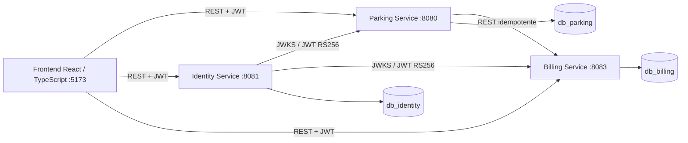
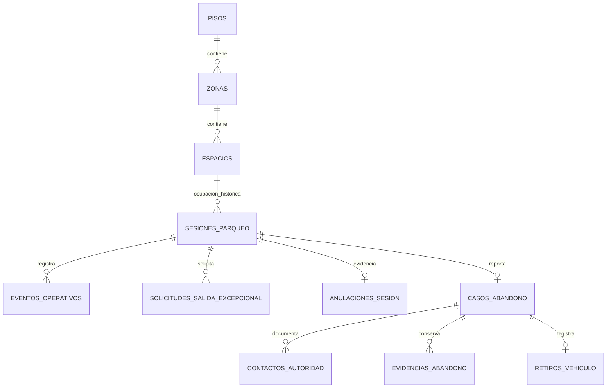
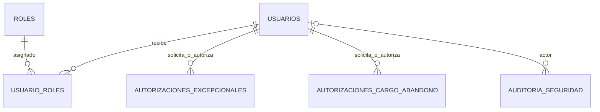
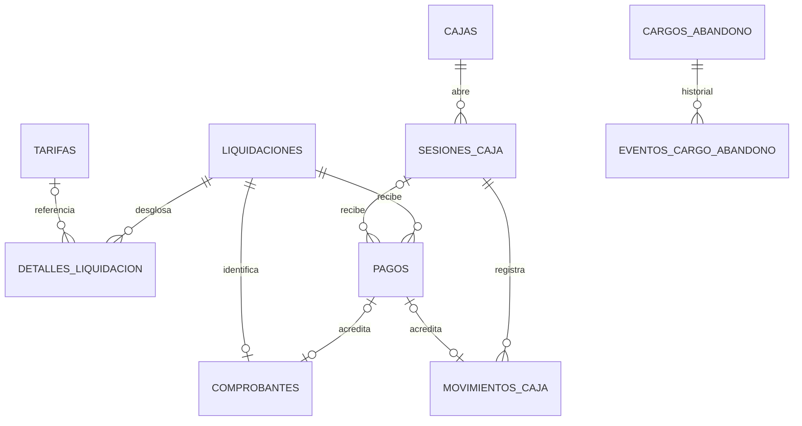
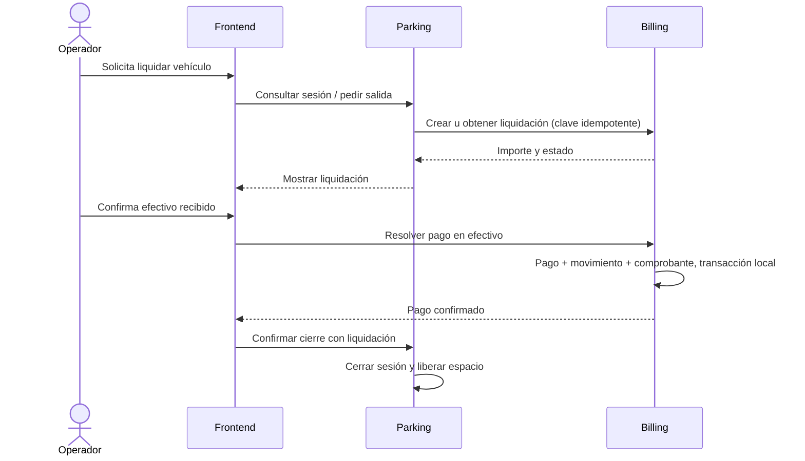

# ParkFlow

## Sistema de gestión de parqueadero basado en microservicios

**Documentación organizada del proyecto · Primer avance**  
**Fecha:** 13 de noviembre de 2026

> **Estado del documento:** consolidado con base en el avance académico entregado y el estado actual del repositorio. El documento distingue las funciones implementadas de las que siguen pendientes. Los datos académicos que no estaban disponibles se dejan señalados para completar.

## Datos de presentación

| Campo | Información |
|---|---|
| Integrantes | Completar nombres y responsabilidades del equipo. |
| Repositorio GitHub | Pegar URL del repositorio. |
| Asignatura | Completar. |
| Docente | Completar. |
| Tablero del proyecto | Añadir URL de GitHub Projects si se utiliza. |

## Resumen ejecutivo

ParkFlow digitaliza la operación de un parqueadero: configuración de pisos, zonas y espacios; registro de entradas; liquidación; pago en efectivo; operación de caja; y cierre de la salida. La solución se divide en tres microservicios —Parking, Identity y Billing—, cada uno dueño de su base PostgreSQL. El frontend está desarrollado con React y TypeScript.

La versión actual permite gestionar la configuración física, registrar vehículos con asignación manual del espacio, emitir tiquetes, buscar sesiones, calcular liquidaciones, registrar pagos en efectivo y coordinar el cierre con Billing. El sistema mantiene separadas la ocupación del parqueadero y la sesión de caja: cerrar una caja no libera espacios ni cierra vehículos.

La arquitectura y las migraciones también contemplan estructuras para mantenimientos, traslados, anulaciones, salidas excepcionales y abandono. La hoja de ruta del repositorio indica que esos flujos todavía no están completos como procesos de aplicación integrados. Por eso, este documento no los presenta como funcionalidades disponibles.

## 1. Descripción del proyecto

### 1.1 Contexto

En muchos parqueaderos, las entradas, salidas y cobros se anotan manualmente o se gestionan con herramientas separadas. Esto puede ocasionar errores de cálculo, pérdida de tiquetes, poca visibilidad de los espacios disponibles y registros incompletos de caja. ParkFlow busca centralizar esas operaciones y conservar trazabilidad de cada sesión.

### 1.2 Objetivo

Proporcionar una aplicación web para administrar la ocupación de un parqueadero y el cobro de sus servicios, manteniendo la integridad de los datos y una separación clara entre identidad, operación del estacionamiento y facturación.

### 1.3 Actores

| Actor | Acciones principales |
|---|---|
| Operador | Registrar ingresos y salidas, asignar espacios, consultar vehículos, operar caja y confirmar el efectivo recibido. |
| Administrador | Gestionar usuarios y roles, configuración del parqueadero y tarifas; aprobar acciones administrativas según las reglas acordadas. |

La autorización se valida en los servicios backend. Ocultar botones en el frontend no sustituye la validación de permisos en el servidor.

## 2. Alcance funcional y backlog

### 2.1 Épicas

| ID | Épica | Propósito |
|---|---|---|
| E1 | Identidad y acceso | Login, usuarios, roles y autorización. |
| E2 | Pisos y espacios | Configuración y consulta de disponibilidad. |
| E3 | Entradas y salidas | Registro de sesiones, tiquetes, búsqueda y cierre. |
| E4 | Tarifas y liquidación | Administración de tarifas y cálculo del valor por cobrar. |
| E5 | Pagos y comprobantes | Pago en efectivo, caja, movimientos y comprobantes. |
| E6 | Panel de operación | Interfaz web para operadores y administradores. |

### 2.2 Historias de usuario principales

| ID | Historia |
|---|---|
| HU-01 | Como operador, quiero iniciar sesión para usar el sistema de forma segura. |
| HU-02 | Como administrador, quiero gestionar usuarios y roles. |
| HU-03 | Como administrador, quiero configurar pisos, zonas y espacios para representar el parqueadero. |
| HU-04 | Como operador, quiero consultar la disponibilidad por piso. |
| HU-05 | Como operador, quiero registrar un vehículo y asignarle un espacio compatible. |
| HU-06 | Como operador, quiero calcular el valor de la estadía cuando el cliente solicita salir. |
| HU-07 | Como operador, quiero confirmar el efectivo recibido y dejar constancia del cobro. |
| HU-08 | Como operador, quiero cerrar la salida después de confirmarse el resultado de Billing. |
| HU-09 | Como administrador, quiero actualizar las tarifas sin cambiar los valores de liquidaciones históricas. |

El avance original describe criterios de aceptación para login, entrada, liquidación idempotente, pago y cierre. La priorización y estado actual de cada historia deben mantenerse en el tablero del equipo.

## 3. Reglas de negocio confirmadas

| Tema | Regla |
|---|---|
| Horario | 08:00 a 22:00, zona `America/Bogota`. |
| Moneda | Pesos colombianos (COP). |
| Vehículos | `CARRO` y `MOTO`. No se mantiene un catálogo de clientes ni de vehículos. |
| Asignación | El operador asigna manualmente un espacio libre, habilitado y compatible con el vehículo. |
| Gracia | Los primeros 15 minutos desde el ingreso son gratis. Se descuentan antes de medir el tiempo facturable. |
| Cobro por horas | Hasta 180 minutos facturables se cobran los bloques de reloj tocados; cualquier fracción posterior a la gracia cuenta como hora completa. |
| Tarifa diaria | Si el tiempo facturable supera 180 minutos, se aplica la tarifa diaria completa en reemplazo del valor por horas. No se acumulan ambas tarifas. |
| Valores carro | $6.000 por hora; $18.000 por día. |
| Valores moto | $3.500 por hora; $10.000 por día. |
| Ciclo diario | Empieza a las 08:00. Se cobra el día completo por cada ciclo; no se prorratea un ciclo parcial. |
| Pago | Solo efectivo, pago completo, sin pagos parciales. Un pago aprobado no se modifica ni se devuelve. |
| Caja | Se puede cerrar aunque haya vehículos estacionados. Cerrar una caja no cierra sesiones de parqueo ni libera espacios. |
| Cancelación | Cancelar una liquidación pendiente conserva activa la sesión y ocupado su espacio. |
| Salida normal | Requiere confirmación de un resultado terminal cobrable de Billing. |
| Tiquete perdido | Se busca por placa y se solicita la tarjeta de propiedad según el procedimiento operativo. |

**Ejemplos del umbral diario:** 3 h 15 min de permanencia dejan 3 h facturables y se cobran por horas. A las 3 h 16 min hay 3 h 1 min facturable y se aplica tarifa diaria. En una permanencia de más de un ciclo diario, cada ciclo se cobra completo.

El recargo nocturno está configurado en $15.000 para carro y $8.000 para moto, pero **no debe aplicarse automáticamente** hasta decidir su frecuencia, el tratamiento de cruces de las 22:00 y si se reciben vehículos fuera del horario.

## 4. Arquitectura de microservicios

Cada servicio tiene su propia base y autoridad sobre sus datos. Los identificadores de recursos de otros servicios son UUID externos; no hay claves foráneas entre bases. Las operaciones cruzadas se coordinan mediante APIs, validación de JWT y claves idempotentes.

| Componente | Tecnología | Responsabilidad |
|---|---|---|
| Frontend | React, TypeScript | Interfaz de acceso, configuración y operación. Consume los servicios por URL configurable. |
| Parking Service | Java, Spring Boot, Maven | Pisos, zonas, espacios, sesiones, tiquetes y coordinación de salida. |
| Identity Service | Java, Spring Boot, Maven | Usuarios, credenciales, roles, autenticación, JWT RS256, JWKS y autorizaciones. |
| Billing Service | Java, Spring Boot, Maven | Tarifas, liquidaciones, pagos en efectivo, cajas, movimientos y comprobantes. |
| Persistencia | PostgreSQL 16 y Flyway | Tres bases separadas, una por microservicio, con migraciones versionadas. |

Los puertos locales publicados para las aplicaciones son 5173, 8080, 8081 y 8083. Docker Compose publica PostgreSQL de desarrollo en el puerto 55433 del equipo para no interferir con una instalación existente en 5432. No hay API Gateway en la arquitectura actual.

### 4.1 Responsabilidades y controladores identificados

| Servicio | Controladores identificados en el código |
|---|---|
| Parking | `ParqueaderoSetupController`, `PisoController`, `ZonaController`, `EspacioController`, `SesionController`. |
| Identity | `AuthController`, `UsuarioController`, `RolController`, `JwksController`. |
| Billing | `TarifaController`, `LiquidacionController`, `ResolucionPagoController`, `ConsultaBillingController`, `CajaController`. |

## 5. Modelo de bases de datos

### 5.1 `db_parking`

Propietario: **Parking Service**. Contiene la configuración física y las sesiones de ocupación. La placa y el tipo de vehículo se almacenan como snapshot de la sesión; no existe tabla maestra permanente `vehiculos`.

| Tabla | Propósito |
|---|---|
| `pisos` | Niveles del parqueadero; la migración local V5 agrega soporte para niveles de sótano. |
| `zonas` | Agrupa espacios dentro de un piso. |
| `espacios` | Espacios físicos, tipo admitido y estado operativo. |
| `sesiones_parqueo` | Registro de ingreso, placa y tipo, espacio asignado y ciclo de ocupación. |
| `eventos_operativos` | Historial de eventos asociados a una sesión cuando corresponde. |
| `mantenimientos_espacio` | Mantenimiento y bloqueo de espacios. |
| `traslados_espacio` | Cambio de espacio de una sesión y espacios de origen/destino. |
| `solicitudes_salida_excepcional` | Solicitud y referencia externa a autorización en Identity. |
| `salidas_excepcionales` | Evidencia local de salida excepcional ejecutada. |
| `anulaciones_sesion` | Motivo y evidencia de anulación. |
| `casos_abandono` | Expediente operativo de un vehículo reportado como abandonado. |
| `contactos_autoridad` | Contactos con autoridades vinculados a un caso. |
| `evidencias_abandono` | Evidencias vinculadas al caso. |
| `retiros_vehiculo` | Registro del retiro físico del vehículo. |

Relaciones principales: `pisos` 1:N `zonas`; `zonas` 1:N `espacios`; `espacios` 1:N sesiones históricas. Una sesión puede tener eventos y solicitudes de salida, y evidencia opcional en tablas de anulación, salida excepcional o abandono. Un caso de abandono puede registrar múltiples contactos y evidencias, y hasta un retiro. Las sesiones se enlazan al espacio con validación de compatibilidad entre tipo de vehículo y espacio.

### 5.2 `db_identity`

Propietario: **Identity Service**. Gestiona cuentas, roles, autenticación y autorizaciones administrativas.

| Tabla | Propósito |
|---|---|
| `usuarios` | Cuentas, credenciales y estado. |
| `identity_bootstrap_lock` | Control de inicialización del primer administrador. |
| `roles` | Catálogo de roles. |
| `usuario_roles` | Relación usuario–rol y registro de quién asignó el rol. |
| `autorizaciones_excepcionales` | Solicitud, autorización y control de consumo para salidas excepcionales. |
| `autorizaciones_cargo_abandono` | Autorización administrativa específica para un cargo por abandono. |
| `auditoria_seguridad` | Eventos de seguridad y actor cuando se conoce. |

Relaciones principales: `usuarios` y `roles` se relacionan mediante `usuario_roles`; un usuario puede solicitar o autorizar operaciones, y las entradas de auditoría pueden guardar un actor. Los UUID de sesiones/solicitudes de Parking son referencias externas.

### 5.3 `db_billing`

Propietario: **Billing Service**. Guarda tarifas, liquidaciones, pagos, cajas, comprobantes e historial financiero local.

| Tabla | Propósito |
|---|---|
| `parametros_facturacion` | Parámetros de facturación. |
| `tarifas` | Valores, categorías y vigencias históricas. |
| `cargos_abandono` | Cargo excepcional autorizado, separado del dinero recibido. |
| `eventos_cargo_abandono` | Historial de decisiones y cambios del cargo. |
| `liquidaciones` | Cálculo asociado a una sesión externa o cargo por abandono. |
| `detalles_liquidacion` | Desglose de conceptos e importes snapshot. |
| `cajas` | Cajas lógicas de operación. |
| `sesiones_caja` | Aperturas, operadores, saldos y cierres. |
| `pagos` | Intentos y resultados de pago. |
| `movimientos_caja` | Movimientos vinculados a una sesión de caja. |
| `comprobantes` | Constancia o recibo asociado a la liquidación y al pago cuando corresponde. |
| `anulaciones_liquidacion` | Registro administrativo de anulaciones permitidas. |

Relaciones principales: `liquidaciones` se desglosan en `detalles_liquidacion`, pueden recibir intentos de pago y tener comprobante. `cajas` tienen sesiones; las sesiones registran pagos y movimientos. Un pago aprobado se relaciona con el movimiento y comprobante correspondientes. Las migraciones aplican restricciones locales para asegurar consistencia de identificadores e importes.

### 5.4 Integridad entre bases

- Cada microservicio modifica únicamente su base.
- No existen claves foráneas entre `db_parking`, `db_identity` y `db_billing`.
- Las referencias externas se validan mediante APIs, JWT, contratos e idempotencia.
- Las transacciones se mantienen locales a cada servicio; no se usa una transacción distribuida.
- Billing confirma localmente pago, movimiento de caja y comprobante.
- Parking cierra la sesión después de confirmar desde Billing un resultado terminal cobrable.

## 6. Flujos principales

### 6.1 Inicio de sesión

1. El usuario envía sus credenciales a Identity.
2. Identity valida el estado de la cuenta y la contraseña.
3. Identity emite un JWT firmado con RS256.
4. Parking y Billing validan el token usando las claves públicas de JWKS.

### 6.2 Entrada del vehículo

1. El operador registra placa y tipo (`CARRO` o `MOTO`).
2. Selecciona manualmente un espacio disponible y compatible.
3. Parking registra la sesión y genera el tiquete.
4. La idempotencia evita duplicar el ingreso si se repite la solicitud.

### 6.3 Liquidación, efectivo y salida

Si el cliente decide no salir, se puede cancelar una liquidación pendiente; la sesión y el espacio siguen activos. Una liquidación gratuita por total cero no se registra como pago en efectivo. Reintentos con la misma clave idempotente recuperan el resultado existente en vez de duplicar el cobro.

### 6.4 Caja

La apertura y cierre de caja pertenecen a Billing. El cierre registra el saldo contado, pero no modifica las sesiones de estacionamiento. Un vehículo puede permanecer estacionado después de cerrar la caja del operador.

### 6.5 Salida excepcional y abandono

La salida excepcional debe tener autorización administrativa y evidencia, no un pago ficticio. En abandono, la sesión continúa activa y conserva ocupado el espacio durante la gestión. El espacio solo se libera tras documentar el retiro físico. Un cargo autorizado no equivale a pago recibido ni crea automáticamente una deuda exigible.

## 7. Seguridad e integridad

- Identity es responsable de autenticación y emisión de JWT RS256; JWKS permite que los otros servicios validen tokens.
- Cada servicio comprueba identidad, permisos y claims en el backend.
- Las bases usan credenciales de aplicación y migración separadas.
- Flyway administra la evolución del esquema; Hibernate valida el mapeo en el arranque según la configuración.
- PostgreSQL aplica claves, índices, restricciones y triggers locales; Java calcula las reglas tarifarias.
- Las tarifas históricas y los snapshots de liquidación conservan el contexto económico del cobro.
- Las operaciones críticas soportan idempotencia y reintentos controlados.
- Los pagos aprobados y sus registros financieros asociados son históricos e inmutables.

## 8. Decisiones de arquitectura registradas

| Decisión | Solución | Consecuencia |
|---|---|---|
| Arquitectura | Tres microservicios: Identity, Parking y Billing. | Separación de responsabilidades y despliegue independiente; requiere contratos entre servicios. |
| Datos | Una base PostgreSQL por microservicio, sin FK cruzadas. | Aislamiento; la consistencia entre dominios se resuelve con APIs e idempotencia. |
| Comunicación | REST síncrono para la primera versión. | Fácil de depurar; requiere gestionar fallos de red y reintentos. |
| Seguridad | JWT firmado con RS256 y claves públicas JWKS. | Validación local de tokens en servicios. |
| Idempotencia | Reintentos de liquidación recuperan la operación original. | Evita cobros duplicados por reenvío de solicitudes. |
| Integridad | Restricciones en PostgreSQL más validación en Java. | La consistencia no depende solo del frontend. |

Kafka, Redis y API Gateway no forman parte de la arquitectura actual.

## 9. Estado de implementación

| Área | Implementado según la hoja de ruta | Pendiente o límite |
|---|---|---|
| Parking | Pisos, espacios, ingresos manuales, tiquetes, búsqueda/corrección de placa, salida coordinada e idempotencia. | Traslados, mantenimiento, anulaciones, salidas excepcionales autorizadas y abandono/retiro completo. |
| Identity | Usuarios y roles, login, JWT RS256/JWKS, bootstrap del administrador y administración de cuentas. | Consumo de autorizaciones integrado con Parking y Billing. |
| Billing | Tarifas, cálculo, liquidaciones idempotentes, cajas/sesiones, pagos en efectivo, movimientos y comprobantes. | Flujo completo de cargos de abandono y sus autorizaciones/revocaciones. |
| Frontend | Aplicación React/TypeScript para acceso, operación, configuración y caja. | No es una suite de pruebas E2E ni reemplaza autorización backend. |
| Gateway | No implementado. | Definir si se necesita y preparar controles de red, CORS y TLS para despliegue público. |

### 9.1 Migraciones y evidencia de validación

En el árbol actual están presentes Parking V1–V5, Identity V1–V3 y Billing V1–V4. La hoja de ruta registra validación temporal hasta Parking V1–V4, Identity V1–V3 y Billing V1–V4. Por tanto, Parking V5 —que habilita niveles de sótano— debe validarse en PostgreSQL temporal antes de afirmar que todas las migraciones presentes fueron comprobadas.

La hoja de ruta registra que las suites Maven y el build de producción del frontend pasaron, y que se probó un flujo HTTP de cobro en un clúster PostgreSQL temporal. También indica que los tests Testcontainers se omitieron por no disponer de Docker en ese entorno. Esas verificaciones no constituyen certificación de producción ni validación de todos los escenarios concurrentes.

## 10. Decisiones pendientes

1. **Recargo nocturno:** frecuencia, cruces de las 22:00, entradas fuera de horario y si el horario limita el ingreso.
2. **Abandono:** importe, método de autorización, si pagar es condición para entregar el vehículo y qué ocurre si el propietario no aparece.
3. **Autorizaciones:** si quien solicita puede aprobar su propia operación, duración, claims y procedimiento de revocación.
4. **Caja:** número de sesiones abiertas por operador/caja, egresos y ajustes permitidos, y nivel de detalle del arqueo.
5. **Privacidad:** plazo de conservación y anonimización de placas y datos de sesiones.
6. **Salidas gratuitas:** tipo de constancia, necesidad de caja abierta y alcance fiscal u operativo.
7. **Despliegue:** Gateway, dominios, TLS, observabilidad, respaldos y recuperación.

Estas decisiones no se deben resolver inventando reglas comerciales ni activando automáticamente valores que solo están configurados.

## 11. Próximos pasos

1. Completar integrantes, responsabilidades, asignatura, docente y URL del repositorio.
2. Validar Parking V5 en PostgreSQL temporal y alinear la documentación de versiones con las migraciones activas.
3. Resolver las decisiones comerciales pendientes y reflejarlas en reglas, contratos y pruebas.
4. Completar traslados, mantenimientos, anulaciones, salidas excepcionales y gestión de abandono/retiro.
5. Ampliar pruebas de concurrencia, fallos de red, reintentos simultáneos y reconciliación.
6. Definir seguridad y operación de despliegue: CORS, TLS, secretos, respaldos, monitoreo y recuperación.

## Fuentes técnicas del proyecto

- Migraciones Flyway: `parkflow-db-definitivo/parking/`, `identity/` y `billing/`.
- Arquitectura y modelo: `parkflow-db-definitivo/docs/01_ARQUITECTURA.md`, `02_MODELO_ENTIDAD_RELACION.md`, `03_DICCIONARIO_DE_DATOS.md`, `05_COMUNICACION_ENTRE_SERVICIOS.md`, `06_REGLAS_DE_NEGOCIO.md` y `07_DECISIONES_PENDIENTES.md`.
- Estado y límites actuales: `PARKFLOW_IMPLEMENTATION_ROADMAP.md`.
- Código de aplicación: carpetas `services/` del backend y proyecto frontend.
