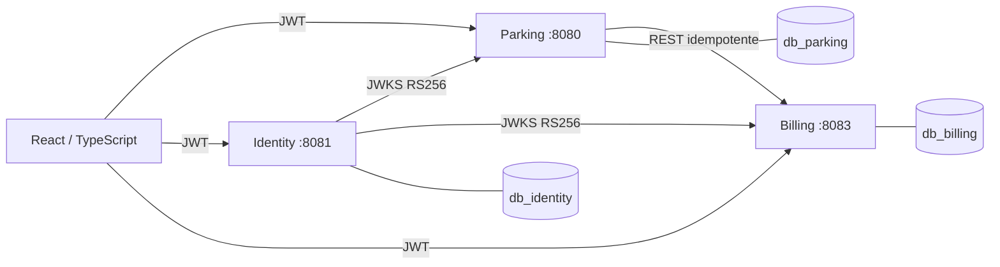

# 01 — Arquitectura ParkFlow

**Actualizado:** 2026-11-12. Este documento describe el sistema implementado y sus límites; el historial de auditoría está en 08 y 09.

## Límites de propiedad

| Servicio | Base PostgreSQL | Datos propios |
|---|---|---|
| Parking Service | `db_parking` | Pisos, zonas, espacios, sesiones, tiquetes, cambios operativos de placa y eventos. No existe catálogo permanente de vehículos. |
| Identity Service | `db_identity` | Usuarios, credenciales, roles y emisión/verificación pública de JWT RS256 mediante JWKS. |
| Billing Service | `db_billing` | Tarifas e historial, liquidaciones, pagos, comprobantes, cajas, sesiones de caja y movimientos. |

Cada servicio usa credenciales de aplicación y migración separadas. Los UUID que identifican recursos de otros dominios se validan mediante contratos HTTP; no hay FK entre bases ni transacción distribuida.

## Diagrama

No hay API Gateway en esta versión. El frontend usa URLs configurables y CORS; en despliegue se debe decidir topología de red y si se incorpora un Gateway.

## Transacciones y recuperación

- Parking registra entrada, asigna espacio manualmente y conserva la sesión operativa. Al solicitar salida, llama a Billing con clave idempotente; solo cierra y libera el espacio al recibir un estado terminal cobrable (`PAGADA` o `GRATUITA`). Un reintento recupera el resultado previo.
- Billing calcula la liquidación, aprueba únicamente efectivo y, dentro de una transacción local, persiste estado pagado, pago, movimiento de caja y comprobante.
- Identity autentica usuarios y entrega JWT RS256; los servicios validan issuer, audience, firma y permisos.
- No hay atomicidad entre servicios. Una respuesta perdida se resuelve repitiendo/consultando la operación con la misma clave idempotente; nunca se crea un segundo pago para corregir un cierre no confirmado.

## Migraciones y versiones

Fuente activa: `../parking`, `../identity` y `../billing`. Estado verificado en PostgreSQL 16.15 temporal: Parking V1–V4, Identity V1–V3, Billing V1–V4. La versión menor temporal fue 16.15. Los archivos de `parkflow-db-nuevo/` son históricos y no se cargan desde los POM actuales.

El perfil normal usa Hibernate `ddl-auto=validate`; Flyway se habilita con credenciales migradoras en configuración explícita. El entorno Compose publica PostgreSQL en `55433` para no ocupar el puerto 5432 del equipo.

## Funcionalidad y límites

Las aplicaciones y sus funcionalidades confirmadas se documentan en [`PARKFLOW_IMPLEMENTATION_ROADMAP.md`](../../PARKFLOW_IMPLEMENTATION_ROADMAP.md). Los flujos completos que faltan incluyen traslado/mantenimiento, salidas excepcionales autorizadas y expediente de abandono/retiro; no deben considerarse disponibles solo porque parte de su modelo esté descrito en documentos o migraciones.

## Decisiones comerciales pendientes

El recargo nocturno (carro $15.000, moto $8.000) está configurado, pero frecuencia y aplicación están pendientes. También están pendientes la política de entrega/cobro del vehículo abandonado, la regla de autoaprobación de autorizaciones y políticas de caja/retención. No se codifican valores para resolver estas decisiones.
