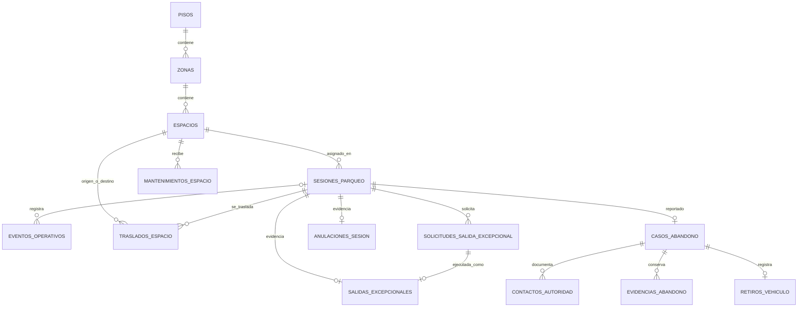
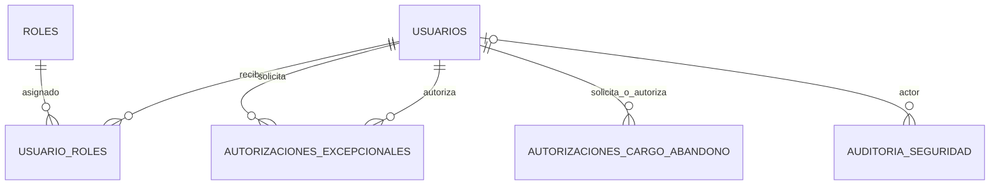
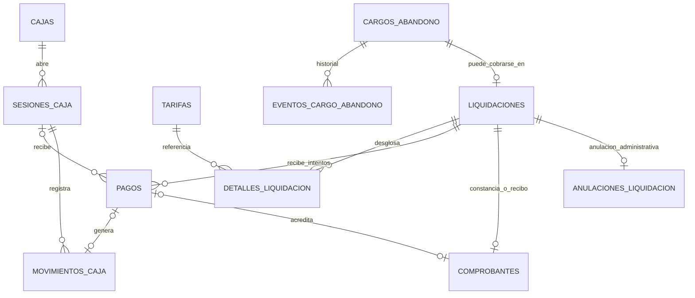

# 02 — Modelo entidad-relación

> Este modelo define el objetivo de datos. Su implementación vigente está en las migraciones Flyway de `../parking`, `../identity` y `../billing`; el alcance funcional que todavía falta se registra en `../../PARKFLOW_IMPLEMENTATION_ROADMAP.md`.

Los diagramas muestran relaciones **dentro** de cada base. Los UUID externos (operadores, administradores, sesiones y liquidaciones de otros servicios) se validan por contrato REST, no con claves foráneas entre bases.

## Parking — `db_parking`

No existe catálogo persistente `vehiculos`: placa y tipo se guardan en la sesión como snapshot. La búsqueda por placa solo indexa sesiones activas. El tiquete es un atributo único e inmutable de la sesión. Anulación y salida excepcional son tablas hijas que referencian sesión; `sesiones_parqueo` no apunta de regreso a ellas, así se elimina el ciclo FK. Un constraint trigger diferido o transacción de servicio exige una fila hija coincidente al confirmar una sesión cerrada/anulada. La salida pagada guarda `liquidacion_id` de Billing como UUID externo; la gratuita es una liquidación de total cero sin fila en `pagos`.

## Identity — `db_identity`

`solicitud_parking_id` y `sesion_parking_id` son UUID externos. El JTI identifica la autorización firmada y tiene unicidad local; no se guarda el JWT completo. `operacion_id` identifica el intento de cierre creado por Parking. El consumo conserva operación y sesión; solo el mismo par puede repetirse idempotentemente.

## Billing — `db_billing`

`liquidaciones.sesion_parqueo_id` es UUID externo de Parking. Las líneas guardan el snapshot del cálculo. `comprobantes.pago_id` es nullable únicamente para una posible constancia gratuita; `liquidacion_id` identifica siempre la operación. FKs compuestas con monto impiden que comprobante o movimiento difieran del pago, su liquidación o su sesión de caja. Constraint triggers diferidos exigen comprobante y movimiento al confirmar un pago aprobado.

El caso de abandono y su evidencia operativa pertenecen a Parking. Identity conserva la autorización administrativa del cargo con propósito propio; Billing conserva el cargo autorizado, su historial y, si ocurre, la liquidación/pago real. El UUID del caso es referencia externa y no crea FK entre bases. Autorizar un cargo no crea automáticamente saldo por cobrar, pago, movimiento de caja ni comprobante.

