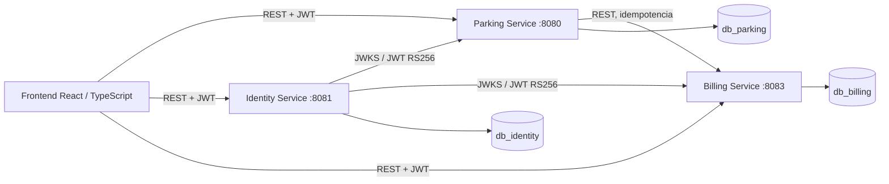
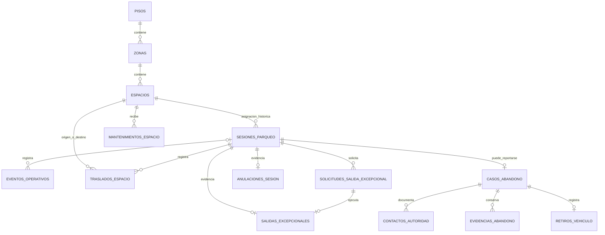
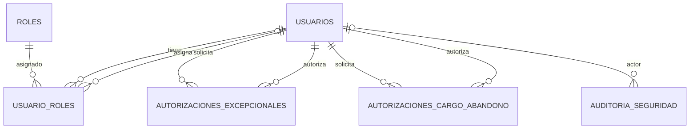
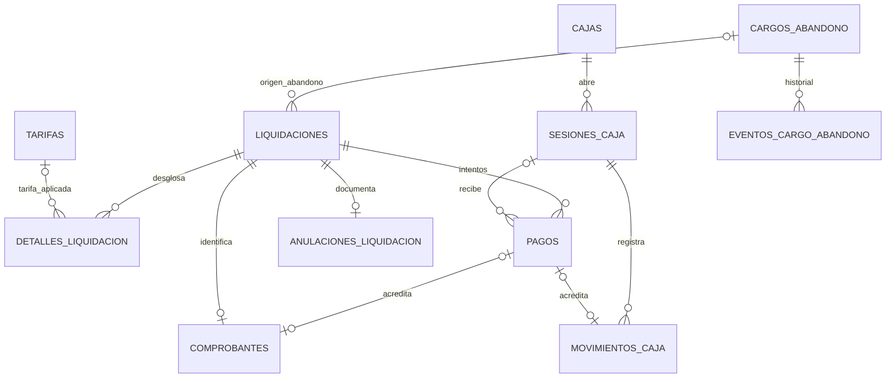
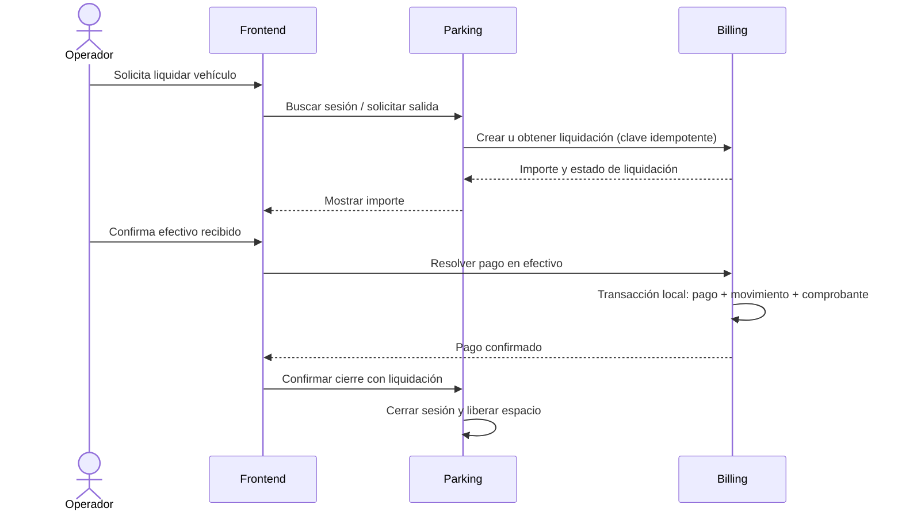

# ParkFlow — modelo de bases de datos y microservicios

**Fuente:** migraciones Flyway `parking/`, `identity/` y `billing/` del paquete definitivo, junto con los servicios Java del repositorio.  
**Alcance:** modelo de datos previsto por las migraciones y arquitectura implementada/documentada. Las funciones descritas como pendientes en la hoja de ruta no se consideran operativas por estar representadas en el modelo.

## 1. Vista general

ParkFlow está dividido en tres microservicios Spring Boot. Cada uno es dueño de su base PostgreSQL y de sus datos. El frontend React/TypeScript consume las APIs usando JWT. No hay claves foráneas entre bases de datos: las referencias cruzadas son UUID y se validan mediante llamadas HTTP y contratos entre servicios.

En Docker Compose el PostgreSQL de desarrollo se publica en el puerto `55433` del equipo. Los puertos `8080`, `8081`, `8083` y `5173` corresponden a Parking, Identity, Billing y frontend, respectivamente.

## 2. Parking — `db_parking`

Propietario: **Parking Service**. Guarda la configuración física del parqueadero y la operación de ocupación: pisos, zonas, espacios, sesiones y sus eventos. La placa y el tipo de vehículo se guardan como una instantánea en la sesión; no hay catálogo permanente de vehículos.

| Tabla | Propósito |
|---|---|
| `pisos` | Niveles del parqueadero; admite niveles de sótano según la migración vigente. |
| `zonas` | Agrupa espacios dentro de un piso. |
| `espacios` | Espacios físicos, tipo admitido y estado operativo. |
| `sesiones_parqueo` | Ingreso, placa/tipo capturados, espacio y ciclo de ocupación del vehículo. |
| `eventos_operativos` | Bitácora de eventos asociados a una sesión cuando aplica. |
| `mantenimientos_espacio` | Bloqueos y mantenimientos de espacios. |
| `traslados_espacio` | Registro del cambio de espacio de una sesión. |
| `solicitudes_salida_excepcional` | Solicitud para una salida excepcional y referencia externa a autorización de Identity. |
| `salidas_excepcionales` | Evidencia local de la salida excepcional ejecutada. |
| `anulaciones_sesion` | Motivo y evidencia de anulación de una sesión. |
| `casos_abandono` | Expediente operativo del vehículo reportado como abandonado. |
| `contactos_autoridad` | Contactos e intervenciones de autoridades en un caso. |
| `evidencias_abandono` | Evidencias vinculadas al caso. |
| `retiros_vehiculo` | Retiro físico del vehículo y su registro operativo. |

Las sesiones enlazan al espacio mediante una restricción que también comprueba compatibilidad de tipo. El tiquete y la idempotencia de entrada se gestionan en Parking. Las tablas de salida excepcional, anulación y abandono conservan su propia evidencia; UUID de autorización y de liquidación son referencias a otros servicios, sin FK externa.

## 3. Identity — `db_identity`

Propietario: **Identity Service**. Gestiona identidad, credenciales, roles, autenticación y autorizaciones administrativas. Emite JWT firmados RS256 y publica las claves mediante JWKS para validación por los demás servicios.

| Tabla | Propósito |
|---|---|
| `usuarios` | Cuenta, datos de acceso y estado de la persona usuaria. |
| `identity_bootstrap_lock` | Controla el proceso de inicialización del administrador. |
| `roles` | Catálogo de roles del sistema. |
| `usuario_roles` | Relación usuario–rol y registro de quién asignó el rol. |
| `autorizaciones_excepcionales` | Solicitud, decisión y consumo de autorización para salida excepcional. Parking mantiene los UUID de solicitud/sesión. |
| `autorizaciones_cargo_abandono` | Decisión administrativa específica para autorizar un cargo de abandono. |
| `auditoria_seguridad` | Registro de eventos de seguridad y actor cuando se conoce. |

Identity valida localmente usuarios/roles. Los identificadores de solicitudes y sesiones de Parking son referencias externas. El JWT completo no se conserva como autorización; se identifica el token firmado mediante su JTI y se registra su consumo/control.

## 4. Billing — `db_billing`

Propietario: **Billing Service**. Es dueño de tarifas, cálculo de liquidaciones, cobro en efectivo, cajas y sus sesiones, movimientos, comprobantes y cargos autorizados por abandono. Conserva snapshots de los valores liquidados y el historial tarifario.

| Tabla | Propósito |
|---|---|
| `parametros_facturacion` | Parámetros de facturación configurables para el servicio. |
| `tarifas` | Tarifas con vigencia y valores por categoría; las históricas se conservan. |
| `cargos_abandono` | Cargo excepcional autorizado, separado del dinero efectivamente recibido. |
| `eventos_cargo_abandono` | Historial de autorización, revocación, liquidación u otros cambios permitidos. |
| `liquidaciones` | Cálculo/operación de cobro asociada a sesión externa o cargo de abandono. |
| `detalles_liquidacion` | Desglose de conceptos, cantidades y snapshots de tarifa/importes. |
| `cajas` | Caja lógica operada por el servicio. |
| `sesiones_caja` | Apertura y cierre de una caja por operador, con saldos y conciliación. |
| `pagos` | Intentos/resultados de pago; el medio comercial definido es efectivo. |
| `movimientos_caja` | Ingresos y ajustes trazables dentro de una sesión de caja. |
| `comprobantes` | Recibo o constancia de la liquidación, relacionado con el pago cuando corresponde. |
| `anulaciones_liquidacion` | Evidencia administrativa para operaciones anulables según las reglas vigentes. |

La integridad local relaciona pago, liquidación, sesión de caja, movimiento y comprobante; las migraciones agregan restricciones compuestas y validaciones diferidas para mantener importes y asociaciones coherentes. Una liquidación gratuita no debe representarse como efectivo recibido. Los pagos aprobados no se alteran para simular devoluciones.

## 5. Responsabilidad y comunicación de los microservicios

| Microservicio | Responsabilidad | Endpoints/controladores identificados |
|---|---|---|
| **Parking Service** | CRUD de pisos, zonas y espacios; sesiones de entrada/salida y operación del parqueadero. | `ParqueaderoSetupController`, `PisoController`, `ZonaController`, `EspacioController`, `SesionController`. |
| **Identity Service** | Registro/autenticación, usuarios, roles, autorización y claves públicas para validar JWT. | `AuthController`, `UsuarioController`, `RolController`, `JwksController`. |
| **Billing Service** | Tarifas, liquidaciones, resolución de pagos, consulta y operación de cajas. | `TarifaController`, `LiquidacionController`, `ResolucionPagoController`, `ConsultaBillingController`, `CajaController`. |

### Secuencia normal de cobro

Las solicitudes con claves idempotentes permiten recuperar respuestas tras fallos de red. No hay transacción distribuida: Billing completa atómicamente los registros locales del cobro; Parking cierra la sesión al confirmar un resultado terminal cobrable. Los servicios comprueban autenticación/autorización mediante JWT, y obtienen las claves de Identity mediante JWKS.

## 6. Límites actuales del modelo

- No hay catálogo permanente de clientes ni vehículos.
- Las FK existen únicamente dentro de la base dueña de cada servicio.
- Las referencias entre servicios se comprueban mediante API, JWT/contratos e idempotencia, no mediante FK PostgreSQL.
- Las migraciones definitivas son la única fuente estructural vigente. `parkflow-db-nuevo/` se conserva como referencia histórica y no se carga desde los servicios.
- El modelo incluye estructuras para funciones que la hoja de ruta puede marcar como pendientes. La existencia de tablas/controladores no implica que todos esos flujos estén completos ni habilitados.
- Las reglas comerciales todavía pendientes deben resolverse antes de habilitar los flujos asociados.

## 7. Fuentes para ampliar

- [Arquitectura](01_ARQUITECTURA.md)
- [Modelo entidad-relación](02_MODELO_ENTIDAD_RELACION.md)
- [Diccionario de datos](03_DICCIONARIO_DE_DATOS.md)
- [Comunicación entre servicios](05_COMUNICACION_ENTRE_SERVICIOS.md)
- Migraciones vigentes: `../parking/`, `../identity/`, `../billing/`
- Código de servicios: `../../services/`
- [Hoja de ruta de implementación](../../PARKFLOW_IMPLEMENTATION_ROADMAP.md)
